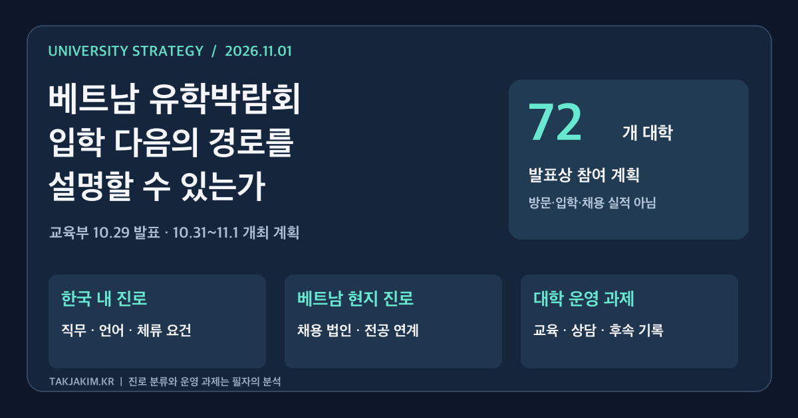

<figure class="note-cover-figure">
  
  <figcaption>교육부 2026년 10월 29일 보도자료를 바탕으로 자체 제작. 72개 대학은 발표상 참여 계획이며, 두 갈래 진로와 운영 점검 항목은 필자의 분석이다. 현장 사진이나 행사 결과를 나타낸 이미지가 아니다.</figcaption>
</figure>

유학 상담에서 “졸업하면 어디에서 어떤 일을 할 수 있나요”라는 질문을 받았을 때, 대학은 기업 로고보다 구체적인 답을 준비해야 한다. 한국 내 취업인지, 본국으로 돌아간 뒤 한국계 기업에서 일하는 경로인지에 따라 필요한 교육과 지원이 달라지기 때문이다.

교육부가 10월 29일 공개한 **2026 베트남 한국유학박람회 개최 계획**은 이 차이를 살펴볼 계기다. 대학과 기업을 같은 공간에 모으는 구상은 유용하다. 다만 상담 공간의 연결이 곧 학생 진로의 연결을 의미하지는 않는다. [[대학 국제화]]를 모집 규모뿐 아니라 교육과 진로의 설계 문제로 읽어야 하는 이유다.

## 오늘의 핵심

- **행사 일정은 10월 31일~11월 1일이다.** 교육부는 베트남 하노이 그랜드 플라자 호텔에서 박람회를 개최한다고 밝혔다. 국내대학 72개를 포함해 현지 진출 한국 기업·공공기관 등 90여 개 기관이 참여하는 계획이다.
- **유학관·취업관·네트워킹관으로 정보를 묶는다.** 유학 상담, 한국 취업 설명회, 기업별 상담, 비자 제도 설명, 기관 간 교류를 한자리에서 제공하도록 구성했다.
- **예상 방문객은 성과가 아니다.** 보도자료의 1만 5천 명 이상은 예상 규모다. 이 글은 사전 발표와 첨부 계획을 확인한 분석이며 실제 방문객, 협약 체결 결과, 입학·취업 실적을 확인한 결과 보고가 아니다.

공식 발표는 하노이한국교육원이 박람회 기간 중 국내대학 15개와 유학생 유치 및 교육·국제교류 협력을 위한 업무협약을 체결할 계획도 담고 있다. 이 역시 계획과 이행 결과를 구분해서 읽어야 한다. 위 내용은 모두 [교육부 보도자료와 첨부 행사 개요](https://www.moe.go.kr/boardCnts/viewRenew.do?boardID=294&boardSeq=107516&lev=0&searchType=null&statusYN=W&page=1&s=moe&m=020402&opType=N)에 근거한다.

## 왜 대학전략 관점에서 중요한가

이번 자료에서 눈에 띄는 것은 국내대학과 함께 **베트남에 진출한 한국 기업**이 참여한다는 점이다. 취업관에는 한국 취업 설명회도 예정돼 있다. 두 정보는 관련 있지만 같지는 않다. 기업이 박람회에 참여한다는 사실만으로 한국 내 채용, 특정 대학 학생의 채용 우대, 인턴십 제공이 확정됐다고 볼 수 없다.

대학은 상담 자료에서 적어도 두 경로를 나눠 설명할 필요가 있다. 하나는 한국에서 학업을 마친 뒤 한국에서 일하는 경로다. 다른 하나는 한국 유학 경험을 활용해 베트남 현지에서 경력을 쌓는 경로다. 두 경로 모두 가능한 선택지로 검토할 수 있지만, 이번 행사에 참여한 모든 기업이 두 경로를 제공한다는 뜻은 아니다.

[[지역정주]]를 대학의 목표로 설정하더라도 학생의 모든 진로를 한국 내 정착으로만 평가해서는 안 된다. 귀국 후 전공과 관련된 일을 하거나 양국 간 사업을 연결하는 진로도 교육의 가치를 보여줄 수 있다. 대학이 필요한 것은 목표를 낮추는 일이 아니라 **취업 국가와 직무, 학습 경험을 구분해서 기록하는 일**이다.

## 정책·교육과정·지역연계 포인트

### 한국어 학습과 직무 수행 사이를 채운다

공식 자료는 베트남 현지 한국어교육과 유학·진로 탐색을 연결하는 방향을 제시한다. 그러나 한국어에 관심이 있다는 사실만으로 전공 수업이나 직장 업무를 수행할 준비가 됐다고 볼 수는 없다.

[[교육과정 개발]]에서는 생활 한국어, 전공 학습 언어, 직무 의사소통을 구분해 볼 수 있다. 예를 들어 경영 분야라면 고객 요구를 정리하고 자료의 근거를 설명하는 과제, 공학 분야라면 작업 지시와 안전 문서를 이해하고 문제를 보고하는 과제를 설계할 수 있다. 이는 행사에서 실제 운영된 수업이 아니라 대학에 제안하는 설계 예시다.

### 기업 부스가 아니라 기업의 과제를 연결한다

[[산학협력]] 담당 부서는 기업 참가 명단을 확보하는 데서 멈추지 말고 학생이 지원 가능한 직무와 필요 역량을 확인해야 한다. 한국 법인과 베트남 법인의 채용 요건, 업무 언어, 학위·경력 조건은 각각 확인할 사안이다.

기업이 제공할 수 있는 것이 채용인지, 직무 소개인지, 과제 피드백인지도 나눠야 한다. 채용을 약속하지 않는 기업도 교육에 기여할 수 있다. 실제 업무를 바탕으로 과제를 검토하고 학생의 설명 방식에 의견을 주는 협업은 충분히 의미가 있다. 다만 이런 협업의 시행 여부는 별도 확인이 필요하다.

### 상담에서 받은 정보를 다음 담당자에게 넘긴다

박람회 상담에서 학생의 관심 전공과 희망 진로를 받았다면, 입학 뒤 학과와 진로 부서가 적법한 범위에서 이를 이어받을 수 있어야 한다. [[학생지원체계]]는 부서가 많다는 설명보다 학생이 다음에 어디로 가야 하는지 알 수 있는 구조에 가깝다.

상담 기록을 무조건 공유하자는 뜻은 아니다. 수집 목적, 동의, 접근 권한과 보관 기간을 먼저 정하고, 교육 지원에 필요한 정보만 이어 가야 한다. 수업 과제와 피드백을 [[학생 포트폴리오]]로 정리한다면 학생이 자기 역량을 설명하는 데도 활용할 수 있다.

## 학생·학부모가 확인할 것

유학과 취업 정보를 한자리에서 듣더라도 계약과 자격은 따로 확인해야 한다.

- **취업 지역과 고용 주체:** 한국 취업 안내인지 베트남 현지 기업의 채용 안내인지, 실제 채용 법인은 어디인지 묻는다.
- **교육의 실체:** 희망 전공의 수업 언어, 전공 한국어 지원, 실제 과제 예시와 졸업 요건을 확인한다.
- **비용과 지원 조건:** 등록금·생활비·주거비를 나누고 장학금의 지급 기간과 유지 조건을 확인한다.
- **실습과 채용의 구분:** 기업 상담이나 설명회 참여가 실습 배정·취업 보장을 뜻하지 않는다는 점을 확인한다.
- **체류 자격:** 한국 내 학업·실습·취업은 해당 시점의 체류 자격과 개별 요건에 따라 달라진다. 행사 참석이나 대학 입학만으로 취업 자격이 생기는 것은 아니다.

## 대학컨설팅 관점에서 보는 전략

박람회 이후 대학이 만들 첫 자료는 상담 건수만 적힌 실적표보다 **진로별 후속 조치표**에 가까워야 한다. 아래는 교육부의 공식 평가지표가 아니라 대학 운영을 위한 제안이다.

| 구분 | 대학이 확인할 내용 | 남길 기록 | 피해야 할 해석 |
| --- | --- | --- | --- |
| 한국 내 취업 관심 | 희망 직무, 언어·전공 준비, 체류 요건 안내 | 상담 후 준비 계획과 담당 창구 | 취업 설명회 참석을 취업 가능 판정으로 간주 |
| 베트남 현지 진로 관심 | 현지 법인의 직무와 채용 요건 | 기업별 확인 정보와 교육 연결 과제 | 한국계 기업 참가를 한국 내 채용으로 간주 |
| 진로 탐색 단계 | 전공 선택과 학습 준비의 불확실성 | 후속 상담·전공 탐색 참여 | 관심 표명을 입학 의사나 등록 실적으로 집계 |
| 입학 후 지원 | 학과·국제처·진로부서의 역할 | 학업 지속과 지원 이력 | 모집 부서의 성과로 교육 성과 전체를 대체 |

지표를 쓸 때는 분모도 정해야 한다. 상담자, 지원자, 입학생, 졸업생은 다른 집단이다. 졸업 후 진로를 파악할 때도 응답자만의 현황인지, 전체 졸업생을 확인한 것인지 밝혀야 한다. 취업 국가와 전공 관련성을 함께 기록해야 다음 교육과정을 바꿀 근거가 생긴다. 이런 [[성과환류]]가 있어야 유학 홍보와 교육 운영이 연결된다.

최근 살펴본 [국립순천대 해외 교육 거점 사례](/education/scnu-global-academy-pathway-2026/)가 입국 전 학습 접점에 관한 문제였다면, 이번 박람회가 던지는 질문은 서로 다른 취업 시장을 대학이 어떻게 설명하고 연결하느냐다. **입학 다음의 경로를 설명할 수 있는 대학이 유학 상담에서도 더 구체적인 답을 줄 수 있다.** 그 답은 취업 보장 문구가 아니라 확인된 조건, 제공 가능한 교육, 다음 상담 담당자로 구성돼야 한다.

## 확인한 출처

- [교육부, 한국어로 열리는 진로·취업의 기회, 베트남 한국유학박람회 개최](https://www.moe.go.kr/boardCnts/viewRenew.do?boardID=294&boardSeq=107516&lev=0&searchType=null&statusYN=W&page=1&s=moe&m=020402&opType=N), 2026년 10월 29일. 첨부 HWPX 본문과 붙임 1~3을 확인했다. 행사 일정·참여 계획·구역 구성·협약 계획은 해당 자료에 근거한다. 방문객은 예상치이며 실제 개최 결과와 채용 성과는 별도로 확인하지 않았다. 진로 분류, 수업 예시, 부서 역할과 지표는 필자의 대학컨설팅 제안이다.
