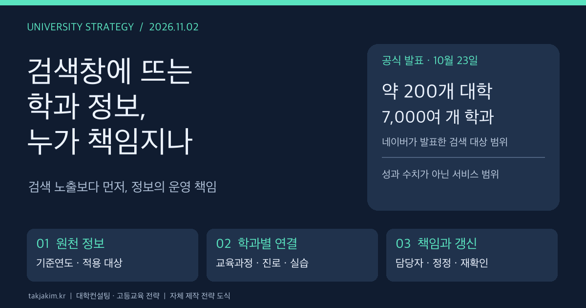

대학의 첫 화면이 꼭 대학 홈페이지일 필요는 없다. 학생이 검색창에 학교와 학과 이름을 넣고 등록금, 취업률, 교육과정의 단서를 먼저 확인한다면, 대학이 공들여 만든 소개 페이지는 그다음에 열릴 수 있다.

네이버는 10월 23일 공식 보도자료에서 대학·학과와 입시 검색을 고도화했다고 밝혔다. 이 소식을 대학컨설팅 관점에서 읽으면 질문이 바뀐다. 검색에 어떻게 더 잘 노출될 것인가보다, **검색에 뜨는 우리 학과 정보를 누가 검증하고 갱신할 것인가**가 먼저다.

<figure class="note-cover-figure">
  
  <figcaption>네이버의 2026년 10월 23일 발표를 바탕으로 재구성한 대학 정보 운영 과제. 자체 제작 전략 도식이며 서비스 화면이나 실측 성과가 아니다.</figcaption>
</figure>

## 오늘의 핵심

- **확인된 변화:** 네이버는 약 200개 대학, 7,000여 개 학과를 대상으로 기본 정보·전형·취업률·등록금 등을 확인할 수 있다고 발표했다. 학과별 권장 선택과목은 이를 발표한 44개 대학의 자료를 바탕으로 제공한다고 설명했다. 두 범위는 서로 다르다.
- **대학경영의 과제:** 입학처, 학과, 기획·공시 담당, 취업지원 부서가 각각 관리하는 정보가 외부에서는 한 학과의 설명으로 읽힌다. 대학 내부의 정보 불일치가 이용자에게 그대로 드러날 수 있다.
- **전략적 해석:** 홍보 문장을 늘리기보다 학과 명칭, 교육과정, 진로 설명, 성과 수치의 기준연도와 담당자를 맞추는 일이 우선이다. 이것은 검색 최적화만의 문제가 아니라 [[데이터 거버넌스]]의 문제다.

## 왜 대학전략 관점에서 중요한가

이번 발표에서 주목할 대목은 검색 대상의 숫자만이 아니다. 네이버는 대학 입학처의 모집요강, 학교 홈페이지, 대입정보포털 어디가 등에 흩어진 정보를 구조화했다고 설명했다. 대학 내부에서는 서로 다른 부서의 업무였던 자료가 이용자에게는 하나의 비교 화면으로 묶이는 셈이다.

이때 같은 학과가 서로 다른 이름으로 남아 있거나, 홈페이지의 진로 설명과 실제 개설 교과목이 어긋나면 문제가 생긴다. 학과 개편 전 소개와 개편 후 모집단위가 함께 검색되는 상황도 점검해야 한다. 특정 대학에서 이런 오류가 발생했다고 확인한 것은 아니다. 외부 플랫폼이 정보를 묶을 때 대학이 미리 점검해야 할 위험이다.

[[대학정보공시]]는 정해진 기준에 따라 정보를 공개하는 제도다. 그러나 공개한 숫자가 이용자의 질문에 충분히 답하는지는 별개의 문제다. 취업률을 제시하는 것과, 그 숫자가 어느 시점의 어떤 집단을 설명하는지 이해하도록 돕는 것은 다르다. 대학은 수치의 정확성과 설명의 정확성을 함께 관리해야 한다.

검색 개편이 지원자 증가나 교육의 질 향상을 가져왔다는 성과는 이번 발표만으로 판단할 수 없다. 여기서 읽을 수 있는 변화는 정보의 유통 방식이다. 대학이 말하고 싶은 순서보다 학생이 비교하려는 항목이 앞에 놓인다.

## 정책·교육과정·지역연계 포인트

### 학과의 이름과 교육 내용이 같은 대상을 가리켜야 한다

학과가 개편되면 명칭만 바꾸는 것으로 끝나지 않는다. 모집단위, 학위명, 전공 소개, 교육과정표, 진로 안내가 각각 어느 학생과 입학연도를 대상으로 하는지 연결되어야 한다. 재학생에게 적용되는 과정과 신입생에게 적용되는 과정이 다를 때는 구분해 보여줘야 한다.

[[교육과정]] 정보는 과목명 목록만으로 충분하지 않다. 학생은 무엇을 배우고, 어떤 순서로 심화하며, 어디에서 실제로 써보는지 알고 싶어 한다. 대학은 전공 역량에서 교과목, 프로젝트, 실습으로 이어지는 경로를 설명할 수 있어야 한다.

예를 들어 지역 제조업과 연계한 전공이라면 기업 이름이나 협약 건수보다 다음 질문이 유용하다. 기업 과제는 어떤 수업에 들어오는가. 학생은 무엇을 만들어 남기는가. 그 경험을 평가하는 사람은 누구인가. [[산학협력]]을 학과 소개의 장식이 아니라 학습경험으로 설명하는 방식이다.

### 진로 안내에는 학생이 만들 결과물이 필요하다

학과 소개에 가능한 직업을 길게 적는 일은 쉽다. 그러나 그 직업과 해당 학과의 교육 사이에는 설명이 필요하다. 데이터 분석가를 진로로 제시한다면 어떤 데이터를 다루고, 어느 수업에서 분석 결과를 검증하며, 무엇을 졸업 때까지 남기는지 보여줘야 한다.

[[학생 포트폴리오]]는 이 간격을 줄일 수 있는 자료다. 다만 우수 학생 한 명의 결과물을 모든 학생이 경험하는 것처럼 소개해서는 안 된다. 정규 교과인지, 선발형 비교과인지, 참여 인원이 제한되는지까지 밝혀야 교육경로를 제대로 비교할 수 있다.

지역 연계도 마찬가지다. 지역기업 취업이 가능한지와 실제 채용·실습 자리가 확보되어 있는지는 다르다. 지역 정착을 전략으로 내세우는 대학이라면 교육, 실습, 채용, 생활 지원 가운데 어느 단계까지 운영하는지 나눠 설명해야 한다. 이번 검색 개편이 이런 내용을 모두 제공한다는 뜻은 아니다. 대학이 자체 정보에서 보완해야 할 내용이다.

### 부서별 자료를 학과 단위로 대조하자

다음은 발표 내용을 그대로 옮긴 표가 아니라 대학 내부 점검을 위한 제안이다.

| 점검 대상 | 확인할 질문 | 협업이 필요한 부서 예시 |
| --- | --- | --- |
| 학과·모집단위 명칭 | 개편 전후 명칭과 적용 연도가 구분되는가 | 학과·교무·입학 |
| 교육과정과 진로 | 소개한 역량을 실제 개설 수업에서 배우는가 | 학과·교육혁신·취업지원 |
| 등록금·취업률 등 수치 | 기준연도와 산출 대상, 원문 링크가 있는가 | 공시·기획·재무·취업지원 |
| 실습·지역 연계 | 협약과 실제 참여 기회를 구분하는가 | 산학협력·현장실습·학과 |
| 외부 노출 정보 | 오류를 발견했을 때 정정 요청 담당자가 있는가 | 홍보·정보화·원천 자료 담당 |

## 학생·학부모가 확인할 것

검색 결과는 탐색의 출발점으로 쓰되, 최종 판단이 필요한 항목은 원문까지 확인하는 편이 좋다. 특히 모집요강은 해당 학년도와 전형을 맞춰 입학처의 최신 공지 및 정정 공지를 확인해야 한다.

취업률과 등록금은 기준연도를 함께 보자. 학과 개편이 있었다면 현재 모집하는 학과와 수치가 가리키는 학과가 같은지도 질문할 필요가 있다. 높은 수치 하나만으로 교육과정의 적합성이나 개인의 취업 가능성을 단정할 수는 없다.

권장 선택과목 역시 모든 대학·학과의 공통 요구라고 읽어서는 안 된다. 네이버 발표에 나온 44개 대학의 권장과목 정보 범위와, 개별 대학이 정한 지원 자격이나 평가 기준은 구분해야 한다.

네이버는 10월 23일 발표에서 11월 가채점·정시 비교 도구를 선보일 계획도 밝혔다. 이 글에서는 그 계획을 실제 서비스 개통이나 정확도 검증이 끝난 사실로 다루지 않는다. 기능이 보이더라도 적용 학년도, 자료 출처와 계산 조건을 따로 확인해야 한다.

## 대학컨설팅 관점에서 보는 전략

대학이 당장 할 수 있는 일은 모든 자료를 새 플랫폼으로 옮기는 것이 아니다. 우선 학과 한 곳을 골라 공식 자료가 서로 같은 설명을 하고 있는지 대조하는 편이 현실적이다.

첫째, 학과별 핵심 정보 목록을 만든다. 명칭, 적용 연도, 교육목표, 교육과정, 실습 기회, 진로, 성과 수치마다 원천 자료와 갱신일을 붙인다. 문서가 있는지만 확인하지 말고 실제 담당자를 정해야 한다. 총괄 부서는 정할 수 있지만, 모든 내용의 책임을 홍보 부서에 몰아주는 방식은 피해야 한다.

둘째, 오류의 종류를 나눈다. 대학 원문이 틀린 경우와 원문은 맞지만 외부 검색에 이전 정보가 남은 경우는 대응이 다르다. 원문 수정, 외부 정정 요청, 재확인의 절차를 구분하고 처리 기록을 남긴다.

셋째, 성과지표를 노출량에만 두지 않는다. [[실행지표]]로는 핵심 항목의 담당자 지정 여부, 기준연도 표시 여부, 정정 요청 처리시간, 교육과정과 진로 설명의 대조 완료 여부 등을 검토할 수 있다. 이는 제안하는 관리 항목이지 이번 서비스의 실측 성과가 아니다.

마지막으로 반복 질문을 교육과정 개선에 돌려준다. 학생이 특정 진로와 수업의 연결을 계속 묻는다면 설명이 부족할 수도 있고, 실제 교육경로가 비어 있을 수도 있다. 문의를 단순히 답변하고 닫지 않고 학과 운영회의에서 검토하는 [[성과환류]]가 필요하다.

검색창은 대학의 교육을 대신하지 않는다. 다만 대학 내부에서 따로 관리하던 정보가 학생 눈에는 하나의 설명으로 읽힌다는 사실을 더 선명하게 보여준다. 대학의 대응도 홍보 문구 수정에서 끝나서는 안 된다. **누가 어떤 근거로 학과를 설명하고, 바뀐 내용을 언제 반영하는가.** 그 책임 구조부터 정비해야 한다.

## 확인한 출처

- [네이버 공식 보도자료: 교육 검색 넓히는 네이버, 학교생활부터 대학 입시까지 공식 데이터로 신뢰도 높인다](https://www.navercorp.com/media/pressReleasesDetail?seq=10034783), 2026년 10월 23일. 검색 개편 범위, 약 200개 대학·7,000여 개 학과, 권장과목 자료 44개 대학, 향후 기능 계획의 근거다. 수치는 네이버가 발표한 서비스 범위이며 독립적인 품질 평가 결과가 아니다.
- [한국대학교육협의회 대입정보포털 어디가](https://www.adiga.kr/), 2026년 11월 2일 확인. 대학·학과·전형 정보의 공식 확인 경로로 참고했다. 네이버 서비스의 정확도나 효과를 검증하는 자료로 사용하지 않았다.

이 글의 부서별 책임 체계, 점검표와 관리 지표는 위 발표를 바탕으로 한 대학경영 관점의 제안이다. 특정 대학의 오류나 성과를 조사한 결과는 아니다.
