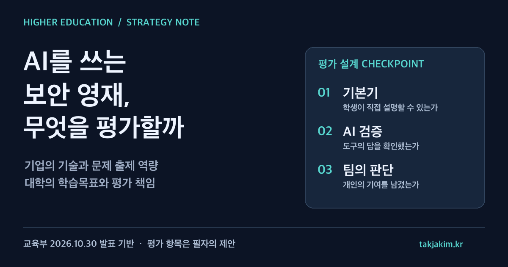

기업이 실습 공간을 열고 전문가가 문제를 출제하면 교육은 현장에 가까워진다. 그런데 학생이 AI와 함께 문제를 풀었다면, 점수가 말해 주는 것은 무엇일까. 학생의 기본기인지, 도구를 고르는 능력인지, 팀원의 기여인지부터 구분해야 한다.

교육부가 10월 30일 공개한 사이버보안 영재교육 협력 계획에는 이 질문을 다룰 단서가 들어 있다. 경진대회 지원과 함께 **기본 역량과 AI 활용 역량이 균형을 이루도록 평가에 적용할 AI 활용 기준을 마련한다**는 내용이다. 대학컨설팅 관점에서 중요한 것은 협약 기관의 이름보다 이 기준을 누가 만들고 수업에 어떻게 반영하느냐다.

<figure class="note-cover-figure">
  
  <figcaption>교육부의 2026년 10월 30일 발표를 바탕으로 만든 자체 전략 도식. 오른쪽 세 항목은 공식 평가표가 아니라 이 글의 운영 제안이다.</figcaption>
</figure>

## 오늘의 핵심

교육부는 LG유플러스·티오리한국과 10월 31일 AI·정보보호 영재교육원 운영 지원 업무협약을 체결할 계획이라고 발표했다. 자료에 적힌 역할은 비교적 구체적이다.

- LG유플러스는 경진대회 단체전 장소와 네트워크·AI 실습 인프라를 제공한다.
- 티오리한국은 개인전·단체전 문제 출제, 운영 기술 지원, 평가와 순위 산정을 맡으며 AI 활용 기준 공동 설계에도 참여한다.
- 협력 분야에는 교육과정 전문화, 정보보안 전문가 특강, 기업 방문 진로체험이 포함된다.

첨부 운영 개요에 따르면 이 영재교육원의 대상은 **전국 중·고등학생 또는 이에 준하는 학생 240명, 권역별 60명**이다. 운영 대학은 서울여대·건양대·대구대·목포대다. 이 숫자는 대학 학부생 대상 교육 정원이 아니다. 이 글도 특정 대학의 종합평가나 학부 모집 안내가 아니라, 대학이 참여하는 청소년 인재양성 체계의 운영 문제를 다룬다.

확인한 자료는 **행사 전 발표된 계획과 협약서·운영 개요**다. 10월 31일의 실제 협약 체결 결과, 대회 운영 결과나 수상 실적을 별도로 확인한 것은 아니므로, 계획을 이미 달성한 성과로 쓰지 않는다. [교육부 발표 및 첨부자료](https://www.moe.go.kr/boardCnts/viewRenew.do?boardID=294&boardSeq=107526&lev=0&m=020402&s=moe)

## 왜 대학전략 관점에서 중요한가

첫째, [[산학협력]]이 시설 견학이나 기업 로고를 넘어 **문제와 평가를 공동으로 만드는 일**로 들어온다. 기업의 기술 변화는 빠르고, 대학은 매 학기 교육목표와 학습 난이도를 일관되게 관리해야 한다. 현장성이 높다는 이유만으로 기업의 문제를 그대로 수업에 넣으면 선수학습이 부족한 학생에게는 어려운 체험으로 끝날 수 있다.

둘째, [[고교-대학 연계]]를 모집 홍보와 분리해서 볼 필요가 있다. 대학이 청소년에게 제공할 수 있는 가치는 전공 이름을 알려 주는 데 그치지 않는다. 안전한 실습 환경에서 기초를 배우고, 자신의 흥미를 확인하고, 다음 학습 과제를 찾는 경험이 될 수 있다. 다만 이번 협약이 특정 대학 입학의 우대나 학점 인정으로 이어진다는 내용은 확인되지 않았다. 교육 참여 경로와 입학 경로는 구분해야 한다.

셋째, AI가 들어오면서 [[역량 기반 평가]]의 설계 부담이 커진다. 정답을 제출한 사실만으로는 이해 수준을 알기 어렵다. 반대로 AI를 사용했다는 이유만으로 학습을 무효로 볼 수도 없다. 대학과 기업이 어떤 도움을 허용하고 어떤 판단을 학생이 직접 설명해야 하는지 합의해야 한다.

## 정책·교육과정·지역연계 포인트

### AI 활용 기준은 대회 공지에서 끝나면 안 된다

자료에는 AI 활용 기준을 마련한다는 방향이 있지만, 모든 과제에 적용할 세부 허용 범위나 배점표가 공개된 것은 아니다. 다음은 그 빈칸을 대학의 수업 설계로 옮기기 위한 제안이다.

| 평가 장면 | 확인할 질문 | 남길 수 있는 증거 |
| --- | --- | --- |
| 기본기 확인 | AI 도움 없이 문제의 조건과 위험을 설명할 수 있는가 | 짧은 구술 설명, 핵심 개념 점검 |
| 도구 활용 | AI가 낸 답을 무엇으로 검증했는가 | 검증 기록, 실패한 가설과 수정 이유 |
| 팀 문제해결 | 누가 어떤 판단을 맡았고 어떻게 공유했는가 | 역할 기록, 공동 검토 메모 |
| 사후 성찰 | 같은 문제를 다시 풀면 무엇을 바꿀 것인가 | 개인 회고, 다음 학습 계획 |

이는 공식 대회 규칙이 아니다. 중요한 것은 AI 사용량을 세는 데서 멈추지 않고, 도구의 제안을 검증하는 과정을 평가하는 것이다. [[AI 리터러시]] 역시 프롬프트 작성 기술만이 아니라 오류를 의심하고 근거를 설명하는 능력으로 다룰 필요가 있다.

### 실습의 현장성과 안전 책임을 함께 정해야 한다

사이버보안 실습은 실제 현장과 닮을수록 접근 권한과 실습 범위가 중요해진다. 대학은 기업·플랫폼과 함께 허가된 실습 환경, 계정 관리, 외부 시스템 접근 금지, 문제 데이터의 반출 범위를 정할 필요가 있다. 이 역시 발표에 이미 완성돼 있다고 단정하는 사항이 아니라 운영 전에 확인할 체크리스트다.

학생에게 기록을 요구할 때도 마찬가지다. [[학생 포트폴리오]]에 문제해결 과정은 남기되, 공개하면 안 되는 취약점 정보나 계정·접속 정보가 섞이지 않도록 해야 한다. 공개용 결과물과 평가용 비공개 기록을 분리하면 학습 증거와 보안 책임을 함께 관리할 수 있다.

### 권역 운영은 지역산업과 연결할 여지가 있지만 자동으로 연결되지는 않는다

네 대학의 권역별 운영 구조는 지역 학생에게 전문교육의 접점을 만들 수 있다. 그렇다고 이번 협약에 지역기업 채용이나 지역정주 성과까지 포함됐다고 읽을 수는 없다. 자료가 확인해 주는 것은 교육원 운영과 기업의 교육·경진대회 지원이다.

대학전략 차원에서는 권역 내 기업의 보안 직무를 소개하거나 대학의 공개 강좌·멘토링과 후속 학습을 잇는 방안을 검토할 수 있다. 다만 학생의 연령, 이동 부담, 학교별 정보 접근성에 맞춰야 한다. 전국 기업 한 곳과의 협약이 지역 전체의 교육 접근성을 해결한 것으로 평가해서는 안 된다.

## 학생·학부모가 확인할 것

프로그램의 이름보다 실제 참여 조건을 먼저 확인하면 좋다.

- **대상과 선발:** 이번 자료의 교육 대상은 중·고등학생 등이다. 지원 자격과 일정은 해당 권역 교육원의 최신 모집 안내를 따로 확인해야 한다.
- **선수학습과 부담:** 어떤 기초 지식이 필요한지, 주말·방학 참여와 이동이 가능한지 확인한다.
- **AI 사용 안내:** 허용 도구, 금지 행동, 개인별 설명 책임을 사전에 안내하는지 본다.
- **대회 이후:** 점수와 수상 여부 외에 자신의 강점과 보완할 부분을 피드백받을 수 있는지 묻는다.
- **과장된 기대 경계:** 수료가 특정 대학 합격이나 취업을 보장하는 것은 아니다. 관련 제도가 있다면 별도의 공식 요건을 확인해야 한다.

학생이 돌아와서 “어떤 도구를 썼다”보다 “그 답이 틀릴 수 있다고 생각해 이렇게 확인했다”를 설명할 수 있다면, 다음 학습으로 이어갈 근거가 생긴다.

## 대학컨설팅 관점에서 보는 전략

이번 사례에서 대학이 가져갈 질문은 **기업 지원을 얼마나 받았는가보다, 그 지원을 학습의 질로 바꾸는 책임을 정했는가**다.

운영 대학은 먼저 [[평가 거버넌스]]를 문서로 정리할 필요가 있다. 기업이 문제를 출제할 때 대학은 학습목표와 난이도를 검토하고, 평가 기준의 변경과 이의제기를 누가 다룰지 합의해야 한다. 첨부 협약서는 공동 협력의 기본 방향을 정하며 법적 구속력은 없다고 명시한다. 따라서 협약 자체와 실제 운영에 필요한 세부 규정·책임 배분을 같은 것으로 보면 안 된다.

다음은 [[성과환류]]다. 대회에서 학생들이 공통으로 설명하지 못한 개념을 찾아 다음 교육과정에 반영하는 편이, 수상 사진을 실적 보고서에 한 장 더 넣는 것보다 교육적으로 유용하다. 예컨대 AI 출력 검증이 부족했다면 실습 전 검증 과제를 보강하고, 팀별 기록이 불균형했다면 개인 회고와 구술 확인을 추가할 수 있다.

마지막으로 성과지표의 범위를 지켜야 한다. 첨부자료가 제시하는 기존 수료생 진로 현황과 이번 협약 이후의 효과는 다른 질문이다. 협약의 효과를 보려면 참여 집단과 시점, 실제 제공된 교육, 평가 방식 변화, 후속 학습을 별도로 추적해야 한다. 기존의 성과를 새 협약의 효과처럼 가져오면 인과관계가 뒤섞인다.

대학이 기업과 함께 AI 인재를 키운다는 말은 이제 낯설지 않다. 차이는 공동 행사 횟수보다 학생의 기본기, AI 검증 과정, 안전한 실습을 누가 어떤 증거로 책임지는지에서 생긴다.

## 확인한 출처

- [교육부, 인공지능 시대 사이버보안 영재교육 지원을 위한 교육부·LG유플러스·티오리한국 업무협약 체결](https://www.moe.go.kr/boardCnts/viewRenew.do?boardID=294&boardSeq=107526&lev=0&m=020402&s=moe), 2026년 10월 30일. 본문과 첨부 HWPX의 업무협약서, 경진대회 개요, 영재교육원 운영 개요, 참여 기업 소개를 확인했다. 기관별 역할과 교육 대상·운영 대학은 이 자료에 근거한다. 본문의 평가표, 안전 점검과 대학 운영 전략은 공식 지침이 아니라 필자의 제안이다.
