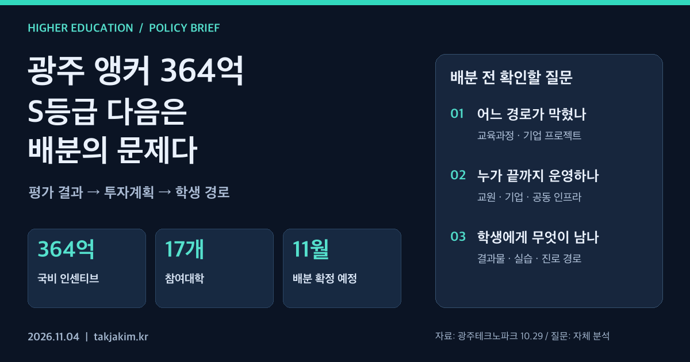

좋은 평가를 받은 사업에 돈이 더 들어온다. 여기까지는 이해하기 쉽다. 어려운 일은 그다음이다. 대학마다 조금씩 나눌 것인가, 이미 성과가 난 과제를 키울 것인가, 아니면 여러 대학이 따로 해결하지 못했던 병목을 함께 풀 것인가.

광주 앵커사업이 교육부 1차년도 연차점검에서 S등급을 받아 **국비 인센티브 364억 원을 확보했다**는 10월 29일 발표는 이 질문을 던진다. 광주테크노파크 보도자료는 지방비 매칭 인센티브 50억 원을 더한 추가 재원을 414억 원으로 설명하고, **11월 참여대학 협의와 지역혁신대학지원위원회 심의를 거쳐 투자계획과 대학별 배분을 확정할 예정**이라고 밝혔다.

지난 [광주형 앵커 S등급 분석](/education/gwangju-anchor-s-grade-operating-model/)에서는 평가받는 운영체계에 주목했다. 이번에는 평가 이후 실제 추가 재원이 제시됐다. 이제 대학전략의 질문은 성적표 해석에서 **다음 투자 대상을 고르는 기준**으로 옮겨간다.

<figure class="note-cover-figure">
  
  <figcaption>광주테크노파크 2026년 10월 29일 보도자료를 바탕으로 자체 제작. 오른쪽 배분 질문은 공식 심사 기준이 아니라 이 글의 전략 제안이다.</figcaption>
</figure>

## 오늘의 핵심

이번 발표에서 확인되는 사실은 다음과 같다. 아래 실적은 광주테크노파크가 공개한 **1차년도 사업 전체의 보고 수치**이며, 새로 확보한 인센티브를 집행한 성과가 아니다.

| 구분 | 공개된 내용 | 해석할 때의 경계 |
| --- | --- | --- |
| 추가 확보 재원 | 국비 인센티브 364억 원, 지방비 매칭 인센티브 50억 원 | 대학별 확정 배분액은 이번 자료에 제시되지 않았다 |
| 참여 기반 | 지역 17개 대학 | 모든 학과·학생이 같은 지원을 받는다는 뜻은 아니다 |
| 교육 성과 | 산업 연계 교육과정 이수자 4,210명, 전략산업 석·박사급 전문인력 429명 양성 | 두 수치의 중복 여부나 개별 학생의 취업 결과는 별도 확인이 필요하다 |
| 연구·기업 연계 | 연구개발·실증과제 94건, 특허출원 119건, 기술이전 114건, 투자유치 57억 원 | 과제·특허·이전 건수는 각각 다른 단위다 |
| 지역사회 연계 | 통합돌봄 전문인력 718명 양성 | 산업인력 외에 지역 서비스 수요도 포함한다 |
| 다음 절차 | 11월 대학 협의 및 위원회 심의 후 투자계획·배분 확정 예정 | 이 글에서 확인한 자료는 10월 29일 발표이며, 최종 배분 결과를 확인한 것은 아니다 |

출처는 [광주테크노파크 보도자료 및 첨부 PDF](https://www.gjtp.or.kr/home/board/B0010.cs?act=read&articleId=15586)다. 같은 날 [한국대학신문 보도](https://news.unn.net/news/articleView.html?idxno=599528)에서도 주요 수치와 예정 절차를 확인했다. 두 자료가 같은 발표를 토대로 하므로, 이를 서로 독립적인 성과 검증으로 보지는 않는다.

예산 표기에는 확인할 점도 있다. 공식 자료는 추가 재원 414억 원에 지방비 매칭 50억 원을 포함한다고 설명하면서, 뒤에서는 인센티브 414억 원을 포함한 금액을 국비로 표현한다. **국비·지방비 분류가 문장 사이에서 일관되지 않아, 이 글에서는 전체 재원 구성을 재산정하지 않았다.** 대학의 실제 투자계획을 검토할 때에는 확정 예산표와 교부 내역으로 구분을 확인해야 한다.

## 왜 대학전략 관점에서 중요한가

[[앵커|ANCHOR(RISE)]]는 지역의 대학 지원을 지역산업과 인재 경로에 연결하는 체계다. 성과에 따라 추가 재원이 들어오면 [[성과환류]]가 작동할 기회가 생긴다. 다만 평가가 좋았다는 이유로 기존 사업을 모두 같은 비율로 확대하면, 환류는 예산 증액에 그칠 수 있다.

예를 들어 교육과정 이수자가 많지만 다음 단계의 기업 프로젝트 자리가 부족하다면, 같은 입문 강좌를 더 여는 것보다 프로젝트 수용력을 늘리는 편이 나을 수 있다. 반대로 장비는 있는데 수업을 맡을 교원과 기업 멘토가 부족하다면, 추가 장비보다 운영 인력과 교과 편성을 먼저 검토해야 한다. **이는 광주의 현재 결함을 확인했다는 뜻이 아니라, 추가 투자 전 점검해야 할 병목의 예시**다.

대학별 균형도 필요하다. 하지만 형평성을 대학별 금액의 유사성만으로 정의하면, 학생이 필요한 교육을 받을 기회와는 어긋날 수 있다. 규모가 작은 대학이라도 특정 실습이나 지역 서비스 교육에 강점이 있다면 공동 경로의 중요한 부분을 맡을 수 있다. 배분의 단위는 대학이되, 설계의 단위는 학생이 이동하는 경로여야 한다.

## 정책·교육과정·지역연계 포인트

### 산업 이름보다 학습 과제를 먼저 적는다

공식 발표는 반도체·AI·모빌리티·에너지 등 미래 성장산업의 핵심인재 양성과 지역기업 취업 연계에 추가 재원을 집중할 계획이라고 설명한다. 이 방향을 교육과정으로 옮기려면 산업 명칭을 더 구체적인 직무와 과제로 번역해야 한다.

어떤 기업의 어떤 공정이나 서비스 문제를 다룰지, 학생에게 필요한 선행 교과는 무엇인지, 한 학기 안에 어떤 결과물을 만들 수 있을지를 먼저 정해야 한다. [[산학협력]]의 증거도 협약 건수에서 끝나지 않는다. 기업이 과제를 제공하고, 중간 피드백에 참여하고, 결과물을 평가할 수 있어야 수업과 현장이 만난다.

[[마이크로디그리]]를 활용한다면 기존 강좌를 묶어 이름을 붙이는 데 그치지 않아야 한다. 이수 조건, 평가 방식, 후속 프로젝트 참여 조건을 함께 공개해야 학생이 자기 전공과의 관계를 판단할 수 있다.

### 대학별 강점을 연결하되 이동 비용을 계산한다

공식 자료에는 광주·전남의 대학과 산업기반을 연계하고 대학별 강점을 활용하겠다는 방향이 담겼다. 이때 [[공유대학]] 방식의 공동 운영은 가능한 설계 선택지다. 다만 이번 발표가 특정 공동학위나 공동 교육과정의 신설을 확정한 것은 아니다.

공동 운영을 검토한다면 수강신청 체계, 학점 인정, 시간표, 통학, 장비 예약을 함께 봐야 한다. 한 대학의 좋은 실습실이 다른 대학 학생에게 열려 있어도, 전공 필수 수업과 시간이 겹치면 실제 접근성은 낮다. 공동 프로그램의 성과는 참여대학 수보다 **학생이 중간에 이탈하지 않고 다음 단계로 넘어갈 수 있는가**에서 드러난다.

### 지역정주를 수료 직후의 숫자로 끝내지 않는다

사업의 방향에는 [[지역정주]] 지원이 포함돼 있다. 이 목표는 지역기업 취업과 관련되지만, 취업 한 번으로 완성되지는 않는다. 직무 적합성, 고용 유지, 성장 기회, 생활 여건을 함께 살펴야 한다.

따라서 [[실행지표]]는 단계별로 구분할 필요가 있다. 교육과정 이수, 기업 과제 수행, [[현장실습]], 지역기업 취업, 일정 기간 이후의 고용 유지를 한 숫자로 합치지 않는 방식이다. 추적 기간과 대상 집단도 명확히 해야 한다. 수료자 전체와 취업 희망자 집단을 혼용하면 프로그램 간 비교가 왜곡될 수 있다.

## 학생·학부모가 확인할 것

큰 예산과 좋은 등급은 대학의 자원을 이해하는 단서다. 그러나 그것만으로 특정 학과의 교육 경험이나 취업 가능성을 판단하기는 어렵다. 관심 대학과 학과에서는 다음을 확인하는 편이 실용적이다.

- **실제 신청 가능한 과정인가.** 대상 학년·전공, 모집 인원, 선발 기준, 개설 학기를 확인한다.
- **정규 교육과정과 이어지는가.** 학점 인정 여부와 전공 필수 시간표 충돌, 수강에 필요한 선수 과목을 본다.
- **학생에게 무엇이 남는가.** 단순 수료증 외에 프로젝트 보고서, 시제품, 데이터 분석, 기업 피드백 등 [[학생 포트폴리오]]에 담을 결과물이 있는지 묻는다.
- **취업 연계가 무엇을 뜻하는가.** 기업 설명회인지, 실습 기회인지, 채용 전형과 연결되는 과정인지 구별한다. 참여가 채용 보장을 뜻하지는 않는다.
- **추가 비용과 이동 부담은 얼마인가.** 교통·숙박, 재료비, 실습 시간 등을 포함해 실제 참여 가능성을 판단한다.

지역 사업의 성과가 학생에게 전달되는지는 학과 홈페이지의 구체적인 공고와 교과목 안내에서 더 잘 보인다. 아직 배분과 후속 공고가 나오지 않았다면 기다려야 할 정보도 분명히 구분해야 한다.

## 대학컨설팅 관점에서 보는 전략

11월 배분을 앞둔 대학과 사업단에 필요한 것은 새 프로그램 목록만이 아니다. 다음 표처럼 **무엇을 바꾸기 위해 얼마를 쓰는지** 설명할 수 있는 투자 논리다. 아래는 공식 배분 기준이 아닌 필자의 제안이다.

| 배분 검토 질문 | 확인할 근거 | 투자 이후 확인할 변화 |
| --- | --- | --- |
| 교육 경로의 어느 지점이 막혀 있는가 | 수강·탈락·실습 대기 현황, 학생 면담 | 다음 단계 진입과 이수 지속 여부 |
| 기업 수요가 수업에 반영됐는가 | 직무 요구, 공동 과제, 평가 기준 | 학생 결과물의 수준과 기업 피드백 |
| 여러 대학이 함께 투자할 이유가 있는가 | 중복 장비·교과, 공동 사용 가능 시간 | 타 대학 학생의 실제 이용과 학점 인정 |
| 사업비 이후에도 유지할 수 있는가 | 교원 업무 배정, 운영비, 기업 참여 조건 | 다음 학기 개설과 운영 책임의 지속 |

좋았던 과제를 키우는 판단과 아직 성과를 내기 어려운 분야를 지원하는 판단은 다를 수 있다. 두 투자를 같은 논리로 포장하지 않는 것이 중요하다. 전자는 확대 가능성을, 후자는 학습과 개선의 필요성을 설명해야 한다. 지역 돌봄처럼 공공서비스 성격이 강한 과제를 기술이전 건수만으로 평가하지 않는 것도 같은 이유다.

**S등급은 다음 투자에 대한 신뢰를 얻었다는 의미가 있다. 그 신뢰가 다음 학기의 수업, 기업 과제, 학생의 진로 선택으로 바뀌는지는 이제 배분과 운영에서 결정된다.** 광주 앵커의 다음 관찰 지점은 추가 확보액 자체보다, 확정 투자계획에 어떤 교육 경로와 운영 책임이 적히는가다.

## 확인한 출처

- [광주테크노파크, 「광주 앵커사업, 국비 인센티브 364억원 확보...반도체 등 미래산업 인재양성 집중 투자」](https://www.gjtp.or.kr/home/board/B0010.cs?act=read&articleId=15586), 2026.10.29. 게시 페이지와 첨부 보도자료 PDF의 재원·실적·11월 배분 계획을 확인했다. 이 글의 1차 출처다.
- [한국대학신문, 「광주 앵커(ANCHOR), 1차년도 연차점검 S등급… 인센티브 364억원 확보」](https://news.unn.net/news/articleView.html?idxno=599528), 2026.10.29. 같은 발표에 대한 보도로 주요 내용과 표현을 대조했다. 별도의 독립 성과평가 자료는 아니다.
