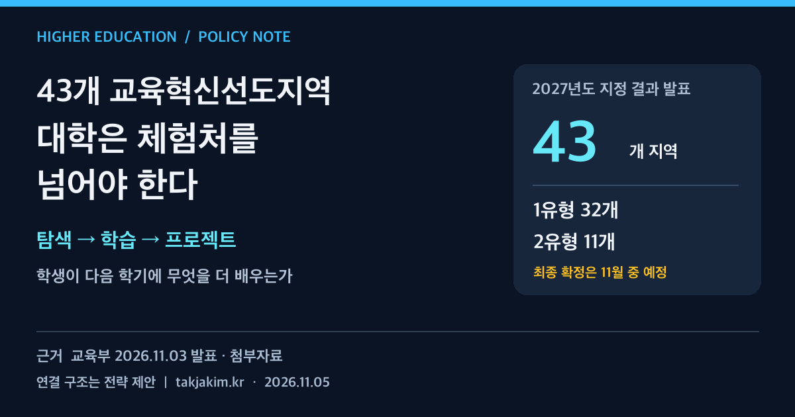

지역의 학생이 대학 실험실을 한 번 방문했다. 만족도도 높았다. 그렇다면 지역 교육과 대학의 연결은 잘 만들어진 것일까. 그 학생이 다음 학기에 무엇을 배우고, 어떤 과제를 수행하며, 대학의 어느 교육과정으로 이어질 수 있는지 답하지 못한다면 아직은 체험 행사에 가깝다.

교육부가 11월 3일 발표한 **2027년도 교육혁신선도지역 43개 지역 지정 결과**는 대학에 이 질문을 던진다. 특히 2유형은 지역 내 교육격차 완화와 함께 **대학·산업 연계 교육 강화**를 필수과제로 제시했다. 지역대학에는 프로그램을 더 많이 제공하는 것보다, 초중등 교육과 대학의 인재 양성을 잇는 운영체계를 만드는 일이 중요해졌다.

<figure class="note-cover-figure">
  
  <figcaption>교육부 2026년 11월 3일 보도자료와 첨부 HWPX를 바탕으로 자체 제작. 탐색·학습·프로젝트의 연결은 이 글의 설계 제안이다.</figcaption>
</figure>

## 오늘의 핵심

이번 발표의 숫자와 절차는 다음과 같다. 출처는 [교육부 보도자료와 첨부 문서](https://www.moe.go.kr/boardCnts/viewRenew.do?boardID=294&boardSeq=107547&lev=0&searchType=null&statusYN=W&page=1&s=moe&m=020402&opType=N)다.

| 구분 | 확인한 내용 | 해석할 때 주의할 점 |
| --- | --- | --- |
| 신청·지정 | 130개 지역 신청, 43개 지역 지정 발표 | 이의신청을 거쳐 11월 중 최종 확정 예정 |
| 1유형 | 32개 지역, 소규모학교 혁신을 통한 지역 교육생태계 구축 | 대학·산업 연계가 모든 유형의 동일한 필수과제인 것은 아니다 |
| 2유형 | 11개 지역, 교육격차 완화 및 대학·산업 연계 교육 강화 | 구체적인 대학별 역할은 지역 운영계획에서 확인해야 한다 |
| 지원 기간 | 최대 5년, 3년 지원 후 단계평가로 2년 추가 지원 | 처음부터 5년 지원이 확정된 구조가 아니다 |
| 다음 일정 | 12월까지 컨설팅을 거쳐 운영계획서 제출, 2027년 1월 사업 추진 예정 | 발표 시점의 계획이며 집행 성과가 아니다 |

예산도 상한과 실제 배정을 구분해야 한다. 보도자료는 1유형과 2유형 기초지자체의 연간 예산을 **20억 원 이내**, 2유형 광역지자체를 **40억 원 이내**로 제시했다. 표에 적힌 2027년 약 19억 원·약 37억 원은 해당 구분의 안내 수치다. 세종·제주는 별도 상한이 제시돼 있다. 이를 각 지역의 확정 교부액이나 대학이 직접 받는 사업비로 읽어서는 안 된다.

또 하나의 경계가 있다. 이번 정책의 중심은 **지역 맞춤형 초중등 교육혁신**이다. 대학 지원사업 전체를 대체하거나, 특정 대학의 정원·입학전형·취업 보장을 확정한 발표가 아니다. 대학전략의 의미는 이 초중등 교육혁신에 대학이 어떤 역할로 참여할지에서 찾아야 한다.

## 왜 대학전략 관점에서 중요한가

[[교육혁신선도지역]]을 대학 홍보의 새 통로로만 보면 대학이 맡는 일은 캠퍼스 투어와 특강으로 좁아진다. 하지만 교육부는 지역 맞춤형 초중등 교육혁신 모델을 대학의 인재 양성 정책과 긴밀하게 연계하겠다는 방향을 밝혔다. 대학은 지역 학생의 학습경험을 함께 설계하는 파트너가 될 수 있다.

이때 [[고교대학연계]]는 진학 설명회와 다르다. 고교에서 탐구한 주제가 대학의 기초 수업이나 실험으로 이어지고, 이후 지역의 문제를 다루는 프로젝트로 연결되는 구조다. 학생에게는 관심과 역량을 확인할 기회가 되고, 대학에는 지역 교육 수요를 교육과정 개선에 반영할 접점이 된다.

다만 이러한 연결이 자동으로 [[지역정주]]를 높인다고 단정할 수는 없다. 지역에 원하는 직무와 일자리, 생활 기반이 없으면 교육 참여만으로 정착이 보장되지 않는다. 지역에 남는 경로를 넓히는 것과 학생의 이동 선택권을 제한하는 것은 다른 일이다. 대학은 지역 산업을 소개하되 학생이 다른 가능성도 비교할 수 있도록 도와야 한다.

## 정책·교육과정·지역연계 포인트

### 유형별 문제를 먼저 읽는다

1유형의 핵심은 학교 규모와 분산에 따른 교육 기회 문제다. 대학이 참여한다면 강의를 공급하기 전에 이동 거리, 수업 시간, 교원의 공동 설계 여건부터 봐야 한다. 대학 실험실을 개방해도 학생이 도착할 교통편이 없으면 접근성은 개선되지 않는다.

2유형은 교육격차와 대학·산업 연계를 함께 요구한다. 이미 정보와 자원이 많은 학교만 대학 프로그램을 반복 이용하면 격차 완화라는 목적과 어긋날 수 있다. 모집 기준, 학교별 참여 기회, 이동 지원, 이주배경학생의 언어 지원 같은 조건을 교육 내용과 함께 설계해야 한다.

보도자료의 평가도 이 지점을 짚었다. 1유형에는 초중고 전반을 아우르는 구체적 생태계 구축 방안이 필요하다고 했고, 2유형에는 지역 교육 현황의 체계적 분석과 기존 프로그램의 질적 개선이 필요하다고 진단했다. **지정은 운영계획이 완성됐다는 인증이 아니라, 계획을 더 구체화해야 하는 출발점**으로 읽는 편이 맞다.

### 대학 자원을 한 학기의 학습경험으로 바꾼다

공식 첨부 문서의 옹진 사례는 학기 중 사전배움과 방학 중 대학·전문기관 현장 프로젝트를 연결하는 블렌디드 교육을 제시한다. 음성 사례에는 공공기관·대학·지역기업과 공동 수업안을 개발하고 공동평가와 교원연수 등을 운영하는 내용이 담겼다. 부산 사례는 초등 지역 탐색, 중등 진로 탐구, 고등 과목선택 및 학점 연계로 이어지는 성장 지원을 제시했다. **모두 공개된 운영 구상이지, 이미 입증된 학생 성과를 뜻하지는 않는다.**

이 사례들을 대학의 [[교육과정 개발]] 관점으로 번역하면 세 가지 질문이 남는다. 참여 전에 무엇을 배워야 하는가. 현장에서 학생은 무엇을 직접 수행하는가. 돌아온 뒤 어떤 결과물을 만들고 피드백을 받는가.

예를 들어 환경 분야라면 대학 방문 전에 지역 하천 자료를 읽고, 실험실에서 측정 방법을 익히고, 이후 자기 지역의 관찰 결과를 보고서로 만들 수 있다. 이는 이 글의 수업 설계 예시이며 이번 발표에 실린 확정 프로그램은 아니다. 중요한 것은 시설의 인상보다 학습 과제의 연속성이다. [[공동 교육과정]]도 강사와 장소를 함께 쓰는 수준을 넘어 학습목표와 평가 기준을 함께 만드는 쪽으로 나아가야 한다.

### 기업은 견학 장소보다 과제와 피드백의 제공자가 된다

[[산학협력]]의 역할도 다시 정리할 필요가 있다. 기업 견학을 했다는 사실만으로 학생이 직무를 이해했다고 보기는 어렵다. 학생 수준에 맞춘 문제를 제시하고, 해결 과정에 피드백을 제공하며, 결과물의 한계를 설명해 줄 때 직무 이해가 구체화된다.

고교생에게 대학생 수준의 생산성과 전문성을 요구해서도 안 된다. 미성년자 안전, 개인정보, 기업 자료 공개 범위, 지도 인력의 책임을 사전에 정해야 한다. 기업의 참여 부담을 낮춘다는 이유로 지도와 평가를 학교 교사에게 모두 넘기면 협력은 오래가기 어렵다.

## 학생·학부모가 확인할 것

지역이 지정됐다는 소식과 내가 참여할 수 있는 프로그램은 구분해야 한다. 지금 확인할 것은 학교 이름의 홍보 효과보다 다음의 실제 조건이다.

- **대상과 접근성:** 어느 학교·학년이 참여하며, 선발 기준과 이동·비용 지원이 공개되는가.
- **수업의 내용:** 대학 방문 전후로 이어지는 수업이 있는가. 단순 관람과 직접 수행을 구분해 안내하는가.
- **결과와 피드백:** [[학생 포트폴리오]]에 담을 탐구 보고서·설계물·발표물이 남고, 구체적인 피드백을 받는가.
- **인정 범위:** 학점 연계가 있다면 적용 대상, 인정 주체와 절차가 무엇인가. 모든 참가자의 대학 학점 인정으로 확대 해석하지 않는가.
- **안전과 선택권:** 실습 안전, 개인정보 이용, 후속 참여 여부가 명확한가. 특정 대학 진학이나 취업을 보장하는 것처럼 설명하지 않는가.

이번 발표만으로 개별 학교의 모집 일정이나 대학별 학점 인정 범위까지 알 수는 없다. 최종 운영계획과 학교·지역의 실제 안내를 따로 확인해야 한다.

## 대학컨설팅 관점에서 보는 전략

12월 운영계획서 제출을 앞둔 지역과 대학이라면 프로그램 목록보다 **공동 운영의 책임표**를 먼저 만드는 편이 낫다. 아래는 공식 평가 기준을 옮긴 것이 아니라 대학컨설팅 관점의 실행 제안이다.

| 실행 과제 | 먼저 정할 것 | 확인할 증거 |
| --- | --- | --- |
| 지역 수요 진단 | 어느 학생에게 어떤 교육 기회가 부족한가 | 학교·생활권별 수요와 참여 장벽 자료 |
| 수업 공동 설계 | 교사·교수·기업 멘토가 각각 맡을 일 | 수업안, 사전학습, 공동 평가 기준 |
| 운영 지원 | 이동·안전·시설·시간표의 책임 주체 | 담당자, 일정, 비용과 대응 절차 |
| 성과 확인 | 참여 이후 무엇이 달라졌는가 | 과제 수행의 변화, 후속 학습, 접근성 개선 |
| 다음 연도 개선 | 무엇을 유지·수정·중단할 것인가 | 검토 회의와 교육과정 수정 기록 |

[[실행지표]]를 잡을 때는 참여 인원과 만족도를 버릴 필요는 없다. 다만 그것만으로는 부족하다. 참여하지 못한 학교는 어디인지, 사전학습에서 현장 과제로 얼마나 이어졌는지, 학생 결과물에서 어떤 역량이 확인됐는지를 함께 봐야 한다. 취업이나 정주처럼 시간이 필요한 결과는 단기 수료 실적과 섞지 않고 별도로 추적하는 것이 타당하다.

이 기록이 다음 학기의 수업과 지원 방식에 반영될 때 [[성과환류]]가 작동한다. 3년 뒤 단계평가가 있으니 그때 자료를 모으는 것이 아니라, 첫해부터 개선 가능한 단위로 기록해야 한다.

43개라는 숫자는 지역 교육혁신의 범위를 보여준다. 대학이 다음으로 답해야 할 것은 자기 지역에서 몇 명을 만났느냐가 아니다. **그 학생이 다음 학기에 무엇을 더 배우게 되었는가.** 대학이 체험처를 넘어 교육 경로의 공동 설계자가 됐는지는 그 답에서 드러난다.

## 확인한 출처

- [교육부, 「지역 교육의 새로운 도약, 43개 교육혁신선도지역 시동」](https://www.moe.go.kr/boardCnts/viewRenew.do?boardID=294&boardSeq=107547&lev=0&searchType=null&statusYN=W&page=1&s=moe&m=020402&opType=N), 2026년 11월 3일. 본문과 첨부 HWPX의 유형별 지정 결과·지원 기간·예산 안내·추진 일정·평가 우수사례를 확인했다. 첨부 문서는 별개의 독립 출처가 아니라 같은 발표의 상세 자료다.

이 글은 위 발표를 바탕으로 한 정책·운영모델 해석이다. 개별 지역의 최종 지정·운영계획 확정이나 대학별 참여·학점 인정·학생 성과를 추가 확인한 것으로 읽어서는 안 된다.
