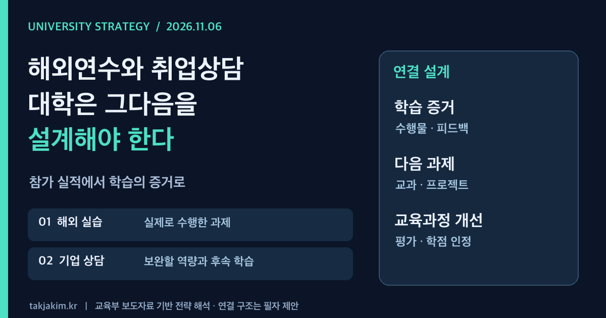

해외 대학의 실습실에 다녀왔고, 로봇 기업 현직자에게 취업 상담도 받았다. 학생에게는 분명 귀한 기회다. 다만 대학의 성과보고서는 여기서 한 문장을 더 써야 한다. **그 경험 이후 학생이 무엇을 할 수 있게 되었고, 다음 학기의 수업은 무엇이 달라지는가.**

교육부가 11월 5~6일 공개한 두 보도자료는 이 질문을 함께 던진다. 하나는 첨단분야 글로벌 교육과정의 성과교류회이고, 다른 하나는 로봇 분야 부트캠프 학생을 위한 현직자 간담회와 소그룹 취업 상담이다. 두 행사는 별개 사업 활동이다. 이를 하나의 통합사업으로 소개하려는 것이 아니라, 대학이 외부 학습경험을 교육과정 안으로 가져오는 방식이라는 공통 과제를 읽으려 한다.

<figure class="note-cover-figure">
  
  <figcaption>교육부 2026년 11월 5~6일 보도자료를 바탕으로 재구성한 자체 제작 전략 도식. 연결 단계는 필자의 제안이며 정부가 확정한 성과지표가 아니다.</figcaption>
</figure>

## 오늘의 핵심

- 교육부와 한국산업기술진흥원은 **11월 6일 오후** 서울에서 첨단분야 글로벌 교육과정 성과교류회를 개최할 계획이다. 여름에 진행된 퍼듀대·토론토대 연계 반도체·AI 교육 경험을 공유하고, 결과보고서 발표와 우수학생 시상을 진행한다. 이 글 작성 시점에는 행사 개최 전이다.[공식자료 1](#sources)
- 같은 날 오후 일산 킨텍스에서는 로보월드와 연계한 로봇 분야 부트캠프 라운드업을 개최할 예정이다. 산업 동향 특강, 기업 현직자 간담회, 소그룹 상담 등이 계획돼 있다.[공식자료 2](#sources)
- 대학전략의 과제는 참가 인원을 늘리는 데서 끝나지 않는다. 외부 실습과 상담을 **학습 증거 → 후속 프로젝트 → 교육과정 개선**으로 연결할 책임과 절차를 정하는 일이다. 이 연결 구조는 보도자료에 제시된 성과가 아니라 대학 운영을 위한 제안이다.

## 왜 대학전략 관점에서 중요한가

[[첨단산업 인재양성 부트캠프]]는 대학과 기업이 함께 1년 이내 단기 집중교육을 개발·운영하는 사업이다. 정규 전공만으로 빠르게 대응하기 어려운 직무 수요를 보완할 여지가 있다. 문제는 새로운 학습경험이 학생의 기존 전공과 따로 기록될 때 생긴다. 전공 수업, 사업단 교육, 해외 실습, 취업지원 부서의 상담 기록이 분리되면 학생이 배운 것을 다음 과제로 연결하기 어렵다.

이번 글로벌 교육과정 자료에는 국내·해외 대학 교수진의 공동 설계, 현지 대학 수료증 발급, 국내 대학 학점 인정 권장이 담겼다. 여기서 **권장은 일괄적인 학점 인정 보장이 아니다.** 실제 인정 여부와 범위는 소속 대학의 규정과 절차를 확인해야 한다. 수료증이 있다는 사실과 전공에서 그 학습을 인정한다는 판단은 다른 문제다.

대학컨설팅에서 볼 지점도 여기에 있다. 국제교류 부서는 연수를 관리하고, 사업단은 예산을 집행하고, 학과는 전공을 운영하고, 취업지원 부서는 상담을 맡는다. 이 구조를 없앨 필요는 없지만, 학생 한 명의 학습경로가 부서 경계에서 끊기지 않도록 공동으로 확인할 기록은 필요하다.

## 정책·교육과정·지역연계 포인트

### 해외 실습: 다녀온 곳보다 설명할 수 있는 과제

공식자료에 따르면 퍼듀대 프로그램에는 반도체 공정·설계와 AI 분야 교육이, 토론토대 프로그램에는 AI 실습 교육이 포함됐다. 반도체 공정에서는 클린룸과 장비를 활용하고, 설계에서는 FPGA 기반 CPU 설계·검증을 다뤘다. AI 과정에는 산업 현장 기술 구현과 데이터 구조 설계 등의 내용이 제시됐다.[공식자료 1](#sources)

이런 경험을 [[학생 포트폴리오]]로 남길 때는 방문 대학의 이름보다 해결한 문제와 판단 근거가 앞에 있어야 한다. 예컨대 공정 실습이라면 어떤 조건에서 측정 결과가 달라졌는지, 설계 과제라면 어떤 검증을 거쳤는지 설명하는 방식이다. 공개할 수 없는 데이터나 기업 자료는 비식별화하고, 개인 기여와 공동 작업을 구분해야 한다.

결과보고서 발표는 출발점이 될 수 있다. 다만 우수학생의 발표만으로 전체 참여자의 역량 향상을 단정해서는 안 된다. 전체 학생의 사전 수준과 사후 수행물을 함께 봐야 무엇이 교육 효과였는지 논의할 수 있다. 보도자료의 학생 소감은 경험 사례이지 취업 효과를 입증한 통계는 아니다.

### 기업 상담: 채용 약속이 아니라 다음 학습의 입력값

로봇 분야 라운드업은 경북대·대구가톨릭대 부트캠프 참여학생 등을 대상으로 한다. 교육부 자료는 두 대학이 기업과 함께 제어·AI·시스템 운용, 설계·전자 등 분야별 교육을 운영한다고 설명한다. 경북대의 지역 테스트베드 연계 실습은 자료상 **운영 예정**으로 제시돼 있으므로 이미 실현된 성과로 읽어서는 안 된다.[공식자료 2](#sources)

학생에게 현직자와의 만남은 직무를 구체화할 기회다. 대학에는 [[산학협력]]의 내용을 검증하는 기회이기도 하다. 기업이 필요로 하는 역량이 기존 수업에서 실제로 평가되고 있는지 물을 수 있기 때문이다.

상담에서 반복적으로 드러난 부족 역량은 다음 학습의 입력값이 된다. 학생별로 부족한 역량 하나와 보완 과제 하나를 남기고, 이후 담당 교원이 수행물을 확인하는 방식부터 시작할 수 있다. 상담 참여가 인턴십이나 채용을 보장하지는 않는다. 후속 기회가 있다면 별도의 선발·평가 조건을 명시해야 한다.

### 지역연계: 전시장의 기술을 지역의 문제로 번역하기

전국 규모 전시회와 해외 실습은 지역대학에도 외부 접점을 제공한다. 그러나 외부 접점이 곧 [[지역정주]] 성과가 되지는 않는다. 지역 기업의 실제 과제, 지도할 교원, 사용할 장비와 데이터, 학생의 참여 시간이 맞아야 지역 안에서 이어질 수 있다.

가령 로봇 운용에 관심을 갖게 된 학생이 있다면, 지역 기업의 공정 문제를 학기 중 프로젝트로 다룰 수 있는지 검토할 수 있다. 이는 이번 행사에서 확정된 후속사업이 아니라 대학이 설계해 볼 경로다. 참여기업 수보다 기업이 과제 정의와 피드백에 얼마나 관여하는지를 보는 편이 교육과정 개발에 유용하다.

## 학생·학부모가 확인할 것

좋은 프로그램인지 판단할 때 해외 대학의 이름이나 협약기업 로고만 보지 말자. 학생이 실제로 참여할 수 있는 조건을 확인해야 한다.

| 확인할 질문 | 확인할 자료 |
| --- | --- |
| 누가 참여할 수 있나 | 해당 학기 모집 공고, 선발 기준, 선수과목 |
| 학점으로 인정되나 | 소속 대학 규정, 인정 교과목과 학점 범위 |
| 실습에서 무엇을 직접 하나 | 실습 시간표, 장비 사용 범위, 개인·팀 과제 |
| 비용과 지원 범위는 어디까지인가 | 장학·체재비 안내, 개인 부담과 중도 포기 조건 |
| 수료 뒤 어떤 지원이 이어지나 | 후속 프로젝트, 상담, 인턴십의 별도 선발 조건 |

[[마이크로디그리]]나 수료증이 제공된다면 이수 기준도 살펴볼 필요가 있다. 출석만 충족하면 되는지, 수행물을 평가하는지, 기업이 평가에 참여하는지에 따라 의미가 달라진다. 교육부 사업 개요에 제시된 공동인증 권장을 모든 대학이 동일하게 시행한다고 가정해서도 안 된다.

## 대학컨설팅 관점에서 보는 전략

### 부서별 실적을 학생별 경로로 묶기

국제교류, 사업단, 학과, 취업지원 부서가 거대한 새 시스템부터 만들 필요는 없다. 우선 한 학생에 대해 다음 네 가지를 공동 확인하면 된다.

1. 참여 전에 어떤 역량을 갖고 있었는가.
2. 외부 실습·상담에서 무엇을 수행하고 어떤 피드백을 받았는가.
3. 돌아온 뒤 어떤 교과목·프로젝트로 이어지는가.
4. 그 경험을 근거로 어떤 수업이나 지원 절차를 바꿀 것인가.

이 네 질문에 답하는 최소 기록을 정하면 행사 결과보고서가 [[학습성과 평가]]의 자료로 바뀔 수 있다. 개인정보 수집 항목과 접근 권한, 보유 기간은 함께 정해야 한다. 학생의 진로 고민을 부서 전체에 불필요하게 공유하는 방식이어서는 안 된다.

### 발표 우수사례를 수업 개선으로 돌려보내기

성과교류회에서 좋은 사례를 발굴했다면 그 학생이 잘했다는 소개 다음에 무엇을 재사용할지 정해야 한다. 과제 설계, 평가 기준, 선수학습 자료 가운데 다른 학생에게도 적용할 수 있는 부분을 추리는 작업이다.

이것이 [[성과환류]]다. 우수사례집을 배포하는 것으로 끝내지 않고, 다음 학기의 실습 과제나 상담 후속 절차를 바꾸는 것이다. 모든 전공에 같은 과제를 보급하기보다는 분야별로 무엇을 가져올 수 있는지 학과가 판단해야 한다.

### 취업률 이전에 확인할 중간 성과

취업 결과는 중요하지만 해외 실습이나 한 번의 상담 효과를 곧바로 취업률로 설명하기는 어렵다. 평가 시점과 대상, 비교 조건이 필요하기 때문이다. 그 전에 확인할 [[실행지표]]를 두는 편이 현실적이다.

| 제안 지표 | 확인하는 질문 |
| --- | --- |
| 피드백을 반영한 수행물 수정 비율 | 학생이 조언을 실제 작업에 적용했는가 |
| 후속 교과·프로젝트 연결 비율 | 외부 경험이 학기 중 학습으로 이어졌는가 |
| 학점 인정 처리 현황 | 인정 가능성 안내와 실제 처리가 일치하는가 |
| 기업 피드백을 반영한 교과 개선 건 | 협력이 대학 수업을 바꾸었는가 |

위 지표는 정부의 확정 평가항목이 아니라 운영 설계를 위한 제안이다. 실제 도입할 때는 분모, 측정 시점, 증빙과 담당자를 정해야 한다. 단순히 기록을 많이 남긴 부서가 유리해지는 지표라면 다시 고쳐야 한다.

대학이 해외연수와 기업 상담을 운영하는 이유는 학생을 잠시 좋은 장소로 보내기 위해서만은 아니다. **돌아온 학생의 다음 과제를 설계하는 것까지가 대학의 일이다.** 그 연결이 보일 때 국제화, 산학협력, 취업지원은 개별 행사 목록을 넘어 하나의 교육전략이 된다.

<h2 id="sources">확인한 출처</h2>

1. [교육부, 「강의실을 넘어 세계로, 반도체·인공지능(AI) 인재 한자리에 모이다」](https://www.moe.go.kr/boardCnts/viewRenew.do?boardID=294&boardSeq=107573&lev=0&searchType=null&statusYN=W&page=1&s=moe&m=020402&opType=N), 2026.11.6. 게시. 첨부 HWPX 본문과 붙임 1·2에서 프로그램 내용, 성과교류회 일정, 학점 인정 권장 등을 확인했다.
2. [교육부, 「로봇 기업 인사 담당자가 직접 부트캠프 학생의 취업 상담에 나선다」](https://www.moe.go.kr/boardCnts/viewRenew.do?boardID=294&boardSeq=107566&lev=0&searchType=null&statusYN=W&page=1&s=moe&m=020402&opType=N), 2026.11.5. 게시. 첨부 HWPX 본문과 붙임 1·2에서 로봇 부트캠프 운영 내용, 라운드업 일정, 학사 유연화 및 인증 권장을 확인했다.

*확인 기준: 2026년 11월 6일 오전, 한국시간. 당일 오후 행사에 관한 내용은 개최 계획이며 완료 결과가 아니다. 후속 프로젝트, 기록 체계와 실행지표는 두 공식자료를 토대로 한 대학경영·교육과정 관점의 제안이다.*
