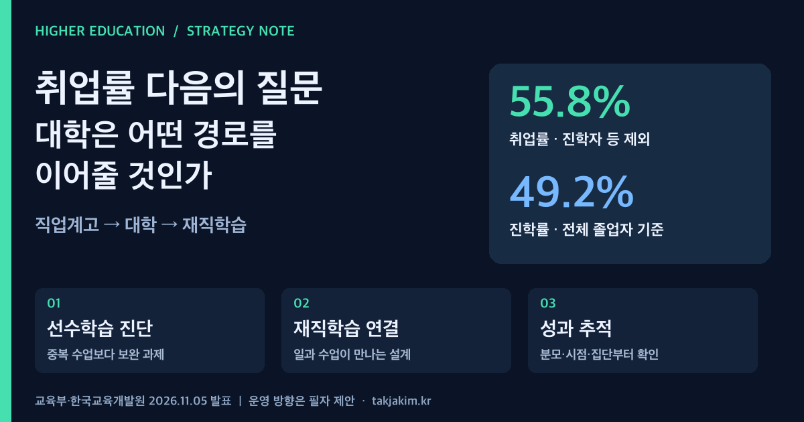

직업계고 졸업자의 취업률이 55.8%라는 발표를 보면 절반 넘게 취업했다고 읽기 쉽다. 그런데 같은 자료의 진학률도 49.2%다. 두 수치를 더하면 이상해지는 이유는 단순하다. **취업률과 진학률은 분모가 다르다.** 대학이 이 통계를 학생 모집이나 지역 인재양성 전략에 쓸 때 가장 먼저 확인할 부분이다.

교육부와 한국교육개발원이 11월 5일 발표한 자료는 고교 취업 성과만 보여주는 문서가 아니다. 전문대학과 지역대학에는 직업교육을 경험한 학생이 대학에서 무엇을 더 배우고, 취업 뒤에는 어떻게 다시 학습으로 돌아올 수 있는지 묻는 자료이기도 하다. 다만 이 조사는 직업계고 졸업자 통계다. 대학 교육의 효과나 특정 대학의 성과를 직접 입증하지는 않는다.

<figure class="note-cover-figure">
  
  <figcaption>교육부·한국교육개발원 2026년 11월 5일 발표자료를 바탕으로 자체 제작. 수치는 공식 통계이며 하단의 대학 운영 방향은 필자의 제안이다.</figcaption>
</figure>

## 오늘의 핵심

- 2026년 1~2월 직업계고 졸업자 **63,038명**을 대상으로 4월 1일 현황을 조사했다. 취업자는 16,209명, 진학자는 31,017명이다. 취업률은 **55.8%**, 진학률은 **49.2%**, 전체 졸업자 중 취업자 비율은 **25.7%**다.[공식자료](#sources)
- 2025년 졸업자 중 본조사 당시 보험가입자의 12개월 후 유지취업률은 **68.9%**다. 이는 2026년 졸업자의 취업률과 대상 집단도, 관찰 시점도 다르다. 두 수치를 하나의 집단이 이동한 결과처럼 연결해서는 안 된다.
- 대학전략에서 중요한 질문은 직업계고 출신 학생을 얼마나 모집하는가에 그치지 않는다. **고교에서 익힌 기술을 대학의 심화학습으로 연결하고, 재직자에게는 일을 유지하면서 배울 경로를 제공할 수 있는가**가 핵심이다. 이는 통계에서 확인된 대학 성과가 아니라 이 글이 제안하는 운영 방향이다.

## 왜 대학전략 관점에서 중요한가

진학자 31,017명은 대학에 이미 들어온 학생 집단이 있다는 신호다. 그러나 자료의 진학자 정의는 학위 취득을 목적으로 고등교육기관에 진학한 사람이다. 이들을 모두 전문대 진학자로 보거나, 전원이 고교 전공과 일치하는 학과에 진학했다고 가정할 수는 없다.

대학은 먼저 자교 학생의 실제 이력을 확인해야 한다. 같은 직업계고 출신이라도 실습 장비를 충분히 다룬 학생과 이론 보완이 필요한 학생, 전공을 이어가는 학생과 다른 분야로 전환한 학생의 출발점은 다르다. 출신 학교 유형만으로 동일한 기초반을 편성하면 이미 배운 내용을 반복시키거나 필요한 지원을 놓칠 수 있다.

여기서 [[교육과정 포트폴리오]]를 점검할 이유가 생긴다. 신입생 대상 정규 전공, 전공 전환을 위한 연결 교과, 재직자 대상 단기 과정이 서로 어떤 관계인지 봐야 한다. 모집 전형별 숫자와 사업단별 프로그램 목록만으로는 학생의 학습이 이어지는지 알기 어렵다.

## 정책·교육과정·지역연계 포인트

### 취업률은 전체 졸업자의 취업 비율과 다르다

공식 산식은 다음과 같다.

> 취업률 = 취업자 ÷ [졸업자 − (진학자 + 입대자 + 제외인정자)] × 100

반면 진학률은 진학자를 전체 졸업자로 나눈 값이다. 따라서 55.8%와 49.2%를 합산하거나, 55.8%를 전체 졸업자 중 취업한 사람의 비율로 설명하면 틀린다. 이번 자료가 별도로 제시한 전체 졸업자 중 취업자 비율은 25.7%다.

대학의 사업 성과에도 같은 주의가 필요하다. 프로그램 참여자 중 취업률인지, 수료자 중 취업률인지, 취업 대상자에서 어떤 학생을 제외했는지에 따라 숫자의 의미가 달라진다. [[실행지표]]를 설계할 때는 지표 이름보다 대상, 분모, 기준일, 제외 기준을 먼저 고정해야 한다.

### 유지취업은 같은 회사에 계속 다닌다는 뜻이 아니다

이번 자료에서 유지취업자는 본조사 당시 건강보험 직장가입자 또는 고용보험 가입자 중 후속 조사 시점에도 보험 가입이 확인된 사람이다. 같은 회사 재직 여부나 전공 일치 여부를 직접 뜻하지 않는다. 보험 가입이 확인되지 않았다는 사실만으로 전원이 실직했다고 단정할 수도 없다.

또한 2025년 졸업자의 6개월·12개월 후 수치와 2024년 졸업자의 18개월 후 수치를 한 집단의 연속 변화로 그리면 안 된다. 서로 다른 졸업연도 집단이다. 재직자 교육을 기획하는 대학은 이 통계를 지원 필요성을 살펴보는 출발점으로 쓰되, 자교 과정의 효과는 별도로 확인해야 한다.

### 지역의 학교에서 취업했다는 사실과 지역에 남았다는 사실

학교 소재지가 비수도권인 집단의 취업률은 58.7%다. 한편 근로지역 기준으로 수도권 소재 기업 취업자 비중은 55.1%로 제시됐다. 두 지표는 집계 기준이 다르므로 이 차이만으로 비수도권 학교 졸업자의 수도권 유출률을 계산할 수 없다.[공식자료의 붙임·별첨](#sources)

[[지역정주]]를 평가하려면 학교 소재지, 일자리 소재지, 거주지와 관찰 기간을 구분해야 한다. 지역 기업과 맺은 협약 수를 늘리는 일은 그 자체로 정주 성과가 아니다. [[산학협력]]이 지역의 실제 직무, 학생의 학습, 일자리의 지속성으로 이어지는지 확인할 자료가 필요하다.

## 학생·학부모가 확인할 것

학교 유형별 취업률만으로 개인에게 유리한 진로를 결정하기는 어렵다. 집단의 구성과 산업 분포가 다르고, 이번 수치가 대학 진학의 효과를 비교한 것도 아니기 때문이다. 대학 프로그램을 살펴볼 때는 다음 질문이 더 유용하다.

| 확인할 질문 | 살펴볼 자료 |
| --- | --- |
| 고교에서 배운 내용을 대학에서 어떻게 이어가나 | 전공 교과목 설명, 선수학습 진단, 기초·심화 과정 안내 |
| 전공을 바꾸려면 어떤 보완이 필요한가 | 연결 교과, 튜터링, 실습 안전교육, 학습상담 안내 |
| 취업하면서 학업을 병행할 수 있나 | 실제 수업 시간표, 출석·실습 규정, 근무 일정과의 충돌 여부 |
| 기업 연계 과정은 어떤 경험을 제공하나 | 수행 과제, 장비 이용, 기업의 평가 참여, 별도 채용 조건 |
| 제시된 취업 성과는 누구를 조사한 것인가 | 졸업연도, 분모, 기준일, 제외 기준, 추적조사 여부 |

전형이나 협약이 있다는 이유만으로 입학, 학점 인정, 취업이 보장되지는 않는다. 특히 고교 실습이나 재직 경험을 대학 학습으로 인정받을 수 있는지는 해당 대학의 규정과 심사를 확인해야 한다.

## 대학컨설팅 관점에서 보는 전략

### 입학 전에는 선수학습을, 입학 후에는 보완 과제를 확인하기

직업계고 연계의 출발점은 협약식보다 학습 내용의 비교다. 고교와 대학 교원이 실제 과제와 실습 수준을 함께 검토하고, 대학 초반에 반복할 내용과 새로 배울 내용을 구분하는 방식이다. 필요하다면 [[모듈형 교육과정]]으로 기초 보완과 직무 심화를 나눌 수 있다.

단, 진단을 학생 분류표로만 쓰지 않아야 한다. 진단 결과에 따라 어느 교과를 듣고 누가 보완학습을 지도할지까지 연결돼야 한다. 고교 전공과 다른 분야로 이동한 학생에게는 새로운 출발을 지원할 경로가 필요하다.

### 취업 이후의 학습을 별도 사업으로 남겨두지 않기

[[선취업 후진학]]을 대학의 운영 모델로 삼으려면 야간 강좌를 개설하는 것만으로 부족하다. 교대근무, 통학 시간, 현장 실습, 시험 일정이 충돌할 때 학생과 기업이 어떻게 조정할지 정해야 한다. 기업이 과제를 제공한다면 영업비밀과 개인정보를 제외하고 어떤 결과물을 평가할지도 합의해야 한다.

이런 설계는 [[평생교육]] 부서에만 맡길 일이 아니다. 학과는 전공 수준을, 학사 부서는 인정 절차를, 기업은 근무와 과제 조건을 책임져야 한다. 새로운 대형 시스템보다 한 과정에서 이 역할을 문서로 합의하는 편이 먼저다.

### 취업의 질은 기업 규모 하나로 끝내지 않기

발표자료는 300인 이상 기업 취업자 비중이 38.4%로 5년 연속 상승했다고 설명한다. 긍정적인 신호지만 기업 규모가 임금, 안전, 직무 적합성, 성장 기회를 모두 대신하는 지표는 아니다.

대학의 [[성과환류]]에는 취업 여부와 더불어 학생이 실제로 수행한 직무, 배운 기술의 활용, 학업 병행의 어려움, 추가로 필요한 역량을 확인하는 절차가 들어가야 한다. 다만 민감한 개인 기록을 무리하게 모으기보다 수집 목적과 동의, 접근 권한을 명확히 하는 것이 전제다.

이번 통계가 대학에 던지는 질문은 직업계고 학생을 더 데려올 수 있느냐가 아니다. **이미 배운 기술이 대학에서 깊어지고, 일하는 동안에도 다음 학습으로 이어질 수 있느냐**다. 대학의 전략은 모집 숫자 이후에도 작동해야 한다.

<h2 id="sources">확인한 출처</h2>

- [교육부·한국교육개발원, 2026년 직업계고 졸업자 취업통계조사 결과 발표](https://www.moe.go.kr/boardCnts/viewRenew.do?boardID=294&boardSeq=107565&lev=0&searchType=null&statusYN=W&page=1&s=moe&m=020402&opType=N), 2026년 11월 5일. 해당 공식 페이지의 보도자료 HWPX와 별첨 세부 분석 자료 HWPX를 함께 확인했다. 보도자료의 산식·주요 결과와 별첨의 용어 정의·조사기준일을 기준으로 서술했다.

통계의 조사기준일과 발표일은 다르다. 대학의 교육과정·재직학습·지역연계 운영 제안은 공식 발표의 확정 정책이나 검증된 교육 효과가 아니라 필자의 대학컨설팅 관점에서 재구성한 해석이다.
