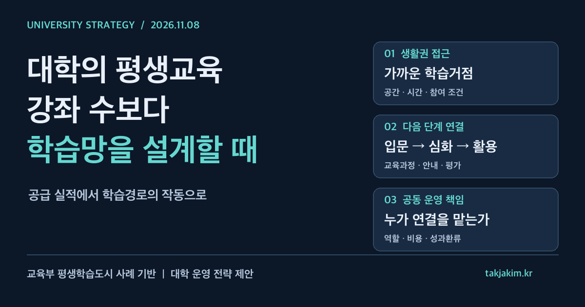

대학 평생교육원의 경쟁력을 강좌 수와 수강 인원으로만 설명하면 놓치는 것이 있다. 퇴근 후 찾아갈 수 있는 장소인지, 처음 배운 사람이 다음 단계로 이동할 수 있는지, 수료 뒤 지역에서 그 배움을 써 볼 기회가 있는지다. 강좌가 많아도 이 연결이 없으면 학습자는 매번 처음부터 다시 찾아야 한다.

교육부가 11월 4일 공개한 **제23회 대한민국 평생학습대상 및 2026년 평생학습도시** 자료는 이 문제를 읽을 좋은 단서다. 대학만을 대상으로 한 정책 발표는 아니다. 오히려 도시와 주민이 만든 학습 구조를 보면서, 대학이 지역 안에서 무엇을 맡아야 하는지 되묻게 한다.

<figure class="note-cover-figure">
  
  <figcaption>교육부 2026년 11월 4일 공식자료를 바탕으로 제작한 전략 도식. 단계와 운영 과제는 필자의 제안이며 정부가 확정한 평가모형이 아니다.</figcaption>
</figure>

## 오늘의 핵심

- 교육부·국가평생교육진흥원의 공식자료에는 평생학습대상 **14점**, 신규 평생학습도시 **5곳**, 평가인증 우수도시 **5곳**이 제시돼 있다. 11월 5일 시상·동판 수여 행사 개최 계획을 발표한 자료이며, 이 글에서 행사 완료 여부까지 별도로 확인한 것은 아니다.
- 눈에 띄는 것은 대규모 건물보다 **분산된 자원 연결, 가까운 학습공간, 개인별 학습 안내**다. 동두천·포천의 공동사업, 부산 서구의 생활권 수업, 서울 은평구의 맞춤형 안내가 서로 다른 방식으로 이 문제에 접근한다.
- 대학전략의 질문은 도시의 프로그램을 그대로 복제할지 여부가 아니다. 대학이 가진 교수진·교육과정·평가 역량을 지역의 학습망에 어디서 연결하고, 무엇을 책임질지 정하는 일이다.

## 왜 대학전략 관점에서 중요한가

[[평생학습도시]]는 대학의 교외 강의장을 늘리는 사업과 같지 않다. 주민의 시간, 이동, 정보 접근, 학습 목적을 함께 다루는 지역 기반이다. 대학이 이를 추가 모집시장으로만 보면 이미 지역에서 활동하는 도서관·평생학습관·주민 강사와 같은 수강생을 두고 경쟁하기 쉽다.

대학이 기여할 수 있는 지점은 따로 있다. 입문 강좌 이후 더 깊게 배우고 싶은 사람에게 다음 교육과정을 제시하고, 강사의 수업 설계를 지원하고, 학습 결과를 확인할 평가 기준을 만드는 것이다. 모든 수업을 대학이 직접 열어야 하는 것은 아니다.

[[성인학습자]]에게는 교육 내용만큼 참여 조건이 중요하다. 같은 과목이라도 야간 운영, 돌봄과의 양립, 이동 시간, 디지털 신청 방식에 따라 실제 접근성이 달라진다. 교육공학 관점의 설계가 필요한 이유다. 좋은 콘텐츠를 확보했다는 말과 학습자가 끝까지 배울 수 있다는 말 사이에는 운영의 간격이 있다.

## 정책·교육과정·지역연계 포인트

### 가까운 공간을 확보하되 수업의 질을 함께 설계하기

공식자료는 부산 서구가 공방·카페 등 소상공인 사업장을 학습거점으로 활용해 **도보 15분 생활권의 한걸음 클래스**를 운영한다고 소개한다. 여기서 15분은 해당 사례의 운영 설명이지 전국 대학에 적용되는 의무 기준이 아니다.

대학에 주는 시사점은 새 강의동 건립만이 접근성 개선 수단은 아니라는 점이다. [[생활권 학습거점]]을 활용하면 주민에게 더 가까이 갈 수 있다. 다만 공간이 가깝다는 이유만으로 교육의 질과 안전이 확보되는 것은 아니다. 실습에 필요한 장비, 장애인 접근성, 보험과 사고 대응, 운영 중단 시 대체 공간까지 확인해야 한다.

대학은 현장 공간 운영자와 역할을 나눌 수 있다. 지역기관은 공간과 주민 접점을, 대학은 강사 지원과 교육과정 검토를 맡는 식이다. 이는 이번 자료가 정한 대학의 의무가 아니라 협력을 설계할 때 검토할 제안이다.

### 진단 뒤에 실제로 갈 수 있는 다음 과정이 있어야 한다

서울 은평구 사례는 성인학습유형검사(ALST)를 활용해 학습 특성을 진단하고 적합한 교육을 안내하는 방식이다. 공식자료가 소개한 것은 학습지원 체계다. 검사 점수가 취업 가능성을 예측한다거나 특정 교육의 효과를 보장한다는 뜻으로 확대해서는 안 된다.

대학이 참고할 부분은 검사 도입 자체보다 **안내 이후의 연결**이다. 학습자가 추천받은 과목에 등록할 수 있는지, 기초과정을 마친 뒤 심화과정으로 이동할 수 있는지까지 봐야 한다. [[학습경로 설계]]는 추천 목록을 출력하는 일보다 넓다.

예를 들어 디지털 입문 수업 다음에 문서 작성, 데이터 활용, 지역 프로젝트를 순차적으로 배치할 수 있다. 이는 필자의 교육과정 예시다. 과정별 선수역량과 완료 기준을 명확히 하고, 상담을 담당할 사람과 재안내 절차도 함께 정해야 한다.

### 지역 간 공유는 공동 홍보보다 운영 합의가 먼저다

사업 부문 대상은 동두천시·포천시의 **포동 L.I.N.K 학습상생 벨트**다. 공식자료는 두 지자체가 학습자원을 공유하고 시니어 디지털 강사 양성, 반려동물 관련 교육, 학습마을 특화사업 등을 공동 추진했다고 설명한다. 학습마을 수익금을 지역 청소년 장학금으로 기탁한 사례도 소개한다.

이를 대학 간 또는 대학·지자체 협력으로 확장할 때 핵심은 프로그램 명칭을 통일하는 일이 아니다. [[지역교육 거버넌스]] 안에서 누가 모집하고, 누가 비용을 부담하며, 누가 민원을 처리할지 먼저 합의해야 한다. 한 기관의 수료자가 다른 기관의 다음 과정에 진입할 때 무엇을 인정할지도 정해야 한다.

공동사업 참여 사실이 대학 학점 인정으로 자동 연결되지는 않는다. 비학위 수료와 정규 학점은 구별하고, 인정 가능성이 있다면 소속 대학의 규정과 심사 절차를 확인해야 한다.

## 학생·학부모가 확인할 것

이번 주제는 재학생뿐 아니라 재직자·중장년·지역 주민에게도 해당한다. 수강료가 낮거나 유명 기관이 참여한다는 사실만으로 선택하기보다, 아래 질문을 실제 모집 안내에서 확인하는 편이 좋다.

| 질문 | 확인할 자료 |
| --- | --- |
| 내 수준에서 시작할 수 있나 | 선수학습, 진단·상담 안내, 기초과정 유무 |
| 일정과 이동이 가능한가 | 실제 교육 장소, 야간·주말 시간표, 접근성 |
| 수료하려면 무엇을 해야 하나 | 출석 기준, 실습·과제·평가 방식 |
| 다음 단계가 실제로 열리나 | 심화과정의 개설 시기와 별도 선발 조건 |
| 학점·자격·취업과 연결되나 | 공식 인정 규정, 자격 발급 주체, 별도 채용 조건 |

[[학생 포트폴리오]]도 성인학습에 활용할 수 있다. 작품이나 프로젝트를 남기되 개인이 무엇을 수행했는지 설명할 수 있어야 한다. 수료증만으로 직무역량이 검증됐다고 보거나, 프로그램 참여가 취업으로 직결된다고 기대해서는 안 된다.

## 대학컨설팅 관점에서 보는 전략

### 공급기관 목록보다 연결이 끊기는 곳부터 보기

지역기관별 강좌를 모두 모으면 긴 목록은 만들 수 있다. 하지만 목록에 없는 것은 학습자가 그만두는 이유다. 신청 절차가 복잡한지, 이동이 어려운지, 입문 다음 과정이 없는지부터 확인해야 한다.

대학은 우선 한 생활권과 한 학습 분야를 정해 경로를 점검할 수 있다. 주민 상담부터 입문·심화·지역 활동까지 실제로 이어지는지 살펴보는 방식이다. 처음부터 지역 전체를 포괄하는 플랫폼을 구축하기보다, 작게 연결해 보고 끊기는 지점을 수정하는 편이 운영 부담을 확인하기 쉽다.

### 공동 운영의 최소 합의서를 만들기

협약서에 협력 의지를 쓰는 것만으로 수업이 열리지는 않는다. 다음 항목이 있어야 실무자가 움직일 수 있다.

1. 대학·지자체·현장기관의 담당자와 결정 권한.
2. 강사·공간·장비 비용의 분담과 취소 시 처리.
3. 모집 기준과 기관 간 학습자 인계 방식.
4. 학습 결과의 확인 방법과 이의 제기 창구.
5. 개인정보 접근 권한, 보유 기간, 삭제 절차.

상담 기록을 많이 공유하는 것이 협력의 증거는 아니다. 학습자의 동의와 적법한 처리 근거를 확인하고, 다음 과정을 안내하는 데 필요한 최소 정보만 다뤄야 한다.

### 수강 인원 뒤에 남는 변화를 평가하기

[[실행지표]]는 공급량과 경로의 작동 여부를 나누어 설계하는 편이 낫다. 아래는 공식 평가항목이 아니라 대학 운영을 위한 제안이다.

| 제안 지표 | 무엇을 확인하나 |
| --- | --- |
| 상담 이후 실제 등록 비율 | 안내가 이용 가능한 교육으로 이어지는가 |
| 입문 수료자의 후속 과정 참여 비율 | 단발성 수강을 넘어 학습이 이어지는가 |
| 과제 피드백 반영 현황 | 출석 외에 학습의 변화를 확인하는가 |
| 운영 개선사항의 다음 기수 반영 여부 | 현장 의견이 교육과정을 바꾸는가 |

분모와 관찰 기간은 함께 공개해야 한다. 후속 과정이 아직 열리지 않은 학습자를 미참여로 처리하거나, 선택적으로 응답한 사람만으로 전체 성과를 설명하면 지표가 왜곡된다. 취업·소득·지역정주 같은 장기 변화는 별도의 추적과 해석이 필요하다.

이 결과를 다음 학기 편성, 강사 지원, 공간 배치로 돌려보내는 것이 [[성과환류]]다. 수강생이 많았다는 보고에서 끝나지 않고, 불편했던 경로 하나를 실제로 바꾸는 일이다.

대학이 지역 평생교육에 참여할 이유는 강의실을 한 번 더 채우기 위해서만은 아니다. **주민이 가까운 곳에서 시작한 배움을 다음 단계까지 이어갈 수 있도록, 교육의 연결을 책임지는 것.** 생활권 학습망에서 대학의 역할을 찾는 출발점은 여기에 있다.

## 확인한 출처

1. [교육부, 제23회 대한민국 평생학습대상 시상식 및 2026년 평생학습도시 동판 수여식 개최](https://www.moe.go.kr/boardCnts/viewRenew.do?boardID=294&boardSeq=107561&lev=0&searchType=null&statusYN=W&page=1&s=moe&m=020402&opType=N), 2026.11.4. 게시. 첨부 HWPX 본문과 붙임 1~3에서 시상 규모, 동두천·포천 사업, 은평구·부산 서구 운영사례를 확인했다.

*확인 기준: 2026년 11월 8일 오전 한국시간. 선정·운영사례는 위 공식 발표의 설명에 근거한다. 행사 완료를 확인하는 후속 보도나 개별 사업의 효과 검증 자료를 별도로 확보한 것은 아니다. 대학의 역할 분담, 교육과정 연결, 지표와 운영 절차는 해당 사례를 토대로 한 필자의 전략 제안이다.*
