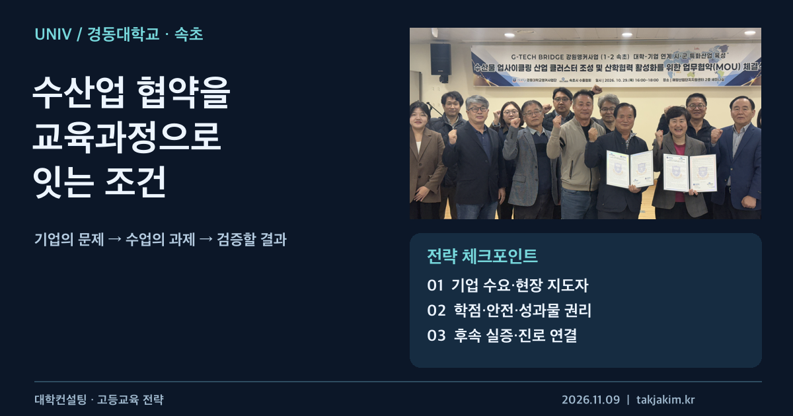
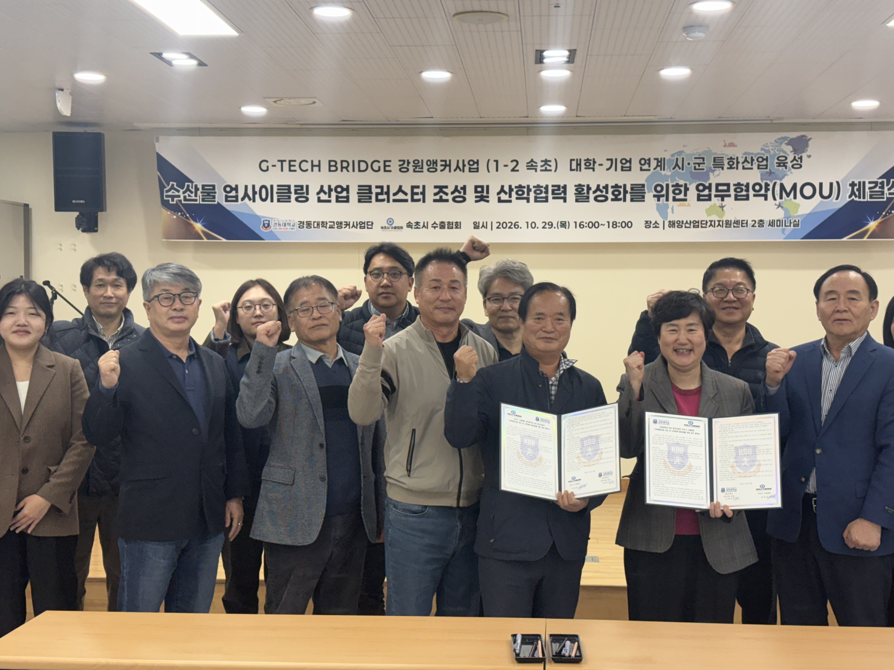

대학과 기업이 협약을 맺었다는 소식에서 가장 궁금한 것은 사진에 몇 명이 섰는지가 아니다. 다음 학기에 학생이 어떤 문제를 풀게 되는지, 기업은 어떤 자료와 현장을 내놓는지, 결과물을 누가 검토하는지가 궁금하다. 서명 이후의 일이 보일 때 협약은 대학전략이 된다.

경동대학교 KDU 앵커사업단과 강원앵커센터가 **11월 2일 공개한 속초 해양산업 협력 소식**은 이 질문을 던질 만한 사례다. 대학의 연구개발 역량에 지역기업 네트워크와 수출·판로 인프라를 연결하려는 구상이 담겨 있다. 다만 공개된 것은 협약과 추진 방향이다. 교육과정 개설, 학생 참여, 취업이나 사업화 성과가 이미 확인됐다는 뜻은 아니다.

<figure class="note-cover-figure">
  
  <figcaption>협약 현장 사진: 경동대학교 KDU 앵커사업단, 2026년 11월 2일 게시자료. 표지 편집과 전략 체크포인트는 필자 제작이며 대학이 발표한 확정 교육과정이 아니다.</figcaption>
</figure>

## 오늘의 핵심

- 경동대 KDU 앵커사업단은 **10월 29일 속초해양산업단지협의회 및 속초시수출협회와 각각 업무협약**을 체결했다고 밝혔다. 11월 2일자 사업단 자료와 강원앵커센터 게시물에서 같은 내용을 확인했다.
- 협력 범위는 수산물 업사이클링과 산업 클러스터, 공동사업 발굴, 기업 지원·기술사업화, 제품 경쟁력과 국내외 판로 확대다. 대학·산업단지·수출협회가 서로 다른 자원을 제공할 수 있다는 점이 긍정적이다.
- 대학컨설팅 관점의 다음 질문은 **이 협력에 교육과정과 학생의 역할이 어떻게 들어가는가**다. 현재 자료만으로는 참여 학과, 학점 인정, 모집 인원, 실습 조건이나 채용 연계를 확정할 수 없다.

## 왜 대학전략 관점에서 중요한가

[[산학협력]]을 개별 기업과의 관계로만 운영하면 교수 한 사람이나 담당자의 인맥에 의존하기 쉽다. 기업 담당자가 바뀌거나 단기 과제가 끝나면 연결도 끊길 수 있다. 이번 사례에서 주목할 부분은 개별 회사뿐 아니라 **입주기업 네트워크를 가진 산업단지협의회와 해외 판로 인프라를 가진 수출협회**가 협약 상대라는 점이다.

공개자료는 이를 G-TECH BRIDGE 기반 강원[[앵커|앵커(ANCHOR)]]사업의 대학-기업 연계 시군 특화산업 육성 과제와 연결한다. 대학이 연구개발을, 협의회가 기업 접점을, 수출협회가 시장 접점을 제공한다는 구상이다. 협약 문구 안에 생산 현장과 시장이 함께 들어 있다는 점은 단순한 교류협약보다 구체적이다.

그렇다고 네트워크 자체가 성과는 아니다. 기업이 제시하는 문제가 대학에서 다룰 수 있는 수준인지, 필요한 실험·분석 역량이 실제로 있는지, 기업의 일정과 학사일정이 맞는지를 따져야 한다. 협회가 기업 여러 곳을 연결하더라도 현장 지도와 자료 제공을 담당할 개별 기업이 정해지지 않으면 학생 프로젝트는 시작하기 어렵다.

[[지역특화산업]]과의 연계를 말할 때도 산업 이름을 학과 홍보문구에 붙이는 것만으로는 부족하다. 대학이 이미 가진 교육·연구 역량 가운데 무엇을 활용하고, 부족한 역량은 어디와 협력할지 정해야 한다. 이번 소식을 대학 전체의 특성화 완성이나 특정 학과의 경쟁력 입증으로 확대해서 읽지 않는 이유다.

## 정책·교육과정·지역연계 포인트

### 기업의 요청을 수업에서 풀 수 있는 문제로 바꾸기

수산물 업사이클링이라는 큰 주제는 그대로 수업 과제가 되기 어렵다. 어떤 부산물을 다루는지, 기업은 무엇을 개선하고 싶은지, 실험과 자료 접근이 어디까지 가능한지부터 확인해야 한다. 원료 특성, 처리 공정, 제품 기획, 시장 조사 중 어느 문제를 맡느냐에 따라 필요한 전공과 평가 방법도 달라진다.

예컨대 기업의 실제 수요가 확인된다면, 한 팀은 원료·공정 자료를 정리하고 다른 팀은 제품 사용처와 시장 요구를 조사하는 방식의 [[캡스톤디자인]]을 검토할 수 있다. 이는 **필자의 교육과정 제안**이다. 경동대가 해당 수업을 이미 운영하거나 특정 학과의 참여를 확정했다는 의미는 아니다.

과제 정의서에는 기업 담당자, 제공 자료, 학생이 접근하지 못하는 정보, 중간 검토 일정, 최종 산출물을 적어야 한다. 기업이 기대하는 상용화 결과와 한 학기 수업에서 가능한 학습 결과를 구분하는 작업도 필요하다. 학생에게 기업의 미해결 문제를 떠넘기지 않고, 기업에도 수업의 범위를 미리 알리는 장치다.

### 시장 접점은 기술 성과의 검증 단계로 활용하기

수출협회가 참여한다는 사실은 해외 취업이나 수출 계약을 보장하지 않는다. 오히려 교육적으로 활용할 지점은 시장의 요구를 더 일찍 알아보는 데 있다. 학생이 만든 제안서나 시제품에 대해 구매자 관점의 의견을 받을 수 있다면 기술 중심 과제의 사각지대를 줄일 수 있다.

[[기술사업화]] 역시 결과물 전시만으로 끝나지 않는다. 후속 시험이 필요한지, 인증과 표시 기준은 무엇인지, 비용과 권리를 누가 부담할지 판단해야 한다. 식품·소재 등 실제 적용 분야에 따라 안전과 규제 검토가 달라질 수 있으므로, 구체적 제품과 용도가 정해지기 전에 사업화 가능성을 단정해서는 안 된다.

<figure class="note-inline-figure">
  
  <figcaption>출처: <a href="https://kdurise.com/news/97" target="_blank" rel="noopener noreferrer">경동대학교 KDU 앵커사업단의 2026년 11월 2일 협약 소식</a>. 협력의 출발을 보여주는 사진이며 교육과정 운영이나 사업화 완료의 증거로 사용한 것은 아니다.</figcaption>
</figure>

### 성과를 남길 권리와 책임부터 합의하기

기업과 함께 만든 결과는 학생의 [[학생 포트폴리오|포트폴리오]]가 될 수 있지만, 공개 범위에 대한 합의가 먼저다. 기업의 공정 정보나 영업비밀이 들어 있으면 취업 지원용으로도 그대로 공개하기 어렵다. 익명화한 문제 설명, 학생의 역할, 검증 방법처럼 공개 가능한 항목을 수업 시작 전에 정해 두는 편이 낫다.

현장 활동이 포함된다면 안전교육, 보험, 이동과 활동 시간, 지도 책임도 확인해야 한다. 기업과 대학의 협약이 있다는 사실만으로 학생의 실습 조건이 확보되는 것은 아니다. 학점 인정이나 정규 교과 편입 역시 별도의 학사 검토가 필요한 사안이다.

## 학생·학부모가 확인할 것

이 사례를 진로 탐색에 활용하려면 학교 이름보다 **현재 공개된 참여 기회**를 확인하는 편이 좋다. 이번 협약 자료는 학생 모집 공고가 아니다. 지원할 수 있는 프로그램이 생겼을 때 다음을 물어볼 수 있다.

| 확인할 질문 | 필요한 근거 |
| --- | --- |
| 우리 학과와 학년도 참여할 수 있나? | 해당 학기 모집 공고와 지원 자격 |
| 수업인가, 비교과인가, 현장실습인가? | 교과목 안내와 학점 인정 규정 |
| 무엇을 만들고 누가 평가하나? | 과제 설명, 평가 기준, 기업 멘토 안내 |
| 비용과 안전 문제는 어떻게 처리하나? | 이동·재료비, 보험, 현장 활동 지침 |
| 결과를 취업 준비에 활용할 수 있나? | 공개 범위와 지식재산권에 대한 안내 |
| 인턴십이나 채용으로 이어지는가? | 별도로 명시된 선발·연계 조건 |

마지막 항목은 특히 구분해야 한다. 협약이 학생에게 좋은 경험의 기반이 될 수는 있지만 **채용 약정으로 읽을 수는 없다**. 기업과 함께 일해 본 경험, 실제 직무를 이해한 정도, 결과물을 설명할 수 있는 능력처럼 학생이 확보할 수 있는 것을 구체적으로 확인해야 한다.

## 대학컨설팅 관점에서 보는 전략

대학에는 협약 건수보다 **협약 이후의 과제 흐름을 관리하는 장치**가 필요하다. 이번 사례에 적용한다면 다음과 같은 운영표를 제안할 수 있다. 아래 항목은 공식 성과지표가 아니라 필자의 점검 틀이다.

| 단계 | 운영 책임을 정할 일 | 남겨야 할 증거 |
| --- | --- | --- |
| 기업 수요 확인 | 협의회·수출협회와 대학의 접수 창구 지정 | 기업이 검토한 문제 정의서 |
| 교육과정 연결 | 교과 담당자와 기업 지도자의 역할 합의 | 수업계획, 학생 과업, 안전·권리 조건 |
| 중간 검증 | 기술 검토와 시장 의견을 받을 시점 설정 | 피드백 기록과 수정 내역 |
| 후속 실행 | 추가 실험·기업 활용 여부를 판단할 책임자 지정 | 후속 검토 결과 또는 중단 사유 |
| 다음 학기 개선 | 사업단과 학과의 공동 검토 | 과제·수업·협력 방식 변경 기록 |

이때 [[성과환류]]는 좋은 사례를 골라 보고서에 넣는 일이 아니다. 어떤 기업 과제는 수업에 맞지 않았는지, 학생의 기초역량이나 지도 시간이 부족했는지, 다음 운영에서 무엇을 줄이고 바꿀지 결정하는 일이다. 완료한 과제만큼 중단한 과제의 이유도 관리해야 한다.

[[지역정주]]도 장기적으로 검토할 방향이지만, 지역기업과의 접점이 생겼다는 사실을 정착 성과로 환산해서는 안 된다. 진로 탐색, 후속 프로젝트, 실제 취업, 일정 기간 뒤 지역 근무 여부는 서로 다른 단계다. 각각의 근거를 쌓아야 지역산업 연계가 대학의 교육성과로 설명된다.

경동대의 이번 협약에서 확인된 긍정적 신호는 대학의 연구개발과 기업·판로 네트워크를 함께 묶으려는 방향이다. 아직 확인해야 할 것은 그 연결이 학과와 수업, 학생의 역할까지 내려오는가다. **협약의 다음 페이지에 수업계획과 검증 기록이 붙는 순간**, 지역협력은 홍보문구를 넘어 대학의 실행 전략이 된다.

## 확인한 출처

- [경동대학교 KDU 앵커사업단 — 속초 해양산업 발전 위한 산학협력 업무협약 체결](https://kdurise.com/news/97), 2026년 11월 2일. 협약일, 참여기관, 사업 연계, 협력 범위와 현장 사진을 확인했다.
- [강원앵커센터 — 경동대학교 KDU 앵커사업단의 속초 해양산업 업무협약 소식](https://www.gwanchor.or.kr/bbs/bbsView?bbsId=14&mid=603006000000&postNo=384), 2026년 11월 2일. 지역 사업 지원기관 게시물에서 같은 발표 내용을 교차 확인했다. 별도의 성과 조사나 독립 평가 자료는 아니다.

두 자료 모두 협약 발표를 다룬다. 교육과정·운영표·평가 방식에 대한 제안은 필자의 대학컨설팅 해석이며, 발표에 없는 학생 참여 규모·취업률·수출 실적은 제시하지 않았다.
