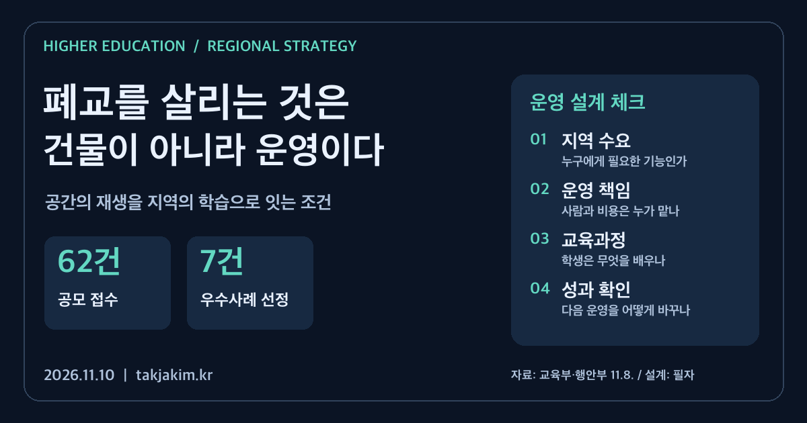

학교가 문을 닫은 뒤 그 건물에 무엇을 넣을 것인가. 전시관, 체험관, 돌봄시설을 떠올릴 수 있다. 그런데 시설 이름을 정하고 개관식을 치르는 일보다 어려운 것은 그다음이다. 다음 달에도 주민이 찾아올 이유가 있는지, 프로그램을 맡을 사람이 있는지, 운영비를 누가 부담하는지를 정해야 한다.

교육부와 행정안전부가 **11월 8일 발표한 폐교 활용 우수사례 7건**은 이 문제를 구체적으로 보여준다. 고양이 보호·분양센터부터 생태교육, 한지체험, 천문과학, 양봉산업, 미디어아트까지 활용 방식은 서로 다르다. 공통으로 읽을 지점은 빈 교실을 채웠다는 사실보다 지역의 수요와 운영 주체를 연결하는 방식이다.

<figure class="note-cover-figure">
  
  <figcaption>교육부·행정안전부 2026년 11월 8일 보도자료를 바탕으로 만든 자체 제작 전략 카드. 운영 설계 단계는 필자의 제안이다.</figcaption>
</figure>

## 오늘의 핵심

- 양 부처가 공동으로 처음 개최한 폐교 활용 우수사례 경진대회에는 **62건이 접수됐고, 최종 7건이 선정**됐다. 노력도·독창성·협력성·효과성·확산 가능성을 평가했으며 국민·현장 의견도 반영했다.[공식자료](#sources)
- 국무총리상은 통영의 한산초 용호분교를 활용한 공공형 고양이 보호·분양센터에 돌아갔다. 교육부 장관상 3건과 행정안전부 장관상 3건도 선정됐다. 지원액은 국무총리상 1억 원, 장관상은 사업별 4천만 원이다. 이는 **이번 선정사업에 대한 지원**이지 모든 폐교 사업의 일반 지원 단가가 아니다.
- 대학전략 관점에서는 이 사례를 대학의 지역연계 교육에 적용해 볼 수 있다. 다만 이번 발표는 초·중학교 폐교 활용에 관한 것이다. **대학 참여사업이나 폐교대학 재산 활용사업이 확정됐다는 뜻은 아니다.** 이 글의 대학 연계 방안은 별도의 운영 제안이다.

## 왜 대학전략 관점에서 중요한가

지역대학이 지역사회와 연결되는 방법은 새 건물을 짓는 것만이 아니다. 이미 있는 공간에 대학의 교육·연구·평가 역량을 보탤 수도 있다. [[지역사회 연계 교육]]을 운영할 때 지역에 지속적으로 열리는 현장이 있다면 학생이 실제 이용자와 만나고, 한 학기의 과제를 다음 학기로 이어갈 여지가 생긴다.

그렇다고 폐교를 대학의 실습장으로 선언하면 끝나는 것은 아니다. 주민이 이용하던 공간에 학생 일정만 우선하면 갈등이 생긴다. 기존 운영기관의 목적과 안전 기준, 주민의 이용권을 먼저 확인해야 한다. 대학은 공간의 주인이 아니라 필요한 기능을 함께 설계하는 협력자가 될 수 있다.

이번 자료에서 통영 사례는 주민 제안에서 출발해 교육지원청·지방정부·민간·전문기관의 협력으로 이어졌다고 설명한다. 부안의 한지체험관은 교내 자생 닥나무와 전통문화 교육을 연결하고, 임실생태누리는 주변 하천·숲을 교육 자원으로 활용한다. 지역에 원래 있던 자원을 교육 내용으로 바꾸었다는 점이 눈에 들어온다.

대학컨설팅에서 살펴볼 질문도 비슷하다. 대학이 제공할 전공 역량이 그 지역의 실제 수요와 맞는가. 매년 다른 사업명을 붙이는 대신 한 장소에서 교육의 질을 축적할 수 있는가. [[대학 운영모델]]은 캠퍼스 내부의 조직도뿐 아니라 이런 외부 협력의 책임 구조까지 포함해야 한다.

## 정책·교육과정·지역연계 포인트

### 시설 개수보다 기능의 조합

선정 사례를 하나의 성공 공식으로 묶기는 어렵다. 공식자료에 제시된 주요 기능만 비교해도 차이가 뚜렷하다.

| 사례 | 공식자료에서 확인한 기능 | 대학이 연계를 검토할 때 물을 질문 |
| --- | --- | --- |
| 통영 공공형 고양이 보호·분양센터 | 보호·치료·입양, 생태교육과 방문객 교류 | 동물복지와 주민 이용을 해치지 않는 교육 참여 범위는 어디까지인가 |
| 임실생태누리 | 폐교와 하천·숲을 연결한 생태교육 | 현장 관찰을 어떤 학습과제로 만들고 계절별로 누가 지도할 것인가 |
| 부안 콩닥콩닥 | 닥나무를 활용한 한지·역사·체험교육 | 지역 강사의 경험을 교육자료로 남기고 함께 개선할 수 있는가 |
| 단양 팝스월드 다자구할미네 | 설화와 AI·XR 등을 접목한 미디어아트 체험 | 콘텐츠 갱신, 이용자 접근성, 유지보수의 책임은 어떻게 나뉘는가 |

마지막 열은 선정사업의 확정 계획이 아니라 대학의 협력 검토 질문이다. 대학의 전공 이름을 시설에 붙이기 전에 현장의 업무와 필요한 역량부터 확인하는 편이 낫다.

### 소유와 운영을 나누면 책임도 구체화해야 한다

단양 사례의 사업명에는 소유와 경영의 분리가 명시돼 있고, 자료는 단양군과 민간기업의 협력을 소개한다. 이것이 모든 지역에 적합한 계약 방식이라는 뜻은 아니다. 다만 공간을 보유하는 주체와 매일 프로그램을 운영하는 주체가 다를 수 있다는 점은 참고할 만하다.

[[민관협력]]을 검토한다면 계약기간, 수선비, 공공 이용시간, 요금, 안전사고 대응, 운영 종료 시 자료와 시설의 인계 조건을 함께 봐야 한다. 공개된 보도자료만으로 개별 사례의 계약조건이나 수익성을 평가할 수는 없다. 눈에 잘 띄는 개관 성과와 장기 운영의 건전성은 구분해야 한다.

### 체험을 교육과정으로 바꾸는 일

대학이 참여한다면 일회성 봉사나 견학에서 한 걸음 더 나아갈 수 있다. 예를 들어 생태교육 공간에서는 학생이 방문객의 관찰 활동을 설계하고, 실제 반응을 수집해 안내자료를 수정하는 과제를 생각해 볼 수 있다. 한지체험 공간에서는 지역 강사와 함께 학습자 연령에 맞는 활동 순서와 설명자료를 개발할 수 있다.

이는 특정 전공의 참여나 신규 교과 개설이 확인됐다는 이야기가 아니다. [[교육과정 개발]]의 관점에서 가능한 설계 예시다. 학점이 있는 [[서비스러닝]]으로 운영하려면 수업 목표, 현장 지도, 평가 기준, 이동·보험·안전 조건이 먼저 정해져야 한다. 학생의 무급 노동으로 시설 인력 부족을 메우는 방식과는 선을 그어야 한다.

## 학생·학부모가 확인할 것

지역연계 프로그램이라는 이름만으로 교육의 질을 판단하기 어렵다. 대학이 이런 현장과 연계한 과목을 실제로 공고한다면 다음 내용을 확인할 수 있다.

1. **누가 가르치고 평가하는가.** 대학 담당교원과 현장 지도자의 역할이 구분돼 있는가.
2. **학생이 무엇을 직접 하는가.** 단순 안내 인력인지, 조사·설계·개선 과제를 수행하는지 살펴본다.
3. **시간과 비용은 어떻게 처리되는가.** 이동 시간, 교통비, 보험, 필수 실습과 선택 활동의 경계를 확인한다.
4. **어떤 결과물을 남길 수 있는가.** 이용자 개인정보나 기관 자료를 침해하지 않는 범위에서 [[학생 포트폴리오]]를 만들 수 있는지 본다.
5. **참여 이후 무엇이 이어지는가.** 다음 교과목·프로젝트나 진로 탐색과 연결되는지 확인하되, 참여 자체를 취업 보장으로 받아들이지 않는다.

## 대학컨설팅 관점에서 보는 전략

### 새 공간보다 한 학기의 운영계획부터

처음부터 상설 대학 거점을 만들기보다 기존 운영기관과 한 학기 단위의 작은 협력을 검토할 수 있다. 주민 수요 하나, 학생 과제 하나, 현장 지도자와 담당교원, 필요한 비용을 적어 보는 것이다. 운영기관이 학생을 받아들일 여력이 없는 경우에는 협력 규모를 줄이거나 시작하지 않는 판단도 필요하다.

학기 말에 전시할 결과물만 정하면 과정이 빠진다. 준비 교육, 현장 활동, 중간 피드백, 수정 작업, 종료 후 인계까지 학사일정에 들어가야 한다. 시설 운영 일정과 대학 방학이 어긋날 때 누가 프로그램을 이어갈지도 중요한 문제다.

### 방문객 수를 교육성과로 바꾸어 읽지 않기

보도자료 붙임에는 방문객 수, 체험 인원, 만족도, 투자액 등 사례별 성과가 제시돼 있다. 수치의 집계 기간과 성격이 달라 이를 단순 순위로 비교해서는 안 된다. 방문객이 늘었다는 사실만으로 학생의 역량 향상이나 [[지역정주]] 효과가 입증되는 것도 아니다.

대학이 참여할 경우에는 기존 시설의 성과와 대학 교육의 성과를 나누어 기록해야 한다. 학생 수행물의 질, 현장 피드백 반영 여부, 주민의 재참여, 운영 인력의 추가 부담 등을 함께 확인할 수 있다. 이런 항목은 정부의 확정 지표가 아니라 협력의 질을 확인하기 위한 제안이다.

### 성과를 다음 운영의 수정 근거로 쓰기

[[성과환류]]는 우수사례집에 실리는 것으로 끝나지 않는다. 이용자가 어려워한 설명을 고쳤는지, 위험했던 동선을 바꿨는지, 지도 시간이 부족해 과제 범위를 조정했는지를 남기는 일이다. 시작할 때부터 누가 어떤 기록을 보고 무엇을 바꿀지 정해야 한다.

이번 선정은 지역마다 서로 다른 기능을 가진 폐교 활용 사례가 있다는 것을 보여준다. 그러나 대학이 가져올 것은 시설의 외형이나 사업명이 아니다. **지역에 필요한 기능을 먼저 정하고, 그 기능을 계속 제공할 사람과 비용을 연결하는 운영 방식**이다. 대학의 교육과정이 여기에 책임 있게 참여할 때 지역연계는 행사 목록보다 오래 남을 수 있다.

<h2 id="sources">확인한 출처</h2>

1. [교육부·행정안전부, 「폐교의 새로운 시작, 지역의 가능성을 열다」](https://www.moe.go.kr/boardCnts/viewRenew.do?boardID=294&boardSeq=107592&lev=0&searchType=null&statusYN=W&page=1&s=moe&m=020402&opType=N), 2026.11.8. 보도. 교육부 게시일, 첨부 HWPX 본문 및 선정사업별 개요에서 접수·선정 건수, 평가 항목, 지원 규모와 사례별 운영 내용을 확인했다.

*확인 기준: 2026년 11월 10일 오전, 한국시간. 이번 공식 발표는 초·중학교 폐교 활용 사례에 관한 것이며 대학 참여를 확정한 자료가 아니다. 대학 교육과정 연계, 계약 검토사항과 성과관리 방안은 필자의 대학경영·교육과정 관점 제안이다.*
