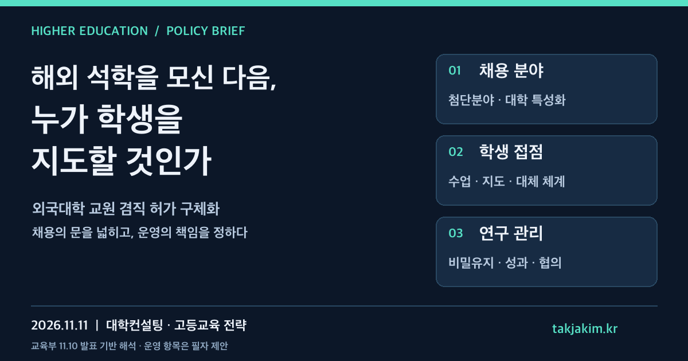

해외 석학을 초빙했다는 소식은 대학의 경쟁력을 설명하기 좋은 문장이다. 그러나 학생에게 더 중요한 질문은 따로 있다. **그 교수에게 언제 수업을 듣고, 어떤 연구 지도를 받으며, 약속한 지도가 어려워지면 누구에게 도움을 요청할 수 있는가.**

교육부는 11월 10일 「교육공무원 임용령」 일부개정령안이 국무회의에서 심의·의결됐다고 밝혔다. 외국대학 교원이 국내대학에 임용된 뒤 원래 외국대학의 교원도 겸직할 수 있도록, 허가 가능한 분야와 절차·기준을 구체화하는 내용이다. 해외 인재를 유치할 통로가 넓어지는 소식이지만, 대학경영에서는 채용 공고보다 그다음의 운영 설계가 더 오래 남는다.[교육부 공식자료](#sources)

<figure class="note-cover-figure">
  
  <figcaption>교육부 2026년 11월 10일 보도자료를 바탕으로 제작한 전략 카드. 학생 접점과 운영 점검 항목은 필자의 제안이며 법정 의무시간이나 정부 평가기준을 뜻하지 않는다.</figcaption>
</figure>

## 오늘의 핵심

- 이번 개정안은 모든 교원에게 모든 겸직을 허용하는 조치가 아니다. **국내대학에 임용된 외국대학 교원의 외국대학 교원 겸직**에 관한 특례를 구체화한 것이다.
- 허가 가능 분야로 인공지능·빅데이터 등 첨단산업 등 분야와 대학이 정하는 특성화 분야가 제시됐다. 대학의 장은 대학인사위원회 심의를 거쳐 허가해야 한다.
- 심의에는 허가 필요성, 비밀 준수 의무, 연구성과 관리, 학생의 교육·지도와 학문 연구에 지장이 없도록 필요한 사항 등이 포함된다. 대학이 준비할 것은 유명 연구자의 명단만이 아니라 이 항목을 실제로 확인할 운영 자료다.

교육부 설명에 따르면 관련 「교육공무원법」 개정은 2026년 5월 19일 이루어졌다. 이번 발표는 그 법률에서 위임한 사항을 시행령으로 구체화하는 단계다. 또한 「사립학교법」 제55조 제1항의 복무 규정 준용에 따라 사립대학에도 해당 특례를 적용할 수 있다고 안내했다. 다만 **국무회의 통과를 곧바로 모든 대학의 채용·겸직 허가 완료나 특정 시행일로 읽어서는 안 된다.** 실제 적용 전에는 공포 법령, 시행일, 대학별 인사규정과 허가 절차를 확인해야 한다.[교육부 공식자료](#sources)

## 왜 대학전략 관점에서 중요한가

해외 연구자가 기존 대학과의 관계를 끊지 않고 국내대학에 참여할 수 있다면, 대학은 인재 확보의 선택지를 넓힐 수 있다. 특히 [[대학 특성화]] 분야에 필요한 연구·교육 역량이 내부에 부족할 때 의미가 있다. 그러나 해외 소속이 있다는 사실만으로 국내 학생의 학습경험이 좋아지는 것은 아니다. 국내 학과의 교육과정과 연구실 운영에 어떤 변화가 생기는지를 설명해야 한다.

대학컨설팅에서 먼저 확인할 것은 채용의 목적이다. 대학 전체의 국제적 인지도를 높이려는 것인지, 특정 연구 분야를 강화하려는 것인지, 대학원생 지도 역량을 보완하려는 것인지에 따라 계약과 지원 방식이 달라진다. 여러 목적이 함께 있을 수는 있다. 다만 어느 목적도 구체적 책임으로 번역되지 않으면, 초빙은 기관의 성과이고 지도 공백은 학생의 문제가 되는 불균형이 생긴다.

[[교원 겸직]] 허가는 이 문제를 인사부서에만 맡겨 둘 수 없게 한다. 인사위원회는 허가를 심의하지만, 실제 수업은 학과가 편성하고, 연구지원 부서는 과제를 관리하며, 학생 지도는 지도교수와 대학원이 맡는다. 허가 당시의 약속을 누가 확인하고 갱신할지까지 연결해야 제도가 작동한다.

## 정책·교육과정·지역연계 포인트

### 채용 분야는 대학의 기존 전략과 맞물려야 한다

첨단분야라는 이유만으로 서로 다른 대학이 비슷한 분야의 교원을 초빙하면, 대학별 특성화의 설명력은 오히려 약해질 수 있다. 초빙 분야를 고를 때는 기존 교수진, 실험·실습 장비, 지역 기업의 문제, 학생이 이수할 교과목을 함께 놓고 봐야 한다.

예를 들어 지역 기업과 추진하는 AI 프로젝트가 있다면, 해외 교원의 역할은 특별강연 한 번으로 끝나기보다 프로젝트의 연구 질문을 검토하거나 학생 결과물에 피드백을 주는 방식으로 구체화할 수 있다. 이는 이번 발표에 포함된 특정 대학의 확정 계획이 아니라, [[산학협력]]과 인재 유치를 연결하기 위한 운영 제안이다. 지역연계는 해외 교원의 이름을 협약서에 더하는 일이 아니라 지역 현장의 문제에 새로운 전문성을 투입하는 일에 가깝다.

### 교육과정에는 학생이 실제로 접근할 수 있는 접점이 필요하다

방문 일정이 정해지기 전에는 강의를 시간표에 넣기 어렵다. 온라인으로 지도한다면 시차, 피드백 주기, 연구실의 일상 지도를 맡을 국내 교원도 정해야 한다. 학부 강의와 대학원 연구지도는 운영 조건이 다르므로 같은 참여 방식으로 묶지 않는 편이 낫다.

학생이 수행한 과제와 지도 내용을 [[학생 포트폴리오]]에 남기는 방법도 생각해 볼 수 있다. 다만 연구 데이터나 기업 과제가 포함됐다면 공개 가능한 범위를 먼저 정해야 한다. 유명 교수의 지도를 받았다는 소개 문구보다, 학생이 어떤 문제를 풀었고 어떤 피드백으로 결과물을 고쳤는지가 학습의 증거가 된다.

### 연구성과는 채용 뒤가 아니라 채용 전에 협의해야 한다

교육부는 인사위원회의 심의 사항에 비밀 준수와 연구성과 관리를 명시했다. 이를 실무로 옮기려면 [[연구성과 관리]]의 범위를 구체화할 필요가 있다. 논문의 소속 표기, 연구 데이터 접근 권한, 지식재산권, 기업 협력과제의 비밀유지, 양 대학의 규정 충돌 가능성 등을 사전에 확인하는 식이다.

이 항목들은 본문에서 제안하는 협의 의제이지, 보도자료가 각각의 처리 방식을 확정했다는 뜻은 아니다. 국내대학의 겸직 허가가 상대 외국대학의 내부 승인까지 대신하지도 않는다. 연구지원·산학협력·법무 담당자가 필요한 경우 함께 검토하고, 상대 대학과 확인할 사항을 구분해 두는 편이 안전하다.

## 학생·학부모가 확인할 것

초빙 소식이 관심 대학의 강점이 될 수는 있다. 다만 다음 질문의 답이 확인될 때 그 강점이 학생의 실제 기회로 이어진다.

| 확인할 질문 | 대학에 요청할 구체적 정보 |
| --- | --- |
| 누가 참여할 수 있는가 | 해당 학과·학년, 신청 자격, 선발 방식 |
| 실제 수업이나 지도를 받을 수 있는가 | 개설 교과목, 지도 방식, 방문·온라인 참여 일정 |
| 연구 참여가 중단되면 어떻게 되는가 | 국내 공동지도 또는 대체지도 체계, 상담 창구 |
| 성과가 학생에게 어떻게 남는가 | 학점 인정 여부, 과제 결과물, 공개·활용 가능 범위 |

해외 교원 초빙이 곧 해외대학 입학이나 취업으로 연결된다고 해석해서는 안 된다. 공동학위나 파견·인턴십도 별도 제도와 협약을 확인해야 한다. 이번 개정안은 그러한 학생 혜택을 일괄 보장하는 발표가 아니다.

## 대학컨설팅 관점에서 보는 전략

대학에는 겸직 허가 신청서와 별도로 **학생 접점과 운영 책임을 한눈에 보는 실행계획**을 제안하고 싶다. 새로운 서류를 많이 만들자는 뜻이 아니다. 이미 인사·학과·연구지원 부서에 흩어진 정보를 한 장에서 맞추자는 것이다.

| 운영 항목 | 채용·허가 전에 합의할 내용 | 운영 중 확인할 증거 |
| --- | --- | --- |
| 특성화 기여 | 기존 학과·연구실의 어떤 부족을 보완할지 | 공동 운영 교과·과제와 기존 전략의 연결 |
| 학생 교육·지도 | 참여 대상, 방식, 일정, 국내 협력 교원 | 실제 지도 기록, 학생 피드백, 대체지도 이행 |
| 연구 협력 | 데이터·성과·비밀유지 관련 협의 범위 | 규정 충돌과 승인 누락 여부, 협업 진행 기록 |
| 지속가능성 | 행정 지원, 재원, 계약 종료 시 인계 | 학생의 학습·연구 연속성, 후속 운영 가능성 |

이 표는 정부의 평가표가 아니라 대학 운영을 위한 제안이다. [[실행지표]]도 같은 원리로 골라야 한다. 초빙 인원은 인재 확보 규모를 설명하지만, 학생의 교육·지도에 지장이 없는지를 단독으로 설명하지 못한다. 예정한 지도가 실제로 제공됐는지, 참여 학생에게 접근 기회가 있었는지, 문제가 생겼을 때 조정이 이루어졌는지를 함께 봐야 한다.

그 결과를 다음 학기의 수업과 다음 계약에 반영하는 것이 [[성과환류]]다. 초빙 성과를 연말 보도자료에만 남기지 않고, 학생 접점이 부족했다면 일정이나 역할을 조정하고, 특성화 기여가 불명확했다면 채용 목적부터 다시 확인하는 방식이다.

해외 석학 유치의 문이 넓어지는 것은 반가운 변화다. 대학의 실력은 그 문을 통과한 이름의 수보다, 그 전문성이 학생에게 닿도록 만드는 운영에서 드러날 것이다.

<h2 id="sources">확인한 출처</h2>

- [교육부, 「교육공무원 임용령」 일부개정령안 국무회의 통과](https://www.moe.go.kr/boardCnts/viewRenew.do?boardID=294&boardSeq=107610&lev=0&searchType=null&statusYN=W&page=1&s=moe&m=020402&opType=N), 2026.11.10. 게시·배포. 첨부 HWPX의 보도자료 본문에서 개정 취지, 관련 법률 개정일, 허가 가능 분야, 대학인사위원회 심의 사항, 사립대학 적용 설명을 확인했다. 이 글은 발표된 정책 내용을 해석한 것이며 개별 대학의 실제 채용 성과나 학생 혜택을 확인한 사례 보고가 아니다.
