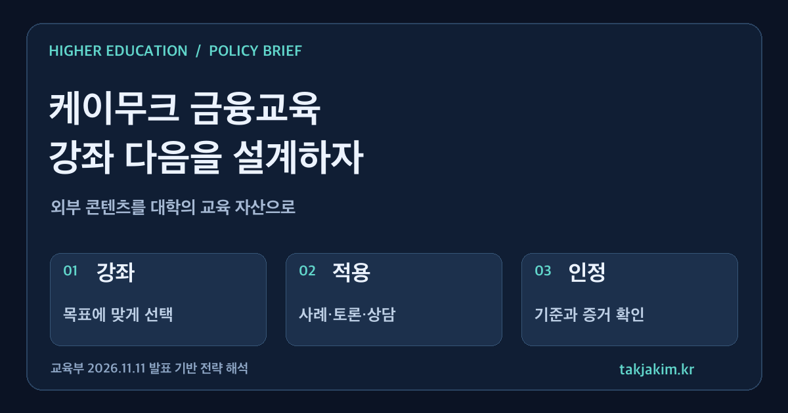

청년에게 금융교육이 필요하다는 데 동의하는 것은 어렵지 않다. 대학이 답해야 할 질문은 그다음이다. 신용관리 강연을 들은 학생이 자신의 부채와 계약을 더 잘 판단하게 됐는지, 온라인 이수가 교양교육이나 학생지원 체계와 어떻게 연결되는지까지 누가 책임질 것인가.

교육부가 11월 11일 발표한 케이무크 연계 청년 경제·금융 소통 강연회는 이 질문을 꺼낼 만한 계기다. 이번 발표를 대학의 관점에서 읽으면, 외부의 좋은 강좌를 소개하는 일과 학생의 배움을 설계하는 일이 얼마나 다른지가 드러난다.

<figure class="note-cover-figure">
  
  <figcaption>교육부 2026년 11월 11일 보도자료를 바탕으로 직접 제작한 전략 도식. 강좌·적용·인정은 이 글의 분석 틀이며 정부가 발표한 별도 사업 모형은 아니다.</figcaption>
</figure>

## 오늘의 핵심

교육부와 국가평생교육진흥원은 11월 24일 서울, 11월 28일 경기 하남에서 청년 경제·금융 소통 강연회를 개최한다고 밝혔다. [[케이무크|K-MOOC]]는 대학 수준의 강좌를 누구나 온라인에서 무료로 수강할 수 있도록 제공하는 사업이다. 이번에는 대면 강연을 온라인 강좌로도 제작해 상시 제공할 계획이다.

- **11월 24일:** 서울 강서구 어울림플라자에서 신용관리와 금융사기 예방을 다룬다. 강연은 14~17시, 서민금융진흥원의 현장 재무상담은 13~17시에 운영할 예정이다. 모집 규모는 120명 내외, 신청 기간은 11월 11~20일이다.
- **11월 28일:** 경기 하남시 카페 라누벨에서 한국경제의 구조와 미래를 주제로 강연과 질의응답을 진행한다. 시간은 14~17시, 규모는 100명 내외, 신청 기간은 11월 6~17일이다.
- **온라인 확장:** 경제·금융뿐 아니라 AI, 기초과학, 첨단기술, 인문학 등 신규 강좌를 11월 말부터 순차 공개한다. 이수증 또는 디지털증명서를 발급하며, 대학생의 학점 인정은 소속 대학의 기준에 따른다.

여기까지는 발표에서 확인한 사실이다. 아래의 교양교육 편성, 지역 연계, 성과관리 방안은 이 발표를 바탕으로 한 대학컨설팅 관점의 제안이다. 모든 대학에 의무적으로 적용되는 새 제도가 발표된 것은 아니다.

## 왜 대학전략 관점에서 중요한가

대학은 이미 외부에서 만들어진 양질의 학습 자원을 활용할 수 있다. 그런데 강좌를 가져오는 것만으로 교육과정이 만들어지지는 않는다. 어떤 학생에게 무엇을 권할지, 기존 수업과 무엇이 겹치는지, 어느 수준의 수행을 요구할지에 대한 판단이 남는다.

교육부가 이번 자료에서 인용한 **2025년 대학의 케이무크 강좌 학점인정 현황 조사**에 따르면, 총 141개 대학에서 3,120개 강좌 중 1,320개 강좌의 이수 결과를 정규 학점으로 인정했다. 자료가 제시한 비율은 42.3%다. 이는 조사에서 제시한 강좌 기준의 수치이지, 전국 대학생의 42.3%가 학점을 인정받았다는 뜻이 아니다. 이를 2026년 현재의 전국 대학 참여율로 읽어서도 안 된다.

이 수치가 던지는 전략적 질문은 인정률을 무조건 높이자는 것이 아니다. **우리 대학은 어떤 외부 학습을, 어떤 교육목표에 맞춰, 어떤 증거를 보고 인정할 것인가.** [[학점인정]]을 행정상의 예외 처리로만 두면 학생은 수강 이후에야 인정 가능 여부를 알게 된다. 반대로 사전 안내와 평가 기준을 갖추면 외부 강좌는 대학의 교육 역량을 보완하는 자원이 된다.

## 정책·교육과정·지역연계 포인트

### 금융지식을 학생의 실제 의사결정과 연결하기

금융교육을 투자 수익률을 높이는 요령으로 좁히면 이번 발표의 취지를 놓친다. 신용점수, 연체, 대출·부채 관리, 금융사기 예방은 취업 준비와 독립생활을 시작하는 학생에게 필요한 생활 역량이다.

대학은 [[금융 리터러시]]를 교양교육, 진로교육, 학생상담 가운데 어디에 배치할지 정할 수 있다. 중요한 것은 부서 명칭보다 학습 과제다. 예컨대 가상의 대출 조건을 비교하고, 의심스러운 금융 권유의 위험 신호를 설명하고, 상담이 필요한 상황에서 공적 지원 경로를 찾게 할 수 있다. 실제 개인의 채무나 신용정보를 과제로 제출하게 할 필요는 없다.

이런 설계는 [[역량기반 교육과정]]의 관점과도 맞닿는다. 강좌를 들었다는 기록과 일상에서 판단할 수 있다는 증거를 구분해야 하기 때문이다.

### 온라인 강좌와 대면 지원의 역할을 나누기

이번 발표에는 온라인 콘텐츠뿐 아니라 대면 질의응답과 맞춤형 재무상담이 함께 들어 있다. 대학이 참고할 대목이다. 공통 지식은 온라인으로 배우고, 이해가 어려운 부분이나 개별 상황은 사람과의 상호작용으로 보완할 수 있다.

이를 [[혼합학습]]으로 운영한다면 온라인 수강을 단순한 사전 숙제로 끝내지 않아야 한다. 짧은 사례 토론과 적용 과제를 붙이고, 전문 상담이 필요한 학생은 적절한 기관으로 연결하는 방식이 가능하다. 교수학습지원 조직은 학습 설계를, 학생지원 조직은 상담 연계를, 학사 조직은 인정 기준을 맡는 식으로 역할을 정할 수 있다.

다만 대학이 금융상품을 추천하거나 개별 투자 판단을 대신하는 구조와는 선을 그어야 한다. 교육과 상담의 범위, 외부기관의 책임, 민감정보 처리 기준을 먼저 합의하는 편이 안전하다.

### 지역 연계는 기관 수보다 지원 경로로 보기

공식 발표의 두 예정 행사는 서울·경기에서 열린다. 이를 전국 지역대학에 동일한 현장 상담 사업이 이미 마련됐다는 뜻으로 확대해서는 안 된다.

지역대학이 응용할 수 있는 부분은 운영 방식이다. 지역의 공공 금융지원기관이나 청년지원 조직과 협력해 온라인 학습 이후의 질문과 상담을 연결할 수 있다. 이때 협약기관 수보다 학생이 실제로 이용할 수 있는 절차가 중요하다. 담당 창구, 예약 방법, 이용 대상, 상담 후 연계 기준이 있어야 한다. 대학의 [[평생교육]] 기능을 재학생뿐 아니라 졸업 초기 청년에게 확장하는 방안도 검토할 수 있다.

## 학생·학부모가 확인할 것

먼저 본인에게 필요한 내용이 신용·부채 관리인지, 금융사기 예방인지, 거시경제 이해인지 구분하는 것이 좋다. 두 행사는 주제와 신청 마감일이 다르다. 참여를 원한다면 [케이무크 누리집](https://www.kmooc.kr/)의 실제 모집 안내에서 대상, 잔여 정원, 신청 절차와 변경 사항을 확인해야 한다. 발표의 모집 규모가 현재 접수 가능한 인원을 뜻하지는 않는다.

학점이 필요하다면 수강 전에 소속 대학의 담당 부서에 물어야 한다. 이수증이나 [[디지털 배지]]를 받는 것과 정규 학점을 인정받는 것은 다른 절차다. 인정 가능 강좌, 신청 시점, 제출 서류, 중복 인정 제한을 미리 확인할 필요가 있다.

배운 내용을 [[학생 포트폴리오]]로 남기고 싶다면 수료 화면만 저장하기보다 자신의 판단이 어떻게 달라졌는지 짧은 사례로 기록해 보는 편이 낫다. 개인정보를 공개하지 않고도 금융사기 의심 상황을 판별한 근거나 가상 예산의 우선순위를 설명할 수 있다. 이런 기록이 취업이나 특정 자격의 효력을 자동으로 보장하는 것은 아니다.

## 대학컨설팅 관점에서 보는 전략

대학이 당장 해야 할 일은 비슷한 강좌를 또 만드는 것이 아닐 수 있다. 이미 있는 자원을 교육과정 안에서 어떻게 쓰는지 정리하는 것부터 시작할 수 있다.

| 운영 과제 | 먼저 정할 사항 | 확인할 증거 |
| --- | --- | --- |
| 강좌 선택 | 학생 집단과 교육목표에 맞는 외부 강좌 목록 | 기존 교과와의 중복·보완 관계 |
| 학습 지원 | 온라인 학습 후 토론·상담·사례 적용 방식 | 학생의 사례 판단과 질문 기록 |
| 학사 연계 | 수강 전 안내와 학점 인정 절차 | 학생에게 공개된 기준과 처리 경로 |
| 협력 운영 | 외부 전문가·기관의 역할과 책임 | 상담 범위, 개인정보 보호, 후속 연계 |
| 개선 | 다음 학기 편성에 반영할 항목 | 이수 과정의 어려움과 학습 결과 |

성과를 수강 신청자 수로만 관리하면 콘텐츠 배포 사업에 머물기 쉽다. [[성과환류]]를 하려면 어느 사례에서 오답이 많았는지, 어느 단계에서 이탈했는지, 상담 경로를 몰라 이용하지 못한 학생은 없는지 살펴야 한다. 개인의 실제 재무 상태를 수집하지 않고도 이런 운영상의 문제는 확인할 수 있다.

이번 발표에서 대학이 가져올 가장 실용적인 힌트는 강좌의 제목보다 연결 구조다. **좋은 콘텐츠를 확보하는 일 다음에, 학생이 적용하고 도움을 요청하고 배움을 인정받는 경로를 설계해야 한다.** 그 경로가 있어야 외부의 공개강좌가 우리 대학의 교육 자산이 된다.

## 확인한 출처

- [교육부, 「교육부, EBS·금융감독원 등과 함께 케이무크로 청년 경제·금융 이해력 높인다」](https://www.moe.go.kr/boardCnts/viewRenew.do?boardID=294&boardSeq=107619&lev=0&searchType=null&statusYN=W&page=1&s=moe&m=020402&opType=N), 2026년 11월 11일 인터넷 보도. 본문과 첨부 보도자료의 행사 개요, 신규 강좌 목록, 2025년 학점인정 현황 수치를 확인했다. 행사 개최와 강좌 공개는 발표 시점의 계획이다.
- [케이무크 공식 누리집](https://www.kmooc.kr/): 개별 강좌와 행사 참여 정보를 확인하는 공식 경로. 이 글은 개별 신청 페이지의 현재 잔여 정원이나 대학별 학점 인정 여부까지 확인한 안내는 아니다.
