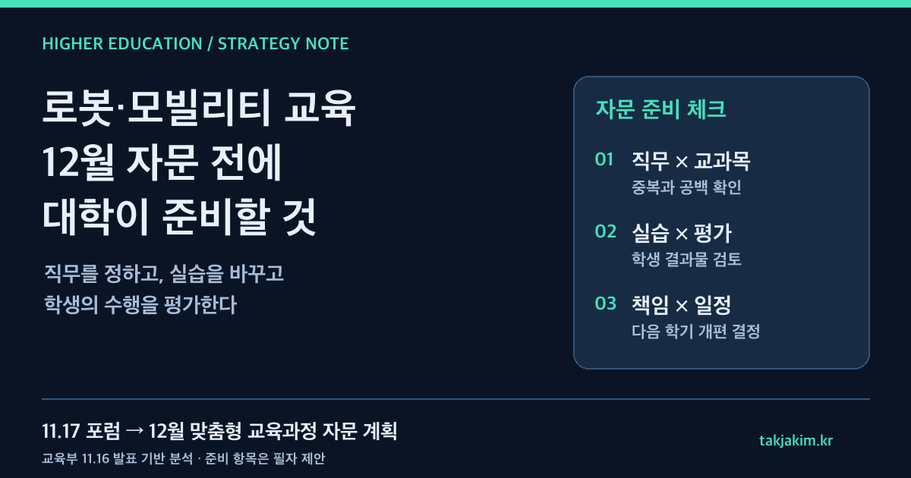

로봇 장비를 들여오고 모빌리티 전공을 신설하면 첨단산업 교육이 시작된다. 하지만 그것만으로 졸업생이 현장에서 무엇을 할 수 있는지 설명되지는 않는다. 대학이 다음으로 작성해야 할 문서는 장비 구매 목록보다 **학생에게 맡길 과제와 그 과제를 평가할 기준**에 가깝다.

교육부가 11월 16일 발표한 제3회 산업계 대학교육 혁신포럼은 이 간극을 점검할 계기다. 특히 눈여겨볼 대목은 행사 자체보다, 올해 포럼 주제를 바탕으로 **12월부터 대학의 교육과정 개편을 돕는 맞춤형 자문을 실시한다는 계획**이다. 대학컨설팅 관점에서 지금은 외부 전문가에게 무엇을 물을지 정리해야 할 시점이다.

<figure class="note-cover-figure">
  
  <figcaption>교육부 2026년 11월 16일 보도자료를 바탕으로 직접 제작한 분석 도식. 오른쪽 준비 항목은 필자의 제안이며 정부의 자문 신청 요건이나 공식 평가지표가 아니다.</figcaption>
</figure>

## 오늘의 핵심

교육부와 한국공학교육인증원은 11월 17일 대전 엑스포타워 유니콘라운지에서 ‘2026 제3회 산업계 대학교육 혁신포럼’을 개최한다고 밝혔다. 주제는 산업계가 바라보는 로봇·미래모빌리티 대학 교육이다. 이 글은 당일 아침 발표 계획을 읽는 글이며, 행사 종료 후의 합의나 성과를 확인한 결과 보고가 아니다.

- 기조 강연에서는 뉴로메카의 실물 인공지능 시대 로봇 자동화·인재양성 전략과 한국교통안전공단의 미래모빌리티 기술 동향·인재양성 전략을 다룰 예정이다.
- 로봇 분야 산업계 요구분석결과 종합보고서를 기반으로 한 주제 강연과 실습기반 콘텐츠 공유, 미래모빌리티 실무능력 논의가 예정돼 있다.
- 교육부와 한국공학교육인증원은 9월 인공지능, 10월 반도체·디스플레이, 11월 로봇·미래모빌리티 포럼의 주제를 바탕으로 12월부터 맞춤형 교육과정 자문을 실시할 계획이다.

보도자료에는 개별 대학의 자문 신청 기간, 선정 규모, 비용 부담, 세부 신청 절차가 제시돼 있지 않다. 자문이 예정됐다는 사실을 모든 대학의 참여 확정이나 신규 재정지원 공고로 확대해서 읽으면 안 된다. 아래의 준비 과제는 발표에서 확인한 사실과 구분한 전략 제안이다.

## 왜 대학전략 관점에서 중요한가

[지난 9월 인공지능공학 포럼을 읽은 글](/education/ai-curriculum-industry-forum/)에서는 산업 수요를 교육과정 운영에 반영하는 문제를 다뤘다. 이번 발표는 그 논의를 로봇·미래모빌리티로 넓히고, 교육과정 개편 자문이라는 후속 실행 계획을 명시했다는 점에서 한 걸음 더 나간다.

산업계 의견을 듣는 일과 교육과정을 바꾸는 일은 서로 다르다. 기업이 요구한 역량이 어느 교과목에서 형성되는지, 선수학습은 충분한지, 누가 실습을 지도하는지, 무엇을 보고 학생의 수행을 판단하는지를 정해야 실제 변화가 된다. 이 연결을 관리하는 것이 [[교육과정 거버넌스]]다.

외부 자문을 성과로 만들려면 대학 내부에도 판단 자료가 있어야 한다. 현재 교과목 목록만 가져가면 자문은 새로운 과목을 추천하는 수준에 머무르기 쉽다. 반면 학생 결과물, 실습 운영의 병목, 기업이 반복해서 지적한 수행 문제를 함께 가져가면 무엇을 줄이고 무엇을 바꿀지 논의할 수 있다.

**자문의 산출물은 보고서 한 권보다 다음 학기에 바뀔 과제 한 개가 먼저여야 한다.** 작은 변화라도 담당 교원, 실습 자원, 평가 방식, 개설 일정까지 정해져야 교육과정 개편이라고 부를 수 있다.

## 정책·교육과정·지역연계 포인트

### 1. 유행하는 기술 이름을 수행 가능한 직무로 바꾸기

피지컬 AI나 미래모빌리티는 범위가 넓다. 모든 대학이 같은 교육과정을 만들 필요는 없다. 지역기업의 생산설비 자동화, 로봇 운영·유지보수, 모빌리티 시험·검증 등에서 대학이 실제로 가르칠 수 있는 영역을 먼저 좁혀야 한다. 이는 이번 포럼이 확정한 직무 목록이 아니라, 대학별 검토를 위한 예시다.

[[직무역량]]을 적을 때도 ‘융합적 문제해결 능력’만으로 끝내지 않는 편이 좋다. 센서 데이터의 이상을 설명하고 원인을 검증할 수 있는가, 시험 조건과 결과를 재현 가능한 방식으로 기록할 수 있는가처럼 관찰 가능한 수행으로 풀어야 교과목과 평가가 연결된다.

### 2. 장비 도입과 반복 실습의 운영비를 함께 보기

비싼 장비 한 대가 학생 다수의 학습 기회를 보장하지는 않는다. 예약 가능 시간, 안전교육, 소모품, 지도 인력, 고장 대응, 팀별 실습 기회까지 계산해야 한다. 소프트웨어 모의실험과 실제 장비 실습을 어떻게 나눌지도 대학 여건에 따라 달라진다.

[[산학협력]] 역시 기업 이름을 확보하는 단계에서 멈추면 안 된다. 기업이 과제를 제공할지, 중간 검토에 참여할지, 최종 결과를 평가할지 역할을 나눠야 한다. 기술자료의 공개 범위와 학생 결과물의 활용 조건도 미리 정해야 한다. 학생이 취업 면접에서 설명조차 할 수 없는 결과물만 남는다면 학습과 진로의 연결이 약해진다.

### 3. 지역산업 연계를 교육 가능한 과제로 번역하기

교육부는 이번 포럼을 메가프로젝트와 ‘5극 3특 성장엔진 전략’ 등과 연계해 마련했다고 설명한다. 그렇다고 지역의 모든 산업 과제가 곧바로 학부 수업이 되는 것은 아니다. 기업의 문제를 학생 수준에 맞는 범위로 줄이고, 실패하더라도 배우는 과정이 남도록 설계해야 한다.

대학은 지역기업을 취업처 목록으로만 보지 말고 과제 설계와 검증의 협력자로 볼 필요가 있다. 기업도 즉시 쓸 수 있는 완제품만 기대하기보다 시험 기록, 오류 분석, 개선 제안처럼 교육에서 생산할 수 있는 결과를 합의해야 한다. 이 합의가 있어야 기업 참여가 특정 교수의 개인적 관계를 넘어 다음 학기에도 이어진다.

## 학생·학부모가 확인할 것

학과명에 로봇이나 모빌리티가 들어가는지만으로 교육의 질을 판단하기는 어렵다. 학교가 공개한 교육과정과 프로그램 안내에서 다음을 확인하는 편이 실질적이다.

- **이수 경로:** 기초 수학·프로그래밍·전공기초 이후 어떤 실습으로 이어지는가. 전공을 바꾸거나 복수전공으로 참여할 때 필요한 선수과목은 무엇인가.
- **참여 조건:** 기업 연계 프로젝트가 전원 대상인지 선발형인지, 추가 비용이나 시간 부담이 있는지 안내돼 있는가.
- **결과물:** 학생이 직접 수행한 역할, 시험·검증 과정, 개선 이력을 보여줄 수 있는가. [[학생 포트폴리오]]에 무엇을 남길 수 있는가.
- **진로 연결:** 참여기업이 있다는 설명과 채용 약정은 구분돼 있는가. 구체적 채용 조건이 없다면 취업이 보장된 것으로 해석하지 않는 것이 맞다.

현재 보도자료는 대학별 수강 조건이나 취업 성과를 제시하지 않는다. 특정 대학의 우열이나 취업 가능성을 이 발표 하나로 판단할 수는 없다.

## 대학컨설팅 관점에서 보는 전략

12월 자문을 준비하는 대학이라면 새로운 비전 문구보다 아래 자료를 먼저 모으는 편이 낫다. 공식 제출 양식이 아니라, 자문을 실제 의사결정으로 연결하기 위한 준비 묶음이다.

| 준비 자료 | 확인할 질문 | 자문 이후 남길 결정 |
|---|---|---|
| 현행 교과목·선수과목 연결도 | 중복과 공백은 어디인가 | 수정할 과목과 이수 순서 |
| 학생 과제·실습 결과물 | 학생이 실제로 어려워하는 수행은 무엇인가 | 과제와 평가 기준의 개편 |
| 기업 수요와 참여 가능 시간 | 기업은 무엇을 제공하고 검토할 수 있는가 | 과제 제공·피드백 역할의 합의 |
| 실습 자원·지도 인력 현황 | 반복 실습을 막는 병목은 무엇인가 | 운영 시간과 예산의 우선순위 |
| 다음 학기 개설·승인 일정 | 언제 누가 변경을 확정하는가 | 담당 조직과 실행 일정 |

성과는 협약 건수나 자문 횟수만으로 보지 않는 것이 좋다. 기업 피드백을 반영해 수정한 과제, 학생이 반복 수행한 실습, 기준에 따라 평가한 결과물처럼 교육의 변화를 보여주는 [[실행지표]]가 필요하다. 이후 학생 수행 결과와 기업 의견이 다음 학기 과제 수정으로 이어졌는지를 [[성과환류]]에서 확인해야 한다.

이 과정에서 특히 필요한 것은 [[산업계 요구분석]]의 번역이다. 기업이 필요하다고 말한 모든 기술을 교과목에 추가할 수는 없다. 대학의 교육목표, 학생의 기초 수준, 지역의 산업 수요를 함께 놓고 선택해야 한다. 자문이 대신해 줄 수 없는 대학 자신의 결정이다.

로봇과 모빌리티가 미래산업이라는 설명은 이미 충분하다. 이제 대학이 보여줘야 할 것은 **어떤 학생이 어떤 과제를 수행하고, 어떤 근거로 역량을 인정받는가**다. 12월의 외부 자문이 의미 있으려면, 그 질문부터 대학 안에 준비돼 있어야 한다.

## 확인한 출처

- [교육부, 「2026 제3회 산업계 대학교육 혁신포럼 개최」, 2026.11.16.](https://www.moe.go.kr/boardCnts/viewRenew.do?boardID=294&boardSeq=107669&lev=0&searchType=null&statusYN=W&page=1&s=moe&m=020402&opType=N) — 행사 일시·장소, 강연·토론 계획, 12월 맞춤형 자문 계획을 첨부 HWPX 본문까지 확인했다. 요구분석 보고서 원문이나 행사 후 결과자료를 검증한 것은 아니다.
