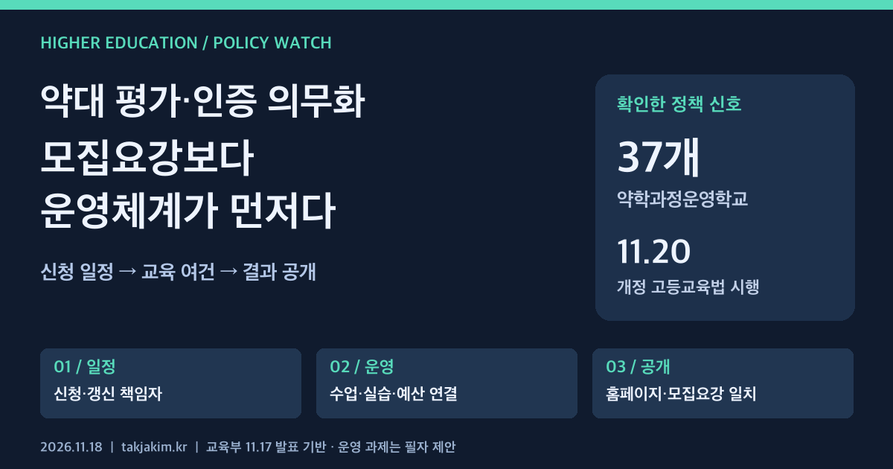

평가·인증을 준비하는 대학에서 가장 먼저 바뀌는 것은 서류 양식일 때가 많다. 하지만 약학교육의 평가·인증 의무화가 요구하는 변화는 서류를 더 잘 정리하는 일보다 크다. **인증 신청 일정, 실제 교육 여건, 학생에게 공개하는 정보가 서로 어긋나지 않도록 대학의 운영을 묶는 일**이다.

교육부는 11월 17일 「고등교육기관의 평가·인증 등에 관한 규정」과 「고등교육법 시행령」 일부개정령안이 국무회의를 통과했다고 밝혔다. 5월 개정된 고등교육법의 11월 20일 시행에 따른 후속 조치다. 오늘은 이 발표를 대학컨설팅 관점에서 읽는다. 특정 약대의 인증 상태나 위반 여부를 판정하는 글은 아니다.

<figure class="note-cover-figure">
  
  <figcaption>교육부 2026년 11월 17일 보도자료를 바탕으로 직접 제작한 전략 도식. 운영 과제는 필자의 제안이며 공식 인증기준이나 개별 대학의 평가 결과가 아니다.</figcaption>
</figure>

## 오늘의 핵심

교육부 보도자료와 첨부 개정령안에서 확인되는 변화는 다음과 같다.

- **약학 교육과정을 운영하는 학교도 인정기관의 평가·인증 절차와 결과 공개 의무의 적용을 받는다.** 교육부는 전국 37개 학교를 대상으로 설명했다.
- 새로 약학과정 운영을 시작하려는 학교는 개시 예정일 **1년 6개월 전부터 1년 3개월 전까지** 신청해야 한다. 이미 인증받은 학교의 갱신 신청은 유효기간 만료 2년 전 이내의 범위에서 인정기관이 정하는 기간에 이뤄진다. 인증받지 못한 학교의 재신청 역시 결과 통보일부터 1년 이내의 범위에서 인정기관이 정하는 기간을 따른다.
- 학교의 장은 통보받은 결과를 인터넷 누리집 등에 공개하고, **학년도마다 모든 학생모집 요강에도 공개**해야 한다.
- 평가·인증을 신청하지 않거나 받지 못하는 등 의무 위반에 대한 행정처분 기준을 마련했다. 교육부 설명은 **1차 위반 시 입학정원의 100% 범위에서 모집정지, 2차 위반 시 전공학과 등 또는 전문대학원 폐지 등**이다.

여기서 ‘100% 범위’를 곧바로 모든 사례의 일률적인 전원 모집정지로 바꿔 읽으면 안 된다. 또한 11월 20일 법 시행과 모든 대학의 인증 만료·신청일이 같은 날이라는 뜻도 아니다. 개별 대학은 인정기관의 일정과 적용 규정을 별도로 확인해야 한다. 이 글은 보도자료에서 확인되지 않은 학교별 유예기간이나 현재 인증 결과를 추정하지 않는다.

## 왜 대학전략 관점에서 중요한가

이번 변화는 [[교육의 질 보증]]을 학과의 평가 업무에만 맡기기 어렵게 만든다. 약대가 교육 여건을 설명하고, 대학 본부가 인력과 예산을 결정하며, 입학 부서가 모집요강을 만들고, 실습기관이 학생의 학습경험을 제공한다. 어느 한 부서의 준비만으로는 이 연결을 관리할 수 없다.

예를 들어 실습 자리가 부족하다는 문제가 확인됐는데도 예산 편성과 협력기관 조정이 다음 해로 미뤄지면, 평가보고서의 개선 계획은 학생의 실제 경험과 떨어진다. 반대로 교육 여건을 개선했더라도 인증 결과와 적용 기간이 모집요강에 정확히 반영되지 않으면 정보 공개의 신뢰가 흔들린다.

따라서 대학의 질문은 ‘누가 보고서를 쓸 것인가’에서 ‘누가 개선을 결정하고 언제 완료 여부를 확인할 것인가’로 옮겨가야 한다. [[교육과정 거버넌스]]와 재정 의사결정이 함께 움직여야 하는 이유다. 이는 인증이 곧 우수 취업이나 국가시험 합격을 보장한다는 주장과도 다르다. 제도의 요건을 충족하는 일과 개별 학생의 성과를 높이는 일은 연결돼 있지만 동일하지 않다.

## 정책·교육과정·지역연계 포인트

### 교육과정은 과목표가 아니라 학습의 증거로 설명한다

교과목을 갖췄다는 사실만으로 학생이 무엇을 할 수 있는지 알 수는 없다. 대학은 [[학습성과]]를 어느 수업과 실습에서 확인하고, 미달한 학생에게 어떤 보완 기회를 제공하는지 설명할 수 있어야 한다. 아래 제안은 정부가 이번 보도자료에서 새로 제시한 공식 인증항목이 아니라, 대학 내부의 준비를 위한 운영 관점이다.

약학교육에서는 이론 수업, 실험·실습, 현장 경험 사이에 학습이 이어지는지 점검할 필요가 있다. 과목별 성적을 모으는 데서 멈추지 말고, 학생의 수행 결과에서 반복되는 어려움을 찾아 수업과 지도에 반영해야 한다. 자료를 모으는 주체와 바꾸는 주체가 다르면 개선은 쉽게 멈춘다.

### 실습기관 협약은 수용 가능 인원과 지도 품질까지 본다

지역 약국·병원·관련 기관과의 협력은 교육의 중요한 기반이 될 수 있다. 다만 [[산학협력]] 협약 건수가 학생에게 제공되는 실습의 질을 대신하지는 못한다. 기관별 수용 인원, 지도자의 역할, 실습 중 문제 발생 시 연락 체계, 학생의 평가와 피드백을 함께 확인해야 한다.

이는 [[현장실습]]을 취업 홍보 사진이 아니라 교육과정의 일부로 보는 접근이다. 지역기관의 인력 사정만을 우선해 학생 배치를 결정하지 않고, 학생이 어떤 경험을 통해 역량을 쌓을지부터 설계해야 한다. 특정 기관과 협력한다는 이유만으로 채용이 보장되거나 지역에 정착할 것이라고 설명해서도 안 된다.

### 공개 정보는 하나의 원본에서 관리한다

인증 결과를 홈페이지와 모집요강에 각각 수작업으로 옮기면 버전이 달라질 수 있다. 대학 내부에 결과 통보 문서, 유효기간, 공개 문구, 수정 이력, 확인 책임자를 연결한 원본을 두는 편이 안전하다. 결과가 바뀌면 학과 소개 페이지와 입학 안내 자료도 함께 점검하는 절차가 필요하다.

## 학생·학부모가 확인할 것

학교를 살펴볼 때는 인증을 받았다는 짧은 문구보다 **언제의 결과이며 어느 기간과 과정에 적용되는지**를 확인하는 것이 좋다. 홈페이지 설명과 해당 학년도의 모집요강이 일치하는지도 볼 필요가 있다.

실습에 대해서는 협약기관 명단만 보기보다 실제 배정 방식, 지도 체계, 추가 비용, 학생의 문의 창구를 질문할 수 있다. 이 질문들은 특정 대학에 문제가 있다고 전제하는 것이 아니다. 공시와 홍보를 학생의 학습경험으로 번역하기 위한 확인이다.

이 글은 개별 학교의 인증 결과를 조사하지 않았다. 지원이나 진학 판단에는 학교가 공개한 최신 결과와 인정기관의 공지를 직접 확인해야 한다. 행정처분 기준의 신설을 재학생 전체의 학업 중단이나 졸업 자격 상실로 단정해서도 안 된다.

## 대학컨설팅 관점에서 보는 전략

대학 본부에는 다음과 같은 실행표를 권한다. 법령상의 제출서식이 아니라 내부 관리용 제안이다.

| 관리 과제 | 함께 확인할 부서·주체 | 완료를 판단할 자료 |
| --- | --- | --- |
| 신청·갱신 일정 관리 | 약대, 기획·교무, 인정기관 담당 창구 | 적용 일정과 담당자, 제출 준비 현황 |
| 교육 여건 개선 | 약대, 인사·재무, 실습기관 | 인력·실습 자원 확보와 예산 집행 내역 |
| 결과 공개 일치 | 약대, 입학, 홍보·웹 운영 | 통보 결과와 홈페이지·모집요강 대조 기록 |
| 개선 조치 추적 | 교육 질 관리 담당, 학과 운영 책임자 | 문제별 조치, 재점검 결과, 다음 학기 변경 사항 |

[[실행지표]]도 문서 작성량보다는 지연된 개선 과제, 필요한 실습 자리의 확보 상황, 공개 정보의 불일치 여부처럼 운영의 병목을 드러내는 쪽이 유용하다. 다만 수치를 만들기 위해 학생의 실습 경험을 단순 점수로 환원하지는 말아야 한다. 정량 자료와 학생·지도자의 설명을 함께 읽어야 한다.

궁극적으로 필요한 것은 [[성과환류]]다. 평가에서 발견한 문제를 예산과 교육과정에 반영하고, 바꾼 뒤 학생의 경험이 달라졌는지 다시 확인하는 순환이다. 인증 직전에 임시 조직을 꾸려 자료를 모으는 방식으로는 이 순환을 유지하기 어렵다.

**모집요강의 인증 문구는 마지막 출력물이다. 그 문구를 뒷받침하는 수업, 실습, 자원 배분, 공개 책임이 먼저 움직여야 한다.** 이번 법령 개정을 대학경영의 과제로 읽어야 하는 이유다.

## 확인한 출처

- [교육부, 「고등교육기관의 평가·인증 등에 관한 규정」 및 「고등교육법 시행령」 일부개정령안 국무회의 통과](https://www.moe.go.kr/boardCnts/viewRenew.do?boardID=294&boardSeq=107680&lev=0&searchType=null&statusYN=W&page=1&s=moe&m=020402&opType=N) — 2026년 11월 17일. 본문과 첨부 HWPX의 보도자료·개정령안에서 신청 절차, 결과 공개, 행정처분 기준을 확인했다. 같은 자료가 다루는 학생주거실태 조사는 이 글의 분석 범위에서 제외했다.

위 출처가 확인하는 것은 제도 변경과 정부의 설명이다. 대학 내부 실행표, 교육과정·실습 운영의 점검 방식은 이를 바탕으로 한 필자의 제안이며, 인정기관의 세부 평가기준을 대신하지 않는다.
