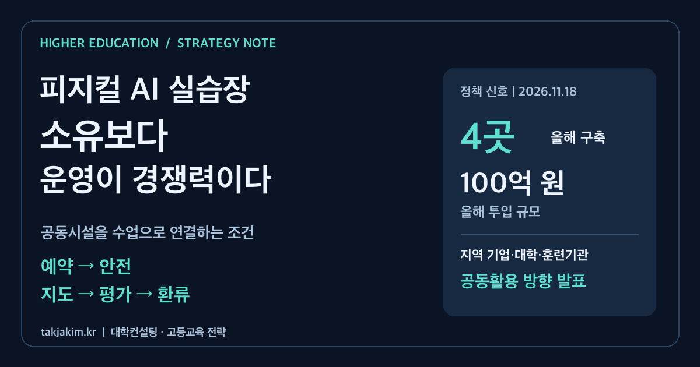

로봇이 있는 대학과 로봇으로 반복해서 배울 수 있는 대학은 다르다. 장비를 보여주는 데는 한 번의 방문이면 충분하지만, 학생과 재직자가 직접 공정을 바꾸고 오류를 복구하려면 실습 시간, 지도 인력, 안전 절차가 함께 움직여야 한다.

고용노동부가 11월 18일 발표한 피지컬 AI 테스트베드 구축은 이 차이를 생각하게 한다. 지역 기업뿐 아니라 대학과 훈련기관에도 시설을 개방한다는 방향이 담겼다. 대학전략의 질문은 새로운 실습장을 어디에 지을 것인가에서, **지역의 실습장을 누가 어떤 조건으로 사용할 수 있게 할 것인가**로 넓어져야 한다.

<figure class="note-cover-figure">
  
  <figcaption>고용노동부 2026년 11월 18일 발표를 바탕으로 직접 제작. 4곳·100억 원은 올해 구축 내용이며, 예약·안전·지도·환류는 필자의 운영 설계 제안이다. 실제 시설 사진은 아니다.</figcaption>
</figure>

## 오늘의 핵심

고용노동부 보도자료에 따르면 정부는 올해 총 100억 원을 투입해 전주·청주·성남·창원 4곳의 폴리텍 캠퍼스에 피지컬 AI 테스트베드를 구축하고 있다. 11월 18일 전주 신기술교육원 개소식을 시작으로 나머지 시설도 연내 가동한다는 계획이다. **4곳 모두 이미 운영을 마쳤다는 의미는 아니다.**

- 지역 연계 분야는 전주 스마트팜, 청주 AI·반도체, 성남 바이오, 창원 제조·물류다.
- 시설은 로봇·설비와 AI를 결합한 공장형 교육시설이다. 폴리텍 재학생뿐 아니라 기업 재직자 교육, 공정 운용·유지보수 인력 양성에 활용하고 지역 중소기업·대학·훈련기관에도 개방한다는 방향이다.
- 내년에는 총 240억 원을 투입해 8곳을 추가 설치할 계획이라고 밝혔다. 이는 발표된 확대 계획이지, 이미 완성된 시설이나 확인된 교육성과가 아니다.

전주 시설은 스마트팜–제조–물류를 하나의 공정으로 잇는다. 비전 AI를 활용한 작물 생육 학습과 로봇 수확, 검수·분류·포장, 이동로봇과 휴머노이드의 적재·출고를 연결하고 디지털트윈 기반 통합관제를 구현했다고 설명한다. 대학이 참고할 대목은 개별 장비의 이름보다 **여러 기술을 공정 흐름 속에서 함께 배우게 했다는 구성**이다.

## 왜 대학전략 관점에서 중요한가

[앞서 로봇·모빌리티 교육과정 자문을 다룬 글](/education/robot-mobility-curriculum-consulting/)에서는 학생 과제와 평가 기준을 준비하는 문제를 살폈다. 이번에는 한 단계 다른 질문이다. 그 과제를 실행할 시설이 대학 밖에 있다면, 대학의 수업과 외부 시설의 운영을 어떻게 연결할 것인가.

모든 대학이 같은 장비를 소유할 필요는 없다. 다만 공동활용이 자동으로 비용 절감을 뜻하지도 않는다. 이동 시간, 학사일정 조정, 안전교육, 지도 인력, 시설 사용료와 소모품 비용이 생길 수 있다. 장비 구입비만 비교하면 공동활용의 실제 비용과 장점이 모두 가려진다.

[[공동활용 인프라]]를 대학의 자원으로 만들려면 예약 가능한 시간과 학생의 실제 수행 기회가 확보돼야 한다. 협약서에 참여기관 이름이 올라가는 것과 학기 중 수업을 반복 운영하는 것은 별개다. [[산학협력]]의 역할도 기업 소개를 넘어 과제 제공, 실습 지도, 결과 검토까지 구체화할 필요가 있다.

보도자료에는 외부 대학의 예약 방식, 사용료, 책임 분담, 학점 인정 절차가 제시돼 있지 않다. 개방 방침을 곧바로 자유 이용이나 학점 교류의 확정으로 읽어서는 안 된다. 지금 대학이 할 일은 참여를 선언하는 것보다 운영 조건을 확인하는 것이다.

## 정책·교육과정·지역연계 포인트

### 1. 시설 개방을 시간표와 책임표로 바꾸기

공동시설은 누가 우선 사용하는지부터 합의해야 한다. 정규 수업, 기업 재직자 훈련, 특성화고 체험이 같은 시간에 몰리면 취지는 좋아도 실습 기회가 부족해진다. 대학은 학기 단위 예약 가능 시간, 팀당 반복 실습 횟수, 고장 시 대체 일정까지 확인해야 한다.

안전도 공동 책임이라는 말로 끝내기 어렵다. 장비 조작 승인권, 안전교육 이수 확인, 사고 대응, 보험, 원상복구 책임을 운영 문서로 나눠야 한다. 아래 내용은 발표된 공식 이용 규정이 아니라 필자의 검토 제안이다.

| 운영 항목 | 대학이 확인할 조건 | 남겨야 할 기록 |
|---|---|---|
| 예약·접근 | 학사일정에 맞는 연속 실습 시간 확보 여부 | 확정 시간표와 취소·대체 기준 |
| 안전·책임 | 사전교육, 조작 권한, 사고·고장 대응 주체 | 이수 기록과 책임 분담표 |
| 교원·지도 | 수업 담당자와 시설 담당자의 역할 | 공동 수업안과 지도 일정 |
| 비용·데이터 | 소모품·사용료 부담, 기업 데이터 공개 범위 | 비용 산정표와 활용 동의 |
| 평가·개선 | 학생 수행을 누가 어떤 기준으로 판단하는가 | 수행 기록과 다음 회차 수정안 |

### 2. 시연을 본 경험과 공정을 다룬 역량을 구분하기

스마트팜부터 물류까지 한 번에 볼 수 있다는 것은 좋은 교육 자원이다. 그러나 전 공정을 관람했다고 전 공정을 운용할 수 있는 것은 아니다. 학습자의 수준에 맞춰 관찰, 부분 조작, 이상 원인 분석, 통합 공정 개선을 구분해야 한다.

[[직무역량]]도 ‘AI를 이해한다’보다 작업 조건을 바꾸고 결과를 설명할 수 있는지로 확인하는 편이 낫다. 예를 들어 분류 기준을 바꿨을 때 오류가 늘어난 원인을 추적하거나, 이동로봇의 정지 상황을 기록하고 복구 절차를 설명하게 할 수 있다. 이는 보도자료가 정한 교육과정이 아니라 수업 설계의 예시다.

실물 장비의 사용 시간이 제한적이라면 [[디지털 트윈]] 등 가상환경에서 준비하고 현장에서 검증하는 방식도 검토할 수 있다. 다만 모의환경에서 성공한 결과와 실물에서 재현한 결과는 구분해 평가해야 한다.

### 3. 시설 담당자만큼 가르칠 사람을 준비하기

같은 날 고용노동부에 게시된 한국기술교육대 포럼 자료는 피지컬 AI 교·강사 교육을 기초 실습, 가상환경 학습, 실물 통합 실습, 신규 실습교육 개발의 4단계로 제안했다. 교강사·콘텐츠·훈련 품질을 연결하는 협력 모델도 제시했다.

두 발표가 하나의 통합 사업으로 확정됐다는 근거는 없다. 다만 함께 읽으면 시설 투자와 [[교강사 역량개발]]을 따로 계획해서는 안 된다는 시사점을 얻을 수 있다. 장비 운용을 잘하는 사람과 학생의 오류를 학습 기회로 바꾸는 사람은 같은 역할이 아니다. 공동시설을 쓰는 대학도 수업 설계와 평가를 외부에 모두 맡길 수는 없다.

## 학생·학부모가 확인할 것

공동 실습시설 소식은 반갑지만, 시설의 존재만으로 특정 학과의 교육이나 취업이 보장되지는 않는다. 대학 안내에서 다음을 확인하는 것이 더 실질적이다.

- **실제 참여 경로:** 정규 교과목인지 비교과인지, 전원 참여인지 선발형인지, 선수과목은 무엇인지 확인한다.
- **직접 수행 시간:** 견학과 장비 조작을 구분하고, 팀 안에서 본인이 맡을 역할과 반복 실습 기회를 살핀다.
- **비용과 이동:** 별도 비용, 이동 수단, 실습 시간대가 공개돼 있는지 확인한다. 현재 보도자료만으로는 대학별 조건을 알 수 없다.
- **남길 수 있는 결과물:** 공개 가능한 실험 기록, 오류 분석, 개선 전후 비교가 [[학생 포트폴리오]]에 남는지 확인한다. 기업 데이터가 들어가면 공개 범위에 별도 합의가 필요하다.

지역 기업에 시설을 개방한다는 방침과 학생의 채용 약정은 다르다. 정부가 기대한 지역 정착 확대 역시 아직 확인된 취업률이나 정착 성과로 바꿔 쓸 수 없다.

## 대학컨설팅 관점에서 보는 전략

대학이 공동시설 활용을 검토한다면 첫 회의의 안건을 장비 목록보다 **한 학기 운영 시나리오**로 잡는 편이 좋다. 어느 학생이 어떤 사전학습을 마친 뒤 몇 차례 방문하고, 누가 지도하며, 무엇을 제출할 것인지부터 정한다. 그다음 필요한 시설 시간과 비용을 계산해야 한다.

첫 시도는 공정 전체를 포괄하는 거창한 교육과정보다 대학이 책임질 수 있는 작은 단위가 낫다. 지역 기업의 문제 하나를 교육 가능한 범위로 줄이고, 가상 준비–실물 검증–결과 설명을 연결해 보는 방식이다. 이는 공식 사업 신청 요건이 아니라 실행 위험을 줄이기 위한 제안이다.

성과관리 역시 방문자 수만으로 끝내지 않아야 한다. 예약한 시간 중 실제로 실습한 시간, 학생별 수행 기록, 중단된 실습의 원인, 기업 피드백을 반영한 과제 수정 등을 [[실행지표]]로 볼 수 있다. 단순 가동률을 높이려고 교육 준비가 부족한 팀을 무리하게 받는 일도 경계해야 한다.

이 기록이 다음 학기 시간 배정과 교원 교육, 장비 보완으로 이어져야 [[성과환류]]가 된다. [[지역정주]]는 더 긴 시간에 걸쳐 확인할 결과다. 시설 구축 직후 정주 성과를 요구하기보다 참여–역량 형성–현장 적용–취업 및 경력 이동을 구분해 추적하는 것이 타당하다.

피지컬 AI 실습장은 지역에 중요한 자산이 될 수 있다. 하지만 대학의 경쟁력은 그 자산을 소유했다는 표지판에서 끝나지 않는다. **학생이 안전하게 반복 수행하고, 교원이 평가하고, 기업이 다시 참여할 수 있는 운영 구조**를 만드는 데서 차이가 난다.

## 확인한 출처

- [고용노동부, 「피지컬 인공지능(AI) 테스트베드 4곳 개소, 지역 기업에 개방하여 실무인력 양성에 활용」, 2026.11.18. — 대한민국 정책브리핑 전재](https://m.korea.kr/briefing/pressReleaseView.do?gubun=pressRelease&newsId=156789765&pageIndex=1&repCode=): 올해 구축 규모·분야, 전주 공정 구성, 개방 대상, 내년 확대 계획을 본문에서 확인했다. 외부 기관별 이용 규정과 운영 실적을 확인한 자료는 아니다.
- [고용노동부, 「인공지능(AI) 시대 직업훈련의 미래는? 한국기술교육대, 개교 35주년 고용·평생직업능력개발 발전 전략 포럼 개최」, 2026.11.18.](https://moel.go.kr/news/enews/report/enewsView.do?news_seq=20272): 교·강사 교육의 단계와 교강사·콘텐츠·품질 연계 구상을 확인했다. 테스트베드 구축 사업과의 통합 운영을 입증하는 자료로 사용하지 않았다.
