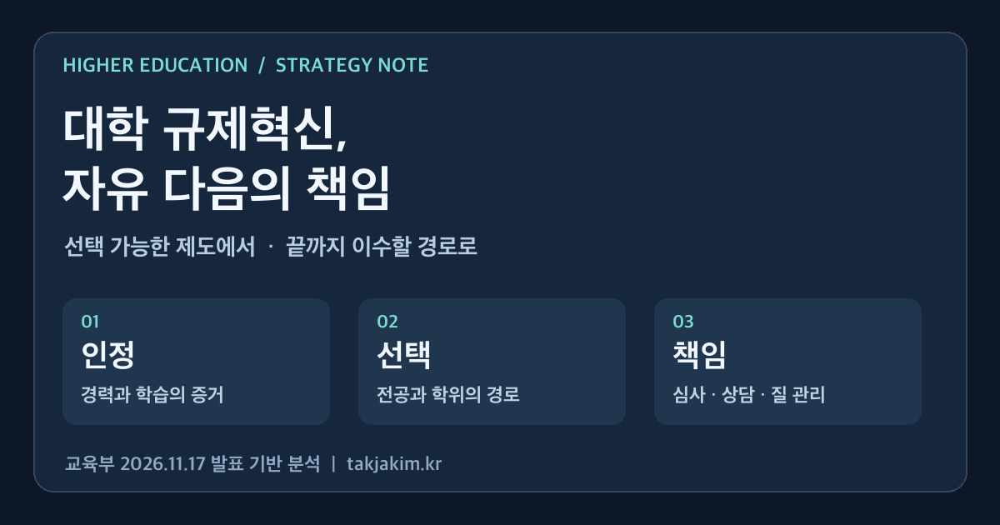

대학이 학생에게 더 많은 선택권을 주겠다고 할 때, 그 선택을 처리할 행정과 교육과정은 얼마나 준비되어 있을까. 현장 경력을 학점으로 인정하는 일도, 졸업할 때 주전공을 바꾸는 일도 학칙 한 줄만 고쳐서는 작동하지 않는다. 무엇을 배웠다고 인정할지, 남은 학습은 누가 안내할지, 최종 학위의 수준은 어떻게 확인할지가 함께 정리되어야 한다.

교육부가 11월 17일 발표한 제3회 대학규제혁신 우수사례는 이 질문을 던진다. 수상 대학의 이름보다 주목할 것은 **입학부터 졸업까지 고정되어 있던 경로를 어디에서, 어떤 조건으로 바꿨는가**다. [[대학규제혁신]]을 대학경영의 문제로 읽어야 하는 이유다.

<figure class="note-cover-figure">
  
  <figcaption>교육부의 2026년 11월 17일 발표를 바탕으로 재구성한 자체 제작 전략 도식. 아래 세 단계는 공식 평가항목이 아니라 이 글의 분석 틀이다.</figcaption>
</figure>

## 오늘의 핵심

- 교육부는 접수된 25건 가운데 대상 1건과 우수상 4건을 선정했다. 대상은 대전보건대학교, 우수상은 국립창원대학교·건국대학교·한양대학교·경북대학교다.
- 발표에는 경력과 선행학습의 학점 인정, 학위 단계 간 연결, 재학 중 전공 설계, 졸업 시점의 전공 선택, 해외 교육과정 운영이 함께 담겼다. 단일 제도의 전국 일괄 시행을 발표한 자료가 아니라, 서로 다른 혁신 사례를 선정한 자료다.
- 대학이 참고할 것은 수상 여부보다 운영 조건이다. **선택권을 넓힌 만큼 심사기준과 상담, 학사정보, 교육의 질에 대한 책임도 구체화되어야 한다.** 이하의 운영 제안은 발표에 대한 필자의 해석이며, 각 대학이 이미 갖춘 성과로 단정하지 않는다.

## 왜 대학전략 관점에서 중요한가

과거의 학사 운영은 같은 시기에 입학한 학생이 비슷한 순서로 교과목을 이수하고, 정해진 전공으로 졸업하는 방식에 익숙했다. 성인학습자와 재직자가 늘고 전공 간 이동이 활발해질수록 이 기본값만으로는 학생의 경로를 설명하기 어렵다.

그렇다고 선택지를 늘리는 것 자체가 곧 혁신의 성과는 아니다. 인정받을 수 있다는 안내를 보고 입학했는데 심사 결과를 늦게 알게 되거나, 전공 변경은 가능하지만 필수과목이 열리지 않아 졸업이 지연된다면 제도의 유연성은 학생의 부담으로 돌아간다.

이번 발표를 관통하는 전략적 질문은 이것이다. **대학이 제공하는 것은 선택 가능한 제도 목록인가, 실제로 끝까지 이수할 수 있는 경로인가.** [[학사유연화]]의 경쟁력은 제도 수보다 경로의 예측 가능성에서 드러난다.

## 정책·교육과정·지역연계 포인트

### 1. 경력을 학점으로 바꾸려면 무엇을 배웠는지 확인해야 한다

교육부는 대전보건대가 [[선행학습인정제|선행학습인정제(RPL)]]에 기반한 학점인정 확대와 교육운영 내실화를 통해 전문기술석사 취득 경로를 기존 8년에서 7년으로 단축했다고 설명했다. 발표의 표현은 고숙련 마이스터 패스트트랙이라는 **전체 취득 경로**에 관한 것이다. 전문기술석사 과정 자체가 8년제에서 7년제로 바뀌었다는 뜻으로 읽어서는 안 된다.

여기서 기간 단축만큼 중요한 대목은 학생선발기준, 이수학점, 성적기준, 졸업요건 등 심사체계를 정비했다는 설명이다. 학습을 인정하려면 근무 연수만 셀 것이 아니라 교과목의 [[학습성과]]와 경력에서 확보한 역량이 어떻게 대응하는지 보여줄 수 있어야 한다.

다른 대학이 적용을 검토한다면 인정 신청서보다 먼저 평가 기준표를 만드는 편이 낫다. 어떤 수행 증거를 제출받고, 누가 판단하며, 부족한 부분은 어떤 수업으로 보완할지 정해야 한다. 이것이 재직자의 부담을 줄이면서 학위의 신뢰를 지키는 출발점이다.

### 2. 학위 사다리는 연결선보다 연결 조건이 중요하다

국립창원대 사례는 경남도립거창대·경남도립남해대와의 통합을 기반으로 전문학사부터 학사, 석·박사까지 이어지는 개방형 다층학사 성장체계를 구축했다는 내용이다. 교육부는 통합 캠퍼스의 특성화 분야와 지역 전략산업을 연결한 교육·연구·산학협력 체계도 설명했다.

다만 학위 단계가 한 조직 안에 있다는 사실과 학생이 실제로 다음 단계로 이동할 수 있다는 사실은 다르다. 대학전략에서는 단계별 진입요건, 인정학점, 보충학습, 재직자의 수업 참여 조건을 함께 확인해야 한다. 이 글은 해당 대학의 세부 진학요건이나 자동 진학을 확인한 것이 아니다.

[[지역산업 연계]] 역시 같은 기준으로 볼 수 있다. 지역에 필요한 직무가 무엇이고, 그 직무의 숙련 수준이 올라갈 때 다음 교육과정으로 어떻게 연결되는지를 설명할 수 있어야 한다. 학위 사다리를 지역 인재의 성장경로로 만드는 작업이다.

### 3. 전공 선택의 시계를 늦출수록 상담과 정보가 중요해진다

건국대 사례는 [[전공자율선택제]]를 입학 단계에 한정하지 않고 재학 기간 전반으로 확대한 학사 개편이다. 교육부는 소단위 전공 과정의 학점 인정 근거와 학생의 자기설계 전공을 설명했다. 한양대 사례에는 전공탐색 기회와 함께, 졸업 시점이라도 전공 이수요건을 충족하면 주전공을 변경할 수 있도록 한 졸업전공선택제 이수체계가 담겼다.

중요한 조건은 이수요건 충족이다. 아무 전공이나 원할 때 바로 바꿀 수 있다는 의미가 아니다. 학생에게는 이미 취득한 학점이 어디에 인정되는지, 남은 필수과목은 무엇인지, 변경하면 졸업 시점이 달라지는지를 확인할 수 있는 정보가 필요하다.

대학이 [[교육과정 맵]]을 학생 단위로 보여줄 수 없다면 선택권은 상담 담당자의 경험에 의존하게 된다. 제도 개선과 함께 학사정보의 정합성, 상담 인력의 업무 범위, 학과 간 책임 분담을 점검해야 하는 이유다.

### 4. 해외 교육과정은 모집의 확장이 아니라 운영의 확장이다

경북대 사례는 베트남의 KNU Vietnam에서 경영학과와 컴퓨터학과를 운영하는 프랜차이즈형 해외 교육과정 수출 모델이다. 교육부는 대학 간 협약과 학칙 등을 바탕으로 해외 교육과정 운영이 가능해진 점을 설명했다.

이 사례를 다른 대학이 참고할 때는 해외에서 몇 명을 모집할 수 있는가만 물어서는 부족하다. 교수자 확보, 현지 수업의 평가 기준, 교육과정 변경 승인, 학생 지원을 누가 맡을지도 함께 검토해야 한다. 이는 사례의 미확인 문제점을 지적하는 것이 아니라 해외 운영을 검토하는 대학에 제안하는 [[교육의 질 관리]] 질문이다.

## 학생·학부모가 확인할 것

제도명이 비슷해도 대학과 학과, 적용 학번에 따라 실제 조건은 다를 수 있다. 수상 기사만으로 본인의 학점 인정이나 전공 변경 가능 여부를 판단하지 않는 편이 좋다.

| 관심 경로 | 확인할 자료 | 구체적으로 물을 질문 |
| --- | --- | --- |
| 경력·선행학습 인정 | 해당 과정의 학점인정 규정과 모집 안내 | 어떤 경력을 어떤 증빙으로 인정하며, 언제 결과를 알 수 있는가 |
| 학위 단계 간 이동 | 진학요건과 학점인정 기준 | 다음 단계에 별도 선발이 있는가, 보충 이수가 필요한가 |
| 전공 설계·변경 | 적용 학번별 학칙과 전공 이수표 | 기존 학점은 어떻게 처리되며 졸업 시점에 영향이 있는가 |
| 해외 교육과정 | 공식 과정 안내와 학위 관련 규정 | 수업·평가·학위 수여와 학생 지원의 책임 주체는 누구인가 |

특히 재직자는 명목상 수업 기간뿐 아니라 실제 시간표, 출석 방식, 실습 참여 조건도 확인해야 한다. 단축 가능한 최단 경로와 본인이 이용할 수 있는 경로는 같지 않을 수 있다.

## 대학컨설팅 관점에서 보는 전략

다섯 사례를 그대로 복제하기보다는 각 대학에서 학생의 경로가 끊기는 지점 하나를 고르는 것이 현실적이다. 재직자의 인정 심사가 오래 걸리는지, 전공 변경 이후 수강 안내가 약한지, 학위 단계 간 연계 기준이 불명확한지부터 확인할 수 있다.

그다음에는 다음 세 가지 산출물을 함께 만드는 방식을 제안한다.

1. **학생 경로표:** 신청부터 심사, 수강, 졸업까지 학생이 해야 할 일과 예상 시점을 한 장에 정리한다.
2. **책임 분담표:** 학과·교무부서·상담부서가 승인하고 안내할 업무를 나누고, 예외 상황의 최종 결정자를 명시한다.
3. **점검 지표:** 처리 기간, 인정 결과에 대한 이의신청, 필수과목 미개설로 인한 지연, 경로별 이수 지속 여부를 살핀다.

이 지표들은 교육부가 이번 공모전에서 제시한 공식 평가지표가 아니라 필자가 제안하는 [[성과환류]] 항목이다. 운영 결과를 다음 학기의 규정과 교육과정에 반영할 때 제도가 학생 경험으로 바뀐다.

대학의 자유가 커졌다는 말만으로 학생이 덜 헤매지는 않는다. 무엇을 인정받고, 어떤 선택이 가능하며, 그 선택을 누가 끝까지 안내하는지 분명해질 때 규제혁신은 대학의 실제 역량이 된다.

## 확인한 출처

- [교육부, 「대학규제혁신 우수사례 발표, 현장 중심의 혁신 성과 확산 기대」, 2026.11.17.](https://www.moe.go.kr/boardCnts/viewRenew.do?boardID=294&boardSeq=107677&lev=0&searchType=null&statusYN=W&page=1&s=moe&m=020402&opType=N) — 공식 게시물과 첨부 보도자료 본문에서 선정 규모, 수상 대학, 각 사례의 내용을 확인했다. 이 글은 대학별 상세 학칙이나 개별 학생의 적용 가능 여부까지 검증한 안내문은 아니다. 상담·정보체계·점검 지표에 관한 내용은 공식 발표와 구분한 대학컨설팅 관점의 제안이다.
