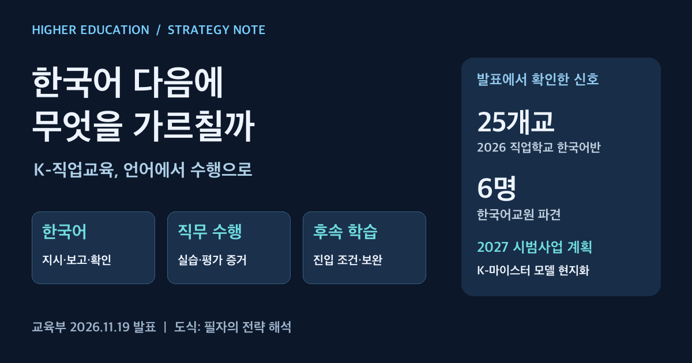

한국어를 가르치는 학교가 늘었다는 소식은 반갑다. 그런데 직업교육기관이라면 그다음 질문이 더 중요하다. 한국어를 배운 학생은 어떤 작업을 더 정확하게 수행할 수 있게 되는가. 안전 지시를 이해하고, 장비 매뉴얼을 읽고, 동료에게 결함을 설명할 수 있는가. 언어교육과 기술교육이 따로 운영된다면 한국어반의 확대가 곧 직업역량의 확대로 이어지지는 않는다.

교육부가 11월 19일 발표한 우즈베키스탄 직업교육 협력은 이 연결 문제를 보여준다. 이번 발표의 직접 대상은 대학 신설이나 유학생 선발이 아니라 현지 직업학교의 한국어교육과 한국 직업교육 운영 사례의 확산이다. 다만 전문대학과 고등교육기관에는 [[국제교육협력]]을 모집 인원보다 **교육과정과 운영 책임의 연결**로 설계할 기회를 제시한다.

<figure class="note-cover-figure">
  
  <figcaption>교육부 2026년 11월 19일 보도자료를 바탕으로 자체 제작. 한국어–직무–후속 학습 연결은 필자의 설계 제안이며, 이미 시행 중인 공식 진학·취업 경로를 뜻하지 않는다.</figcaption>
</figure>

## 오늘의 핵심

- **직업학교 한국어교육이 확대됐다.** 교육부 자료에 따르면 우즈베키스탄에서 한국어반을 운영하는 직업학교는 지난해 3개교에서 2026년 25개교로 늘었다. 현지에서 한국어반을 운영하는 전체 201개 학교 중 직업학교에 해당하는 수치다.
- **교원 파견에는 비용 부담 주체가 있다.** 한국어교원 6명이 현지 직업학교에 파견됐고, 급여·왕복 항공료·숙소·보험 등은 우즈베키스탄 직업교육청이 부담한다. 한국 대학의 학생 모집 사업이나 한국 정부의 전액 지원 사업으로 바꿔 읽어서는 안 된다.
- **다음 단계는 교육모델의 현지화다.** 교육부는 경상북도교육청과 함께 2027년부터 K-마이스터 직업교육체계 확산모델 개발을 시범 추진한다고 밝혔다. 확정된 취업 성과가 아니라 앞으로 추진할 사업 계획이다.

## 왜 대학전략 관점에서 중요한가

이번에 한국을 방문하는 우즈베키스탄 직업교육청 관계자들의 일정은 11월 16일부터 21일까지다. 발표에는 항공, 소프트웨어, 자동화 설비, 전자·기계 분야 직업계고 4개교의 교육과정과 실습실 참관, 교육부·한국전문대학교육협의회·한국직업능력연구원 등과의 협력 논의가 담겼다. 방문 결과로 어떤 협약이 체결됐는지까지 확인된 자료는 아니다.

대학이 여기에서 발견할 수 있는 전략적 신호는 한국어 수요 자체보다 **언어를 배운 이후의 교육 수요**다. 현지에서 기초 기술과 한국어를 익힌 학습자에게 어떤 심화교육이 필요한가. 국내외 어디에서 실습을 이어갈 수 있는가. 기존 학습의 수준은 어떻게 확인할 것인가. 이 질문은 전문대학의 직업교육, 재직자교육, 해외 기관과의 협력과 직접 맞닿는다.

다만 우즈베키스탄의 테크니쿰을 한국 전문대학과 동일한 학제로 취급하면 곤란하다. 교육부는 이를 중등 일반교육과 고등교육의 중간 단계에 해당하는 중등 직업교육기관으로 설명한다. 명칭이나 수업 연한이 비슷하다는 이유로 편입, 학점 인정, 학위 동등성을 가정할 수 없다. [[학위 상호 인정]]이나 진학 경로는 별도 제도와 기관 간 합의의 확인 대상이다.

## 정책·교육과정·지역연계 포인트

### 한국어 수업의 다음 장면을 정해야 한다

한국어교육을 직무교육과 연결하려면 일반 회화 다음에 무엇을 수행할지부터 정하는 편이 낫다. 예컨대 설비 분야라면 작업 전 안전 점검을 설명하고, 이상 신호를 기록하고, 정비 결과를 전달하는 과제가 가능하다. 이는 발표에 제시된 확정 교육과정이 아니라 [[직무기반 교육과정]] 개발을 위한 예시다.

설계의 단위도 단어 목록만으로 끝나서는 안 된다. 직무 장면, 필요한 언어 기능, 기술 수행, 평가 증거를 함께 묶어야 한다. 한국어 시험 점수는 참고자료가 될 수 있지만 장비를 안전하게 다룰 수 있다는 증거를 대신하지 못한다. [[학습성과]]를 언어와 기술의 두 축으로 구체화해야 하는 이유다.

| 설계 질문 | 교육과정에 담을 것 | 확인할 증거 |
| --- | --- | --- |
| 어떤 작업을 할 수 있어야 하나 | 현지 산업과 장비에 맞춘 실습 과제 | 작업 절차 수행 기록 |
| 그 작업에 어떤 한국어가 필요한가 | 지시 이해, 보고, 질문과 확인 | 상황별 설명·보고 결과물 |
| 부족한 부분은 어떻게 보완하나 | 언어·기술별 보충학습 | 재평가 결과와 지도 기록 |
| 다음 교육으로 무엇을 이어갈 것인가 | 기관별 진입요건과 추가 학습 | 요건 확인표와 상담 기록 |

### 수출해야 할 것은 학교의 외형보다 운영 방식이다

2027년 시범사업은 한국 마이스터고의 산업수요 맞춤형 고숙련 기술인재 양성 사례를 우즈베키스탄의 교육·산업 여건에 맞게 도입하도록 지원하는 계획이다. 이를 국내 교육과정의 단순 복제로 이해하면 현지 장비, 교원, 기업 수요와 어긋날 수 있다.

[[산학협력]]의 상대 역시 실제로 확인해야 한다. 누가 현지의 직무 수요를 설명하고, 어떤 기업이 과제를 제공하며, 실습 결과를 누가 평가할 것인가. 한국 대학이 참여를 검토한다면 자신의 교육 브랜드를 먼저 제안하기보다 현지 교원과 함께 과제를 만들고 평가하는 역량을 점검해야 한다. 이때 [[공동교육과정]]은 업무 분장과 평가 권한까지 합의했을 때 비로소 운영 가능한 형태가 된다.

### 지역산업 연계는 자동으로 따라오지 않는다

해외 교육협력과 국내 지역기업의 인력 수요를 연결하는 구상은 가능하다. 그러나 이번 자료만으로 국내 기업 채용, 비자 발급, 특정 지역 정착이 보장됐다고 말할 수는 없다. 교육 협력의 발표와 학생의 취업 자격은 서로 다른 문제다.

대학이 [[지역산업 연계]]를 검토한다면 기업의 실제 직무, 실습 환경, 언어 요구, 관련 법령과 학생 보호 조건을 따로 확인해야 한다. 현지 취업과 현지 고등교육 진학도 존중해야 할 경로다. 모든 협력의 종착점을 한국 입국으로 설정하면 파트너 국가가 부담하는 교육의 목적과 어긋날 수 있다.

## 학생·학부모가 확인할 것

이번 발표는 개별 학생의 국내 대학 입학이나 해외취업을 보장하는 모집 공고가 아니다. 관련 프로그램을 안내받는다면 다음 내용을 문서로 확인하는 것이 좋다.

- **교육기관과 자격:** 어느 기관이 수업하고, 누가 어떤 수료증이나 자격을 발급하는가. 그것이 학위인지 단기 수료인지 구분해야 한다.
- **총비용과 지원 범위:** 교원 파견 비용을 현지 정부가 부담한다는 사실이 학생의 등록금·생활비 지원까지 뜻하지는 않는다.
- **진학과 취업의 조건:** 어학요건, 학력 인정, 실습 참여 자격, 취업과 체류에 필요한 절차를 각각 확인해야 한다.
- **학습의 증거:** 수료증 외에 실습 기록과 평가 결과가 남는가. [[학생 포트폴리오]]는 다음 교육기관이나 기업이 실제 역량을 이해할 수 있는 자료여야 한다.

## 대학컨설팅 관점에서 보는 전략

대학이 먼저 만들 문서는 대규모 협약서보다 **한 직무에 대한 작은 공동 설계안**에 가깝다. 현지 기관과 한 분야를 정하고, 기초학습 수준과 필요한 한국어, 실습 과제, 평가 기준, 후속 교육의 진입 조건을 맞추는 일이다. 그 과정에서 대학이 무엇을 제공할 수 있고 무엇은 제공할 수 없는지도 분명해진다.

비용과 책임을 나누는 표도 필요하다. 이번 파견사업은 교원 비용의 부담 주체를 공개했다는 점에서 참고할 수 있다. 대학 간 협력에서는 여기에 교재 개발, 장비 유지, 통역, 교원 연수, 평가와 학생 상담의 부담을 추가로 협의해야 한다. 공개된 사업에 이 항목들이 모두 해결되어 있다는 뜻이 아니라, 참여기관이 확인해야 할 운영 과제다.

마지막으로 [[성과환류]]의 단위를 방문 횟수나 협약 건수에만 두지 말아야 한다. 과제 수행 수준, 보충학습 이후의 개선, 다음 과정 진입과 학업 지속을 살펴야 한다. 취업을 지표로 삼는 경우에도 기간과 대상 집단, 확인 방법을 정해야 한다. 발표에 없는 성과 수치를 앞당겨 제시할 이유는 없다.

한국어반이 늘어난 것은 시작점이다. 대학의 역할은 그 수요에 모집 홍보물을 얹는 데 그치지 않는다. **언어로 이해하고, 기술로 수행하고, 다음 학습으로 이어갈 수 있게 만드는 것.** K-직업교육이 대학전략과 만나는 지점은 그 연결을 책임지는 교육과정에 있다.

## 확인한 출처

- [교육부, 「우즈베키스탄 직업학교에 한국어와 케이(K)-직업교육 확산」](https://www.moe.go.kr/boardCnts/viewRenew.do?boardID=294&boardSeq=107703&lev=0&searchType=null&statusYN=W&page=1&s=moe&m=020402&opType=N), 2026년 11월 19일. 첨부 HWPX 본문과 붙임에서 방문 일정, 참관 분야, 한국어반 운영 학교 수, 파견 인원·비용 부담, 2027년 시범사업 계획, 테크니쿰의 성격을 확인했다. 교육과정 설계와 대학의 참여 방식에 관한 제안은 이 자료에 대한 필자의 전략 해석이다.
