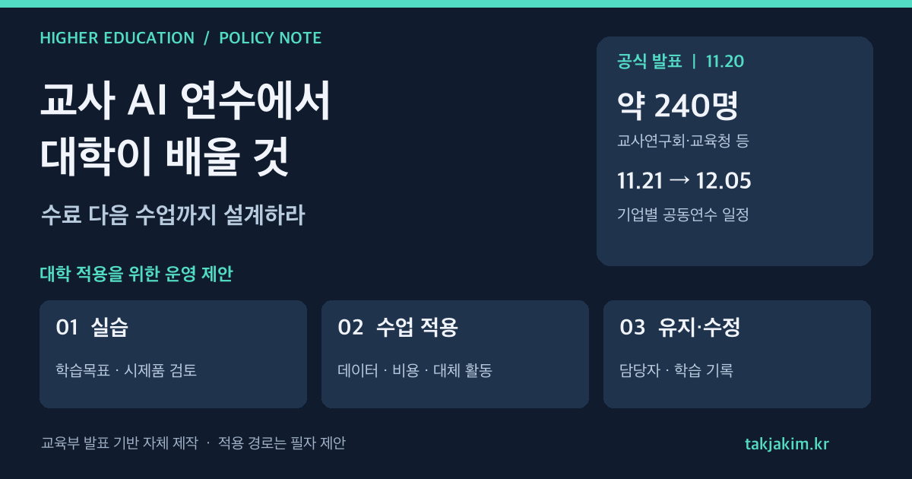

AI 연수에서 만든 퀴즈 생성기가 다음 학기 수업에서도 쓰이려면 무엇이 필요할까. 실행되는 시제품은 출발점이다. 문항의 오류를 누가 점검할지, 학생 정보가 외부 서비스로 넘어가도 되는지, 무료 사용량이 끝난 뒤 비용을 누가 낼지가 남는다. 대학의 교수자 연수도 이 문제에서 자유롭지 않다.

교육부와 한국과학창의재단이 발표한 MS·Google·AWS 연계 교사 공동연수에서 눈여겨볼 부분은 기업 이름보다 **실습 이후의 수업 적용과 후속 지원을 함께 제시했다는 점**이다. 이 글은 초·중등 교사 대상 발표를 대학 [[교수학습지원센터]]와 교육과정 개발에 참고할 사례로 읽는다. 대학 대상 신규 지원사업이 발표됐다는 뜻은 아니다.

<figure class="note-cover-figure">
  
  <figcaption>교육부 2026년 11월 20일 보도자료와 첨부 프로그램안을 바탕으로 자체 제작. 하단의 수업 적용 경로는 필자의 대학컨설팅 제안이며 공식 사업 지침이 아니다.</figcaption>
</figure>

## 오늘의 핵심

- 공동연수는 11월 21일~12월 5일 기업별 사옥에서 진행하는 일정으로 발표됐다. 대상은 AI·융합교육 교사연구회 소속 참가 희망 교사와 시도교육청 담당자 등 약 240명이다. 교사연구회 전체 규모인 552명·100개 팀과 이번 연수 대상 규모를 구분해야 한다.
- 교육용 AI 웹앱 제작, Google 도구를 활용한 수업·업무 역량 강화, AI 문제해결 프로젝트가 기업별 프로그램이다. 세부 프로그램은 구성안이며 추진 상황에 따라 바뀔 수 있다.
- 교육부는 우수사례의 성과공유회 확산과 후속 연수·멘토링을 예고했다. 다만 발표만으로 실제 수업 개선이나 학생 성취 향상을 확인할 수는 없다. 대학은 이 구조를 참고하되, 현장 적용의 증거를 별도로 설계해야 한다.

위 내용은 [교육부 보도자료와 첨부 HWPX](#sources)에서 확인했다. 아래의 대학 운영안은 해당 사업의 의무사항이 아니라 필자의 제안이다.

## 왜 대학전략 관점에서 중요한가

대학에서 AI 활용 교육을 담당하는 조직은 교수학습지원센터, 정보전산원, 도서관, 교육혁신 부서 등으로 나뉠 수 있다. 연수 담당자가 사용법을 설명해도 계정과 보안은 다른 부서가 결정하고, 교과목 평가는 교수자가 맡는다. 이 사이의 연결이 없으면 실습 결과물을 실제 학생에게 적용하기 어렵다.

이번 발표의 참가자는 초·중등 교사다. 대학은 학문 분야와 수업 규모, 평가 방식이 다르므로 프로그램을 그대로 옮겨오면 안 된다. 예를 들어 정답이 비교적 분명한 기초 퀴즈와 임상 판단·설계 비평을 다루는 과제는 검토 기준이 다르다. [[교수설계]]는 도구를 고른 뒤 수업을 끼워 맞추는 일이 아니라, 학생이 해야 할 학습활동에 맞춰 도구의 역할을 정하는 일이다.

대학경영에서는 연수 횟수와 참여 인원을 관리하기 쉽다. 반면 연수를 마친 교수자가 수업을 어디까지 바꾸었는지는 확인하기 번거롭다. 그래도 지원 예산을 늘리려면 그 불편한 부분을 봐야 한다. 수료증만으로는 학생의 경험을 설명할 수 없기 때문이다.

## 정책·교육과정·지역연계 포인트

### 기업별 도구를 배우되, 수업의 목표는 대학이 정해야 한다

첨부 프로그램안에서 MS 과정은 요구사항 명세, 웹앱 구현, 생성형 AI API 연동, 결과의 정확성·적합성 검토, 배포와 교차 점검을 다룬다. Google 과정에는 수업 설계와 평가, 협업 활동, 포트폴리오 구현 등이 포함된다. AWS 과정은 현장의 문제를 정의하고 웹페이지와 자료를 제작하는 실습을 제시한다.

여기에서 대학이 가져올 것은 특정 서비스의 일괄 도입 결론이 아니다. 수업의 문제를 정의하고 결과물을 검토하는 절차다. [[AI 리터러시]]도 프롬프트를 잘 쓰는 능력에 그치지 않는다. 생성한 설명이 해당 전공의 기준에 맞는지, 어떤 경우에 사용을 중단해야 하는지 판단하는 능력을 포함해야 한다.

예컨대 지역기업과 함께 운영하는 프로젝트 수업이라면 실제 기업의 미공개 문서를 실습에 넣기 전에 공개 자료나 가상 자료로 먼저 검증하는 편이 낫다. [[산학협력]]으로 받은 자료를 교육용이라는 이유만으로 외부 AI에 입력할 수 있다고 가정해서는 안 된다. 협약의 이용 범위, 학생 접근 권한, 결과물 공개 조건을 수업 계획과 함께 정해야 한다.

### 후속 지원은 다음 수업의 수정 작업을 도와야 한다

교육부 자료는 Google 과정의 온라인 후속 연수 6회와 AWS 과정의 상시 온라인 멘토링을 안내한다. 전체 우수사례를 공유할 행사는 12월 11일로 예고했다. 이 일정은 계획이며, 11월 22일 현재 후속 과정의 성과가 입증됐다는 의미는 아니다.

대학은 후속 지원의 시간을 교수자의 실제 적용 일정에 맞추면 좋겠다. 연수 직후에는 시제품을 검토하고, 첫 수업 뒤에는 학생이 막힌 지점을 수정하며, 학기 말에는 다음 학기에 남길 것과 폐기할 것을 결정하는 식이다. [[학습전이]]를 지원하려면 연수장에서 잘 만든 화면보다 수업에서 생긴 문제를 함께 살피는 시간이 필요하다.

이때 [[학습성과]]는 AI 사용량과 구분해야 한다. 학생이 생성된 답을 더 빨리 제출했는지와 개념을 더 잘 설명하게 됐는지는 다른 질문이다. 동일한 성취기준으로 과제의 근거 제시, 오류 발견, 수정 과정을 살펴야 한다. 소규모 시범수업에서 좋은 반응이 나왔더라도 비교 조건 없이 AI 덕분이라고 단정하지 않는 것이 맞다.

## 학생·학부모가 확인할 것

대학의 AI 교육을 살필 때 유명 기업과의 협력 로고만 보지 말자. 학생에게 필요한 확인 사항은 더 구체적이다.

- 해당 도구를 정규 수업에서 실제로 사용하는가, 특강 참여 기회만 제공하는가.
- 유료 계정과 API 비용을 학생이 부담하는가. 개인 기기의 성능이나 장애 접근성 때문에 참여가 어려울 때 대안이 있는가.
- AI 사용이 허용되는 과제와 제한되는 평가를 강의계획서에서 구분하는가.
- 생성물의 오류를 학생이 수정하고 설명할 기회가 있는가. 결과물만 제출하면 끝나는 수업은 아닌가.
- 개인정보나 기업 자료를 입력하지 않도록 안내하고, 문제가 생겼을 때 연락할 담당자가 있는가.

특히 진로와 취업을 위해서는 사용한 서비스 이름보다 해결한 문제와 검증 과정을 남기는 편이 유용하다. [[학생 포트폴리오]]에는 최초 요구사항, 실패한 출력, 수정 이유, 최종 결과의 한계를 함께 담을 수 있다. 이것은 이번 공동연수가 취업 성과를 냈다는 주장이 아니라 대학의 과제 설계에 대한 제안이다.

## 대학컨설팅 관점에서 보는 전략

대학이 다음 학기 AI 교수자 연수를 준비한다면, 모집 안내를 만들기 전에 수업 적용의 책임을 먼저 나눠두길 권한다. 아래 표는 대학이 자체적으로 조정할 운영안이다.

| 시점 | 확인할 산출물 | 맡을 역할의 예 |
| --- | --- | --- |
| 연수 전 | 적용할 교과목, 학습목표, 학생 활동, 사용 데이터의 범위 | 교수자와 교수학습지원센터 |
| 실습 종료 | 작동하는 시제품, 오류 검토 기록, 비용·계정 조건 | 교수자·실습 지원 인력·전산 담당자 |
| 첫 수업 적용 전 | 학생 안내문, 대체 활동, 개인정보·접근성 점검 | 교수자와 관련 행정 부서 |
| 적용 후 | 학생의 어려움, 수정 내역, 다음 학기 유지 여부 | 교수자·센터·학과 |

작은 규모로 시작하더라도 각 수업에 누가 연락을 받을지 정해두는 편이 낫다. API 키가 노출됐을 때 차단할 사람, 학기 중 서비스가 중단됐을 때 대체 활동을 안내할 사람, 담당 교수자가 바뀌었을 때 결과물을 넘겨받을 사람이 필요하다. 이 일을 모두 교수자 개인에게 맡기면 연수 예산과 별개로 운영 부담이 쌓인다.

[[성과환류]] 회의에서도 우수사례 발표만 모으지 않았으면 한다. 사용을 중단한 사례와 이유를 함께 남겨야 다른 학과가 같은 문제를 반복하지 않는다. 좋은 시제품이어도 유지비가 너무 크거나 학습목표에 도움이 되지 않으면 다음 학기에 쓰지 않을 수 있다.

이번 발표는 대학의 AI 연수를 설계할 때 참고할 만한 실습·후속지원 구조를 보여준다. 대학이 덧붙일 일은 분명하다. 연수를 마친 교수자가 실제 수업에 적용할 수 있도록 검토 시간과 지원 담당자를 배정하고, 학생이 무엇을 배웠는지 확인할 기록을 남기는 것이다.

<h2 id="sources">확인한 출처</h2>

- [교육부, MS·Google·AWS와 손잡고 교사의 인공지능(AI)·융합교육 역량을 키운다](https://www.moe.go.kr/boardCnts/viewRenew.do?boardID=294&boardSeq=107729&lev=0&searchType=null&statusYN=W&page=1&s=moe&m=020402&opType=N) — 2026년 11월 20일 게시·배포, 인터넷 보도시점 같은 날 12시. 첨부 HWPX의 본문과 세부 프로그램 구성안을 함께 확인했다. 일정, 대상 규모, 기업별 실습 내용, 후속 지원과 성과공유회 계획의 근거다. 본문과 첨부는 동일 발표 자료이므로 공개 출처는 1건으로 센다.

※ 이 글은 2026년 11월 22일 기준 발표된 계획을 해석했다. 연수의 실제 진행 결과, 수업 효과, 참가자의 만족도나 대학별 도입 성과는 확인한 자료에 포함되어 있지 않다.
