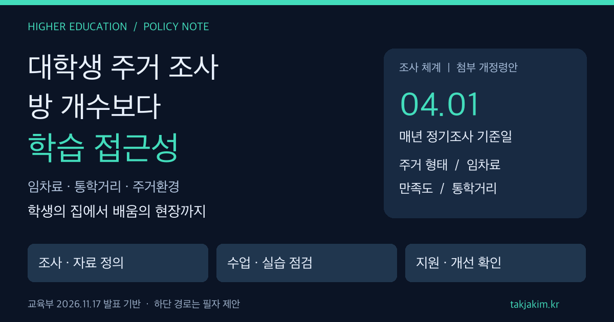

지역 기업과 좋은 실습 과목을 만들어도 학생이 현장에 갈 교통편과 머물 곳을 구하지 못하면 교육과정은 계획대로 작동하기 어렵다. 대학 주거 문제를 기숙사 정원만으로 읽기 어려운 이유다. 학생이 어느 집에 사는가뿐 아니라, 그곳에서 어떤 학습 기회에 접근할 수 있는가를 함께 봐야 한다.

교육부는 11월 17일 고등교육법 시행령 일부개정령안의 국무회의 통과를 발표하며 **학생주거실태 조사 추진 기반을 마련했다**고 밝혔다. 약학교육 평가·인증 의무화와 함께 발표된 내용이지만, 대학의 학생지원과 지역연계 전략에서는 주거 조사 자체가 별도의 의제다. 이 글은 새 조사 결과를 분석한 글이 아니라, 발표와 첨부 개정령안에서 확인한 조사 체계를 대학 운영에 어떻게 활용할지 살펴보는 글이다.

<figure class="note-cover-figure">
  
  <figcaption>교육부 2026년 11월 17일 보도자료와 첨부 개정령안을 바탕으로 자체 제작. 학습 접근성 및 지원 연결은 필자의 전략 제안이다.</figcaption>
</figure>

## 오늘의 핵심

- 교육부 발표는 주거 형태, 임차료, 주거환경 만족도 등을 조사해 주거 안정과 복지 정책의 기초자료로 활용하고 결과를 공개한다는 내용이다. **지원금 신설이나 기숙사 확충 예산을 확정한 발표는 아니다.**
- 첨부 고등교육법 시행령 개정령안 제4조의11은 정기조사를 **매년 4월 1일 기준**으로 실시하도록 규정한다. 이는 조사 기준일이지, 반드시 그날 하루에만 응답을 받는다는 뜻이 아니다. 조사 목적·기간·대상·내용을 담은 계획을 수립하고 대상자에게 미리 알리는 절차도 담았다.
- 대학은 국가 조사에 필요한 자료를 정확히 제공하는 일과, 결과를 대학의 지원 결정에 활용하는 일을 구분해 준비할 필요가 있다. 조사 체계의 마련만으로 학생 부담이 줄거나 학업 지속이 개선됐다고 말할 수는 없다.

위 사실은 [교육부 보도자료와 첨부 개정령안](#sources)에서 확인했다. 아래의 운영 방안과 지표는 법령상 새 의무를 나열한 것이 아니라 대학컨설팅 관점의 제안이다.

## 왜 대학전략 관점에서 중요한가

대학은 교육과정을 통해 학생에게 기회를 제공한다. 그러나 시간표와 거주 여건이 맞지 않으면 같은 과목을 신청해도 학생마다 참여 가능성이 달라질 수 있다. 아침 일찍 시작하는 실험, 저녁까지 이어지는 팀 프로젝트, 캠퍼스 밖 기업에서 진행하는 실습이 그렇다. 이런 활동에서 발생하는 이동과 체류 부담을 확인하는 것은 [[학습 접근성]]을 점검하는 일이다.

물론 통학거리가 길다고 학업 성과가 반드시 낮아지는 것은 아니다. 주거 만족도가 낮다는 응답만으로 중도탈락의 원인을 단정해서도 안 된다. 경제적 여건, 전공의 수업 방식, 근로 시간 등 다른 조건이 함께 작용할 수 있다. 조사는 대학의 가설을 검토할 근거이지, 특정 학생을 위험군으로 분류하는 낙인이 되어서는 안 된다.

[[학생성공]]을 대학의 목표로 삼는다면 등록 이후에도 수업에 참여할 수 있는 조건을 살펴야 한다. 기숙사 수용률은 시설 공급을 설명하지만, 교외 거주 학생의 비용과 이동 제약까지 대신 설명하지는 못한다. 시설 부서의 통계와 학생지원 부서의 상담이 다른 표에 머물러 있다면 대학경영의 의사결정에서도 이 간격이 남는다.

## 정책·교육과정·지역연계 포인트

### 조사 항목을 대학의 판단 질문으로 바꾸기

첨부 개정령안은 주택 유형·규모·점유형태, 주거환경 만족도와 선호도, 주택가격과 임대료, 학생 가구 구성과 소득, 성별·학년·학교·통학거리·거주 지역 등을 조사 내용으로 제시한다. 교육부장관은 필요한 자료를 학교의 장에게 요청할 수 있고, 학교의 장은 특별한 사정이 없으면 협조하도록 했다.

대학이 먼저 해야 할 일은 새로운 설문부터 만드는 것이 아니다. 기존 자료의 기준일과 정의가 일치하는지 확인하고, 국가 조사와 중복되는 질문을 줄여야 한다. [[데이터 거버넌스]]의 관점에서 담당 부서, 접근 권한, 보관 범위도 먼저 정할 필요가 있다. 소득이나 거주 정보를 교육활동 정보와 연결하려면 적법한 처리 근거와 목적, 최소 수집 원칙부터 검토해야 한다.

| 확인할 조건 | 대학이 검토할 질문 | 가능한 대응의 예시 |
|---|---|---|
| 임차료와 납부 부담 | 특정 시기에 비용 부담이 집중되는가 | 기존 주거·장학 지원의 신청 시점과 안내 개선 |
| 통학거리와 이동 여건 | 필수 수업 시간과 교통편이 충돌하는가 | 셔틀 시간, 실험 분반, 학습공간 운영시간 검토 |
| 주거환경 만족도 | 조용한 학습공간이나 안전한 이동이 부족한가 | 학습공간 연장 운영, 지자체와 안전 동선 협의 |
| 캠퍼스 밖 실습 참여 | 실습 지역에서 단기 체류가 필요한가 | 기업·지자체와 교통·숙소 지원 가능성 협의 |

이 표는 정책으로 확정된 지원 메뉴가 아니다. 조사 결과에 따라 대학이 비교할 수 있는 선택지다. 시설 신축은 비용과 시간이 크게 드는 만큼, 기존 공간·시간표·지원 절차를 조정하는 방안과 함께 검토해야 한다.

### 교육과정의 장소와 시간을 함께 설계하기

[[현장실습]]과 기업 연계 프로젝트를 확대할 때 과목의 학점과 평가 방식만 합의해서는 부족하다. 실제 수업 장소, 이동 시간, 체류 비용을 학생에게 사전에 알려야 한다. 기업 현장 교육을 늘리는 전략이 오히려 비용을 감당하기 어려운 학생의 참여를 줄이는지 확인할 필요도 있다.

[[산학협력]] 담당 부서와 학과, 학생지원 조직이 함께 움직여야 하는 지점이다. 학과는 수업 요건을, 기업은 현장 운영 조건을, 학생지원 조직은 학생이 감당해야 할 비용과 지원 경로를 확인한다. 이를 교육과정 협약 단계에서 논의하면 학기 중 개인별 민원으로만 처리하는 부담을 줄일 수 있다.

지역과의 협력도 마찬가지다. 대학이 [[지역정주]]를 목표로 제시할 때 재학 중 거주 안정과 졸업 후 취업·정착을 같은 성과로 섞어서는 안 된다. 학생 주거 조사는 재학 여건을 이해하는 자료다. 이 자료만으로 졸업생 정주 성과를 입증할 수는 없다. 다만 지역의 교통·주거 기관과 구체적인 협력 과제를 찾는 출발점은 될 수 있다.

## 학생·학부모가 확인할 것

대학을 비교할 때 기숙사 유무에 더해 다음을 확인하면 좋다.

- 기숙사 선발 기준, 비용 납부 일정, 탈락했을 때 안내받을 수 있는 지원이 무엇인지 확인한다.
- 전공의 필수 실습이 어느 캠퍼스와 외부 기관에서 진행되는지, 이동·체류 비용을 누가 부담하는지 묻는다.
- 셔틀과 대중교통의 마지막 운행 시간이 실험·프로젝트 종료 시간과 맞는지 살핀다.
- 주거·장학 지원이 자동 적용되는지 별도 신청인지, 신청 기간과 문의 부서가 명확한지 확인한다.

이번 발표만으로 모든 학생에게 새로운 주거비 지원이 생긴 것은 아니다. 실제 지원 자격과 금액은 대학과 사업별 최신 안내로 확인해야 한다.

## 대학컨설팅 관점에서 보는 전략

대학이 준비할 첫 산출물은 거대한 통합 플랫폼보다 **자료 정의와 의사결정 책임을 적은 한 장의 운영표**에 가깝다. 어느 부서가 어떤 자료를 확인하고, 어떤 문제를 발견했을 때 누가 조정할지 정하는 것이다.

먼저 국가 조사와 기존 대학 자료의 항목·기준일을 대조한다. 이어 학과별 수업·실습 운영에서 주거와 이동이 문제가 될 수 있는 구간을 찾는다. 지원안은 학생과 담당자의 의견을 함께 듣고 소규모로 적용한 뒤, 이용 여부와 부담 변화를 확인하는 편이 현실적이다.

[[실행지표]]도 공급량과 학생의 경험을 나눠야 한다. 상담 횟수나 지원 건수만으로 효과를 판단하기보다, 신청 절차의 이해도, 지원까지 걸린 시간, 이동 부담의 변화 등을 함께 볼 수 있다. 학업 지속과의 관계를 분석하더라도 단순한 전후 차이를 지원의 인과적 효과로 단정하지 않는 것이 중요하다.

마지막은 [[성과환류]]다. 조사 결과가 다음 학기의 시간표, 학생지원 예산, 지역 협력 안건 중 무엇을 바꾸었는지 남겨야 한다. 아무 결정도 바뀌지 않았다면 자료를 더 모으기 전에 결과를 사용하는 회의와 책임 구조부터 점검해야 한다.

**학생의 집을 파악하는 데서 끝내지 말고, 그 집에서 배움의 현장까지 닿을 수 있는지 보자.** 주거 조사를 대학전략의 자료로 읽는 이유다.

<h2 id="sources">확인한 출처</h2>

- [교육부, 「고등교육기관의 평가·인증 등에 관한 규정」 및 「고등교육법 시행령」 일부개정령안 국무회의 통과](https://www.moe.go.kr/boardCnts/viewRenew.do?boardID=294&boardSeq=107680&lev=0&searchType=null&statusYN=W&page=1&s=moe&m=020402&opType=N) — 2026년 11월 17일. 첨부 HWPX의 보도자료와 붙임2 고등교육법 시행령 개정령안 제4조의11·제4조의12, 부칙을 확인했다. 매년 4월 1일 기준 정기조사, 조사 항목·결과 공개·자료 협조 및 위탁 체계를 근거로 삼았다. 실제 조사 결과나 지원 효과를 확인한 자료는 아니다.

관련해서 읽을 글: [약대 평가·인증 의무화와 대학 운영체계](/education/pharmacy-accreditation-operating-model/). 같은 발표 중 약학교육의 질 관리 부분을 다룬 글이며, 이 글은 학생 주거와 학습 접근성에 초점을 맞췄다.
