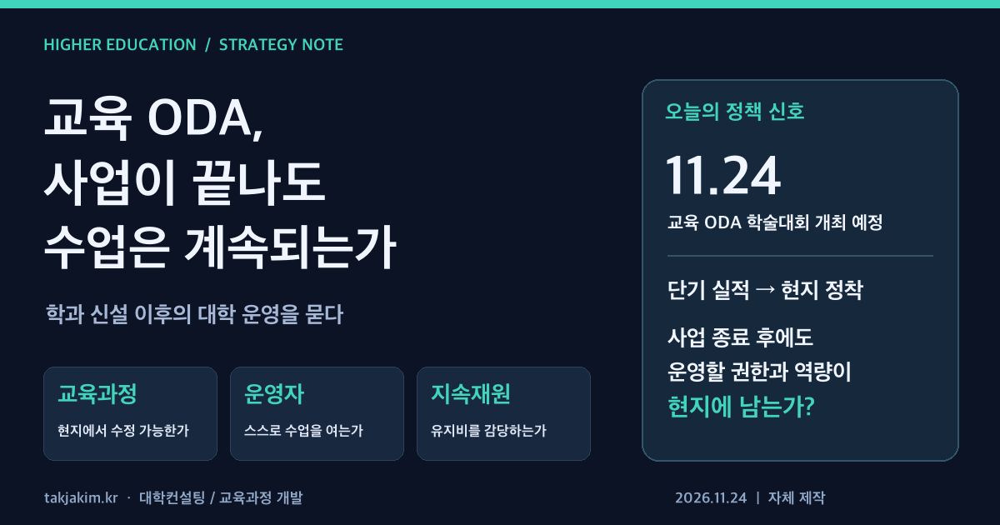

한국 대학의 지원으로 협력국 대학에 학과가 생겼다고 하자. 교재와 실습 장비도 갖췄다. 그런데 지원이 끝난 다음 학기에 현지 교원이 수업을 편성하고, 실습 재료를 구입하고, 학생의 성취를 평가할 수 있을까. 국제협력의 성과를 판단하려면 개설식 사진 다음의 시간표까지 살펴야 한다.

교육부가 11월 23일 공개한 보도자료는 **11월 24일 제13회 교육 공적개발원조(ODA) 학술대회를 개최한다**고 예고했다. 주제는 ‘성과를 넘어 지속가능한 변화로: 한국 교육 공적개발원조(ODA)의 진단과 미래전략’이다. 이 글은 행사 결과나 현장에서 합의된 정책을 전하는 글이 아니다. 개최 예고와 첨부 사업 개요를 근거로, 대학이 국제협력을 어떻게 설계할지 살펴본다.

<figure class="note-cover-figure">
  
  <figcaption>교육부 2026년 11월 23일 보도자료를 바탕으로 자체 제작. 교육과정·운영자·지속재원 구분과 점검 질문은 필자의 전략 제안이다.</figcaption>
</figure>

## 오늘의 핵심

- 교육부와 한국연구재단은 11월 24일 서울 드래곤시티에서 학술대회를 개최할 예정이라고 밝혔다. 협력국 수요, 사업의 현지 정착, 지속가능성, 향후 정책과제가 논의 주제다. **개최 계획을 실제 성과나 확정된 신규 지원사업으로 읽어서는 안 된다.**
- 첨부 사업 개요에서 국제협력 선도대학 육성·지원은 국내 대학의 자원을 활용한 수원국 대학의 학과 신설, 교육과정 개편 지원, 취업 연계 초청 연수 운영 등을 포함한다. 대학의 역할은 방문이나 교류 행사에 한정되지 않는다.
- 대학컨설팅 관점에서는 ‘무엇을 제공했는가’와 ‘지원 없이도 무엇이 계속 작동하는가’를 함께 설계해야 한다. 후자를 확인할 책임자·재원·자료가 없으면 사업 종료 시점에 성과를 판단하기 어렵다.

위 사실의 근거는 [교육부 보도자료와 첨부 HWPX의 사업 개요](#sources)다. 아래의 운영 방안과 지표는 새로 정해진 정부 의무가 아니라 필자의 제안이다.

## 왜 대학전략 관점에서 중요한가

[[국제개발협력]]을 대학의 국제화 실적 한 줄로 처리하면 협정 건수, 파견 인원, 연수 횟수가 앞에 놓이기 쉽다. 이 숫자들은 활동 규모를 보여주지만, 협력국 대학의 교육 역량이 얼마나 달라졌는지까지 설명하지는 못한다. 교수진이 교체되어도 수업이 유지되는지, 현지 산업의 직무 변화가 교육과정에 반영되는지를 따로 봐야 한다.

[[대학국제화]] 전략에서도 이 구분은 중요하다. 국제처가 협약을 담당하고 개별 교수가 교육과정을 만들더라도, 예산과 학사 권한을 가진 현지 조직이 운영을 맡지 못하면 협력은 담당자 개인에게 의존하게 된다. 사업 책임교수의 의지만으로 해결할 수 없는 문제다. 한국 대학 내부에서도 국제처, 참여 학과, 재정 담당, 교육과정 지원 조직이 어디까지 책임지는지 명확해야 한다.

이번 발표가 강조한 협력국의 자립역량은 이런 문제를 돌아보게 한다. 이를 사업이 성공했다는 증거로 받아들이기보다, 앞으로 확인해야 할 질문으로 읽는 편이 정확하다. **지원이 끝난 뒤에도 현지 대학이 스스로 수업을 바꾸고 운영할 수 있는가.** 대학의 전문성이 가장 직접적으로 쓰일 지점이다.

## 정책·교육과정·지역연계 포인트

### 교육과정은 번역본이 아니라 현지의 운영 문서여야 한다

[[교육과정 공동설계]]는 한국의 강의계획서를 현지 언어로 바꾸는 작업보다 넓다. 학생의 선수학습, 수업 언어, 현지 자격제도, 실습 여건, 졸업 후 직무를 함께 검토해야 한다. 한국에서 가능한 고가 장비 중심의 실습이 협력 대학에서도 반복 가능한지는 별도 문제다.

예를 들어 장비가 없는 주에도 학습목표를 달성할 대체 과제가 있는지, 인터넷 연결이 불안정할 때 평가를 어떻게 진행할지 확인할 필요가 있다. 이런 조건을 반영한 강의계획서, 평가 기준, 실습 안전 지침이 현지 조직에 남아야 한다. 자료를 전달했다는 확인서보다 현지 교원이 자료를 수정하고 실제 수업에 적용한 기록이 더 유용한 판단 근거가 된다.

### 교원 연수 다음에 독립 운영을 확인해야 한다

[[교수역량 개발]]을 연수 이수로 끝내지 않으려면 수업 준비, 공동 운영, 현지 주도 운영의 단계를 나눌 수 있다. 각 단계에서 누가 수업을 결정하고 학생의 결과물을 평가했는지 기록하는 것이다. 이는 정해진 정부 절차가 아니라 대학 간 협력에 적용할 수 있는 설계안이다.

현지 교원이 첫 수업을 맡은 뒤에도 피드백을 받을 창구가 필요하다. 다만 한국 측의 상시 개입 없이는 수업을 바꾸지 못하는 구조라면 자립과는 거리가 있다. 자문을 받을 수 있는 것과 운영 권한이 외부에 남아 있는 것을 구별해야 한다.

### 유지비와 지역의 직무 수요를 같은 표에 놓기

장비를 도입할 때는 구매비뿐 아니라 소모품, 수리, 소프트웨어 이용료, 기술지원 인력의 비용을 계산해야 한다. [[총소유비용]]을 검토하지 않으면 지원 기간에는 작동하던 실습실이 이후에는 사용하기 어려워질 수 있다. 현지 대학이 부담할 항목과 부담하기 어려운 항목을 초기 협의에서 드러내는 편이 낫다.

[[산학협력]]도 협약 기업 수만으로 판단하기 어렵다. 현지 기업이 실제 과제를 제공하는지, 실습에 필요한 지도와 안전 조건을 갖췄는지, 졸업생에게 요구하는 역량이 과목에 반영되는지를 확인해야 한다. 취업 연계 연수를 운영한다는 사업 설명이 곧 취업 보장을 뜻하지는 않는다. 국가별 제도와 개별 프로그램의 참여 조건을 따로 확인해야 한다.

## 학생·학부모가 확인할 것

학생에게는 해외 협력사업에 참여한다는 이름보다 어떤 경험을 할 수 있는지가 중요하다. 국내 참여 학생과 협력국 학생은 역할과 지원 조건이 다를 수 있다. 다음 질문을 실제 모집 안내와 운영계획에서 확인할 필요가 있다.

- 참여 활동이 정규 교과, 학점, 실습으로 인정되는가. 인정된다면 평가자와 기준은 누구에게 있는가.
- 항공·숙박·보험·비자·현지 이동 등 비용 중 지원 범위와 개인 부담은 무엇인가.
- 현지에서 문제를 만났을 때 연락할 책임자, 안전관리와 중도 복귀 절차가 있는가.
- 활동 이후 [[학생 포트폴리오]]에 남길 수 있는 결과물과 피드백은 무엇인가. 현지 기관의 자료나 학생 정보를 공개해도 되는가.

모든 교육 ODA 사업이 국내 대학생의 해외 파견 프로그램을 포함하는 것은 아니다. 이번 보도자료도 개별 학생의 참여 자격이나 비용 지원 조건을 확정한 모집공고가 아니다. 행사 소식만으로 참여 가능성을 판단하지 말고 해당 대학의 공식 공고를 확인해야 한다.

## 대학컨설팅 관점에서 보는 전략

대학은 사업계획서에 종료 후 운영계획을 별첨하는 데서 한 걸음 더 나갈 수 있다. 종료 이후의 질문을 먼저 적고, 그 답을 확인할 수 있도록 사업 기간의 활동과 자료 수집을 거꾸로 설계하는 것이다.

| 설계 영역 | 사업 기간에 남길 것 | 종료 이후 확인할 질문 |
| --- | --- | --- |
| 교육과정 | 현지 학사체계에 반영된 과목과 수정 이력 | 다음 학기에도 개설되고 필요한 개편이 이루어지는가 |
| 운영 인력 | 교원·행정 담당자의 역할과 인수인계 문서 | 특정 담당자가 바뀌어도 수업과 행정이 이어지는가 |
| 재원·시설 | 소모품·수리비·이용료의 부담 주체 | 예산 편성과 조달이 실제로 가능한가 |
| 학생 경험 | 과제 결과물, 평가 기준, 개선 의견 | 학생이 목표 역량을 보여주고 피드백을 받는가 |
| 지역 연결 | 현지 기관의 과제와 협력 역할 | 외부 지원이 줄어도 협력이 유지될 이유가 있는가 |

이 표는 평가 항목을 더 많이 만들자는 뜻이 아니다. [[성과환류]]에 쓸 자료를 골라내자는 제안이다. 모든 사업에 같은 취업률이나 유지율을 일괄 적용하기보다, 학과 신설 사업과 교원 연수 사업이 각각 무엇을 바꾸려 했는지부터 구분해야 한다. 사업 초기와 종료 후의 자료를 비교하더라도, 변화 전체를 한국 측 지원만의 효과라고 단정해서는 안 된다.

학생과 교원의 정보를 수집한다면 [[데이터 거버넌스]]도 함께 정해야 한다. 누가 어떤 목적으로 자료를 보관하고, 협력 종료 후 누가 접근할 수 있는지 합의해야 한다. 성과를 보여주겠다는 이유로 학생의 개인정보나 현지 기관의 내부 자료를 홍보물에 무단으로 옮겨서는 안 된다.

교육부는 이번 학술대회에서 제시된 의견을 바탕으로 신규 사업을 발굴하고 사업 간 연계와 성과관리를 강화할 계획이라고 밝혔다. 이는 향후 추진 방향이지, 이번 행사로 새로운 사업의 예산과 선정 조건이 확정됐다는 뜻은 아니다. 대학은 공고를 기다리는 동안에도 자신의 교육과정 개발 역량과 협력국의 운영 여건을 대조해 볼 수 있다.

대학이 남겨야 할 것은 지원사업의 이름이 아니라, 그 이름이 없어져도 이어지는 수업이다. 국제협력의 지속가능성은 종료 보고서의 문구보다 **현지 대학이 다음 학기의 시간표를 스스로 만들 수 있는가**에서 더 구체적으로 드러난다.

<h2 id="sources">확인한 출처</h2>

- [교육부, 제13회 교육 공적개발원조(ODA) 학술대회 개최](https://www.moe.go.kr/boardCnts/viewRenew.do?boardID=294&boardSeq=107786&lev=0&m=020402&opType=N&page=1&s=moe), 2026년 11월 23일 등록. 첨부 HWPX의 보도자료 본문과 붙임 3 ‘교육부 소관 공적개발원조(ODA) 사업 개요’를 함께 확인했다. 행사 일자·논의 주제·사업 범위의 근거이며, 행사 결과 자료는 아니다.
