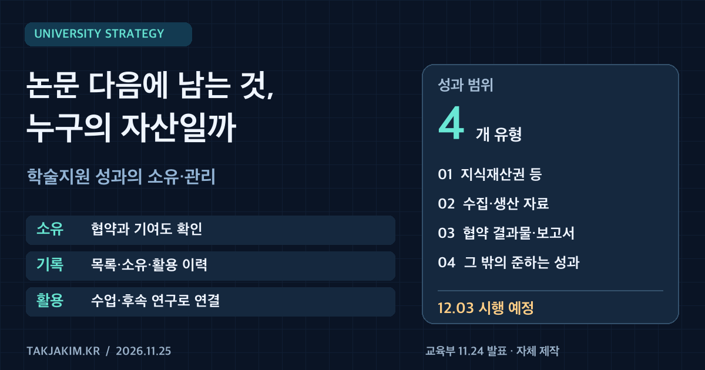

지역의 구술 기록을 모으고, 인터뷰를 분류하고, 검색 가능한 데이터베이스를 만들었다고 하자. 논문은 발표했지만 연구가 끝난 뒤 자료의 보관 장소와 이용 허락을 결정할 사람이 불분명하다면 무엇이 대학에 남을까. 성과를 냈다는 사실과 그 성과를 계속 쓸 수 있다는 것은 다른 문제다.

교육부가 **11월 24일 발표한 「학술진흥법 시행령」 일부개정령안 국무회의 통과** 소식은 이 간극을 다룬다. 보도자료는 개정 시행령이 **12월 3일부터 시행된다**고 안내한다. 오늘 시점에 이미 시행 중인 제도라고 읽어서는 안 된다. 이 글은 공개된 보도자료와 첨부 개정안을 근거로, 대학이 준비할 운영 과제를 살펴본다.

<figure class="note-cover-figure">
  
  <figcaption>교육부 2026년 11월 24일 보도자료·첨부 개정안을 바탕으로 자체 제작. 소유·기록·활용의 운영 점검은 필자의 해석이다.</figcaption>
</figure>

## 오늘의 핵심

- 개정안은 학술지원 성과를 지식재산권, 수집·생산 자료, 협약 결과물과 중간·결과보고서, 그 밖의 준하는 유형·무형 성과의 **네 유형**으로 분류한다. 논문 편수만으로는 관리 범위를 다 담을 수 없다.
- 여러 대학 등이 성과를 창출했을 때 각자 창출, 공동 창출, 일부 수행 위탁을 구분해 소유 기준을 제시한다. 공동 창출은 기여도를 기준으로 하되 기관 간 협의가 있으면 그 협의에 따른다.
- 대학 등의 장은 성과 목록, 소유 현황, 활용 실적을 기록·관리하고 전문관리기관이 별도로 정한 절차에 따라 등록하도록 규정한다. **연구 종료보고와 지속적인 자산 관리를 연결하는 대학 내부의 업무 설계**가 중요해진다.

위 내용은 [교육부 발표와 첨부 개정안](#sources)에서 확인했다. 아래의 조직 배분, 점검표, 교육과정 활용 방안은 정부가 새로 의무화한 세부 양식이 아니라 대학컨설팅 관점의 제안이다. 개별 과제에 대한 적용 범위와 경과조치는 최종 공포 법령, 협약, 전문관리기관 안내를 추가로 확인해야 한다.

## 왜 대학전략 관점에서 중요한가

[[연구성과 관리]]를 연구비 정산의 마지막 단계로만 보면 보고서 제출 여부가 중심이 된다. 그러나 데이터베이스, 소프트웨어, 조사 자료는 보고서가 제출된 뒤에도 보관·갱신·이용 허락이라는 업무를 남긴다. 담당 연구자가 이동하거나 사업단이 종료되어도 이 업무는 사라지지 않는다.

특히 인문사회 연구의 성과는 특허처럼 눈에 잘 보이는 권리만으로 설명하기 어렵다. 지역의 생활사 자료, 번역 결과물, 조사 도구, 디지털 학술자원은 교육과 후속 연구의 기반이 될 수 있다. 그렇다고 모든 자료를 즉시 공개할 수 있다는 뜻은 아니다. [[지식재산권]]의 귀속과 개인정보·제3자 저작물·연구참여자 동의에 따른 이용 제한은 구분해서 검토해야 한다.

대학경영의 과제는 성과를 대학 자산이라고 선언하는 데서 끝나지 않는다. 누가 목록을 만들고, 누가 이용 요청을 판단하며, 어느 예산으로 보관하는지를 정해야 한다. 이번 개정안을 계기로 필요한 것은 새 시스템을 서둘러 구매하는 일보다 기존 연구처·산학협력단·도서관·연구소의 업무가 어디에서 끊기는지 확인하는 일이다.

## 정책·교육과정·지역연계 포인트

### 1. 성과 분류와 보관 대상을 먼저 맞추기

첨부 개정안 제18조는 논문, 저서·역서, 소프트웨어, 학술활동 과정에서 구축한 데이터베이스·학술자원, 특허 등 지식재산권을 첫 유형에 포함한다. 별도로 수집·생산 자료와 협약 결과물·보고서도 제시한다. 대학 내부에서는 이 구분을 실제 과제 산출물과 대조해야 한다.

예를 들어 하나의 조사 과제에서도 논문, 설문 원자료, 코딩 지침, 분석 코드, 결과보고서가 나올 수 있다. 이것은 이해를 돕기 위한 예시이지 법령에 정해진 일률적인 제출 목록은 아니다. 모든 파일을 무차별적으로 모으기보다 무엇이 성과인지, 어떤 이용 제한이 있는지, 원본과 관리본을 어디에 두는지 구별하는 편이 유용하다. [[데이터 거버넌스]]는 이때 저장 공간뿐 아니라 책임과 접근 권한을 정하는 문제다.

### 2. 공동연구는 시작할 때 이용 조건까지 협의하기

여러 기관이 각자 창출한 성과는 해당 기관이 각각 소유한다. 공동으로 창출했다면 기여도를 기준으로 소유 비율을 정하되 기관 간 협의에 따른 예외가 가능하다. 일부 학술활동을 위탁받은 기관이 창출한 성과는 위탁한 기관이 소유하도록 규정한다. 단순히 참여기관 수로 균등 배분한다고 해석해서는 안 된다.

[[공동연구 협약]]에서는 소유 비율만 합의하고 실제 이용을 비워 두지 않는 것이 좋다. 자료를 수업에서 활용할 수 있는지, 후속 과제에 제공할 수 있는지, 유지·갱신 비용을 누가 부담하는지를 함께 논의할 수 있다. 이런 항목이 모두 이번 개정안의 의무라는 뜻은 아니다. 공동 소유가 실제 활용으로 이어지기 위한 협약 검토 항목이다.

지역 대학·연구소가 함께 만든 자료를 [[산학협력]]이나 지방정부 정책연구에 활용하려는 경우에도 마찬가지다. 기관이 소유한다는 사실만으로 기업이나 지방정부에 자유롭게 제공할 수 있다고 단정할 수 없다. 원자료의 동의 범위와 계약 조건을 따로 검토해야 한다.

### 3. 연구 자료를 교육과정으로 옮기는 중간 작업

지역 조사 자료가 쌓이면 학생의 수업 과제로 활용할 가능성이 생긴다. 하지만 연구용 원자료를 그대로 강의실에 배포하는 것은 별개의 문제다. 공개 가능한 부분을 선별하고, 필요한 비식별 처리와 권리 검토를 거친 뒤, 학습목표에 맞는 사례·과제로 재구성해야 한다.

[[교육과정 개발]] 관점에서는 이 중간 작업에 담당자와 시간이 필요하다. 예컨대 지역 문제를 다루는 수업에서 공개 가능한 자료 묶음, 분석 절차, 평가 기준을 함께 제공할 수 있다. 연구 성과가 학생의 [[학생 포트폴리오]]로 이어지는 경로를 만들되, 학생 결과물을 외부에 공개할 권한까지 자동으로 생기는 것은 아니라는 점을 안내해야 한다.

## 학생·학부모가 확인할 것

이번 발표는 새로운 장학금이나 학생 모집, 취업 보장을 알리는 내용이 아니다. 학생에게 직접 중요한 질문은 대학이 보유한 연구 성과를 어떤 조건에서 학습 경험으로 연결하는가다.

- 연구실이나 프로젝트에 참여한다면 내가 만드는 자료·코드·보고서의 이용 및 공개 조건을 안내받는가.
- 수업에 제공되는 지역·산업 자료가 실제 분석과 피드백으로 이어지는가, 단순한 견학이나 행사로 끝나는가.
- 졸업 후 포트폴리오에 넣어도 되는 결과물과 공개하면 안 되는 자료를 구분해 주는가.
- 연구책임자나 사업 담당자가 바뀌었을 때 문의할 기관 내 창구가 있는가.

이 질문만으로 특정 대학의 우열을 판단할 수는 없다. 다만 연구 실적을 학생의 교육 기회로 설명하는 대학이라면, 그 기회가 운영되는 구체적인 조건도 함께 보여줄 필요가 있다.

## 대학컨설팅 관점에서 보는 전략

대학에는 성과 보관 업무가 이미 여러 부서에 나뉘어 있을 수 있다. 새 규정 하나로 모든 업무를 한 조직에 몰아주기보다 실제 과제 몇 건을 골라 성과가 만들어진 뒤 어디로 이동하는지 추적하는 편이 현실적이다. 다음은 그 과정에 쓸 수 있는 점검표다.

| 운영 단계 | 확인할 내용 | 남길 기록의 예시 |
|---|---|---|
| 협약 검토 | 공동·위탁 수행의 구분, 소유 및 활용 조건 | 협약 조항과 기관 간 합의 |
| 성과 식별 | 산출물 유형, 보관 위치, 이용 제한 | 성과 목록과 제한 사유 |
| 내부 관리 | 소유 현황, 담당 조직, 접근 권한 | 소유·담당자·권한 기록 |
| 등록 준비 | 전문관리기관의 절차와 요구 항목 | 안내 확인 및 등록 이력 |
| 활용 점검 | 후속 연구·수업·지역 활용의 실제 여부 | 활용 실적과 개선 사항 |

이 표는 법정 서식이 아니다. 제18조의2에서 제시한 기록·관리와 등록의 틀을 대학 내부 업무로 연결하기 위한 제안이다. 전문관리기관의 구체적인 절차를 확인하지 않은 채 등록 시스템이나 제출 기한을 추정해서는 안 된다.

[[성과환류]]에서도 보관 건수와 활용 성과를 구분해야 한다. 목록에 올린 자료가 늘었다고 교육의 질이나 지역 기여가 자동으로 높아지지는 않는다. 활용되지 못한 이유가 권리 미정리인지, 자료 설명의 부족인지, 유지비 부재인지 확인하고 다음 협약과 과제 설계에 반영해야 한다.

12월 3일 시행을 앞둔 지금의 준비 질문은 명확하다. **우리 대학은 연구가 끝난 다음에도 성과의 소유와 이용 조건을 설명할 수 있는가.** 연구자의 성과를 기관 차원에서 오래 쓸 수 있게 만드는 일은 행정 정리이면서 동시에 대학의 연구·교육 전략이다.

<h2 id="sources">확인한 출처</h2>

- [교육부, 「학술진흥법 시행령」 일부개정령안 국무회의 통과](https://www.moe.go.kr/boardCnts/viewRenew.do?boardID=294&boardSeq=107813&lev=0&searchType=null&statusYN=W&page=1&s=moe&m=020402&opType=N) — 2026년 11월 24일 등록. 같은 페이지의 첨부 HWPX 본문 및 붙임 개정안 제18조·제18조의2를 함께 확인했다. 보도자료는 12월 3일 시행 예정, 성과의 네 유형, 공동·위탁 수행 시 소유 기준, 기록·관리 및 등록 절차의 근거다. 이 글의 조직 배분·교육과정 활용·운영 점검표는 필자의 제안이다.
