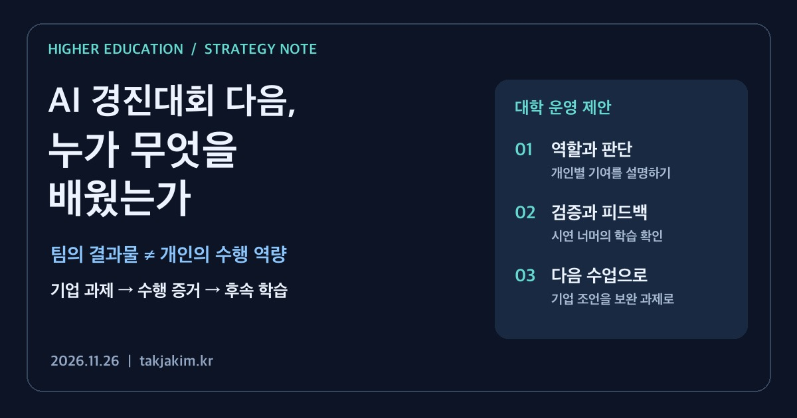

기업이 낸 문제를 학생들이 함께 풀고, 결과물을 발표한다. 여기까지는 대학에서 익숙한 장면이다. 그런데 기업 면접에서는 질문이 바뀐다. **“그중 본인이 한 일은 무엇인가요?”** 팀의 발표자료만 남았다면, 대학이 자랑하는 성과와 학생이 설명할 수 있는 역량 사이에 틈이 생긴다.

교육부가 11월 25일 발표한 인공지능(AI) 부트캠프 학생 라운드업은 이 틈을 살펴볼 기회다. 이번 글은 행사의 성과를 미리 평가하려는 것이 아니다. 기업 과제, 팀 경진대회, 취업 상담을 개인의 학습 증거로 연결하려면 대학이 무엇을 준비해야 하는지에 초점을 둔다.

<figure class="note-cover-figure">
  
  <figcaption>교육부의 11월 25일 보도자료를 바탕으로 자체 제작한 전략 카드. 오른쪽 항목은 발표된 성과가 아니라 대학 운영을 위한 제안이다.</figcaption>
</figure>

## 오늘의 핵심

교육부와 한국산업기술진흥원은 11월 25일부터 27일까지 부여 롯데리조트에서 AI 분야 첨단산업 인재양성 부트캠프 학생 지원 행사인 라운드업을 개최한다고 밝혔다. 보도자료상 AI 부트캠프 운영 대학은 40개교다. 경진대회는 학교당 4인 1팀, 총 40개 팀·160명 규모로 계획됐다. 행사 전체 참석 규모인 300명 내외와 경진대회 참가 학생 규모는 구분해서 읽어야 한다.

기업이 현안을 과제로 제시하고 데이터와 프로그램을 제공하며 평가에도 참여한다는 점이 눈에 띈다. 자료에 제시된 과제안에는 역량 분석 AI 에이전트, 산업자원 순환·재활용 에이전트, 지역밀착형 AI, 공공 법령 질의응답, 학습 에이전트와 가드레일 설계가 포함됐다. 단순한 도구 사용 실습보다 문제를 정의하고 작동 가능한 해법을 만드는 활동에 가깝다.

다만 **이 글을 쓰는 11월 26일 아침 기준으로 행사는 진행 중이다.** 수상 결과, 취업 성과, 실제 운영 만족도는 이번 자료에서 확인되지 않는다. 아래의 평가표와 후속 운영안은 정부의 확정 방침이 아니라 대학컨설팅 관점의 제안이다.

## 왜 대학전략 관점에서 중요한가

이번 사례는 [[산학협력]]의 접점이 협약서에서 학생의 수행 과제로 내려오는 모습을 보여준다. 기업이 문제를 내고 평가에 참여한다면, 대학은 기업 요구를 수업과 평가로 번역할 수 있다. 하지만 기업이 좋은 문제를 냈다는 사실만으로 교육과정의 질이 보장되지는 않는다.

[[프로젝트 기반 학습]]에서는 팀이 만드는 산출물과 각 학생이 배우는 내용이 일치하지 않을 수 있다. 한 학생이 대부분의 코드를 작성하고 다른 학생은 발표만 맡았을 수도 있다. 역할 분담 자체가 잘못은 아니다. 문제는 역할별 배움과 수행 수준을 구분하지 않은 채 같은 역량을 획득했다고 인증하는 데 있다.

대학경영의 과제는 경진대회 수상팀을 홍보하는 일에서 멈추지 않는다. 기업 멘토가 본 강점과 한계, 학생의 작업 기록, 교원의 평가를 연결해 **누가 어떤 조건에서 무엇을 할 수 있는지** 설명할 수 있어야 한다. 그래야 사업단의 행사 실적이 학과의 교육 개선과 학생의 진로 자료로 남는다.

## 정책·교육과정·지역연계 포인트

### 팀 결과물과 개인 수행 증거를 나눠 남기기

[[학생 포트폴리오]]에 최종 발표자료만 넣기보다, 개인별로 짧은 수행 기록을 붙이는 편이 낫다. 자신이 담당한 기능, 직접 내린 판단, 실패한 시도, 검증 방법을 설명하도록 한다. 코드 작성자가 아니라도 데이터 정제 기준, 사용자 요구 분석, 안전성 점검, 평가 설계 같은 기여를 증명할 수 있어야 한다.

AI를 활용한 프로젝트라면 도구 사용을 숨기게 할 필요도 없다. 대신 모델이 만든 부분과 학생이 검토·수정한 부분을 구분하고, 결과가 틀렸을 때 어떤 방식으로 찾아냈는지 확인한다. 저장소의 수정 기록만으로 실력을 단정하지 말고, 짧은 구술 설명이나 재현 과제를 함께 보는 방식이 현실적이다.

### 기업 평가는 교육 평가의 전부가 아니다

보도자료는 문제해결력, 현장 적용성, 창의성, 전달력과 기업별 주제 지표를 평가 기준으로 제시한다. 대학은 이를 참고하되, 수업에서 약속한 [[학습성과]]와 어떻게 대응하는지 별도로 정리해야 한다. 기업이 선호하는 완성도 높은 시연과 초급 학생의 학습 진전은 같은 척도가 아니다.

| 확인할 층위 | 남길 자료의 예 | 대학에서 맡을 역할 |
| --- | --- | --- |
| 팀의 문제해결 | 결과물, 테스트 결과, 기업 피드백 | 사업단·기업 멘토의 자료 수집 |
| 개인의 수행 | 역할 기록, 판단 근거, 구술 설명 | 담당 교원의 학습 평가 |
| 다음 단계 | 보완 과제, 후속 상담, 심화 모듈 | 학과·취업지원 조직의 연결 |

이 표는 제안이다. 실제 수업의 규모와 학생 수준에 맞춰 간소화해야 한다. 모든 작업을 기록하게 만드는 행정 부담보다, 학생이 면접이나 후속 수업에서 다시 사용할 수 있는 핵심 자료를 남기는 것이 우선이다.

### 전국 공통 과제를 지역 문제로 다시 번역하기

전국 단위 기업 과제는 기술 수준을 비교하고 새로운 도구를 접하는 데 유용하다. 반면 [[지역산업 연계]]는 대학 인근 기업이 실제로 가진 데이터, 예산, 유지관리 여건에서 출발해야 한다. 대형 클라우드 환경에서 시연한 결과물이 소규모 지역기업에서도 그대로 작동한다고 볼 수는 없다.

예를 들어 지역밀착형 AI 과제를 후속 수업으로 가져온다면, 지역기업이나 기관이 제공할 수 있는 자료의 범위부터 확인할 필요가 있다. 개인정보와 영업정보를 제외한 자료로도 과제를 수행할 수 있는지, 유료 서비스 비용을 누가 부담할지, 학기 종료 뒤 누가 결과물을 관리할지 정해야 한다. 후속 프로젝트는 이런 조건을 합의한 뒤 열어야 한다.

## 학생·학부모가 확인할 것

유명 기업 이름이나 수상 실적만 보기보다 학생 본인에게 남는 자료를 물어보면 좋다. 팀 발표자료를 개인 포트폴리오에 활용할 수 있는지, 기업 데이터나 화면을 공개할 때 제한은 없는지, 멘토 피드백을 개인별로 받을 수 있는지가 실제로 도움이 되는 질문이다.

보도자료에는 공개 모의 면접, 채용 동향 안내, 기업 채용설명회, 현직자 직무 상담과 선배와의 대화가 계획돼 있다. 이것은 취업 준비를 지원하는 장치이지 채용을 보장하는 약속은 아니다. 상담에서 받은 조언을 이후 어느 교원이나 부서와 함께 보완할 수 있는지도 확인할 필요가 있다.

수료증이나 [[마이크로디그리]]를 제공하는 과정이라면 발급 여부뿐 아니라 이수 기준과 학점 인정 범위를 살펴봐야 한다. 해당 행사 참여만으로 자동 취득되는지, 별도 교육과정과 평가가 필요한지는 각 대학의 안내에서 확인해야 한다.

## 대학컨설팅 관점에서 보는 전략

지난 [부트캠프 라운드업 분석](/education/bootcamp-roundup-curriculum-feedback/)이 현장 경험을 교육과정 개선으로 돌려보내는 데 주목했다면, 이번에는 **팀 성과에서 개인의 학습 증거로 넘어가는 평가 단위**를 더 구체적으로 보려 한다. 같은 사업을 다뤄도 새 행사가 열렸다는 이유만으로 전략적 진전이 생기지는 않는다.

우선 사업단과 학과가 최소한의 개인 수행 기록 양식을 합의할 수 있다. 항목은 담당 과업, 주요 판단, 검증 결과, 다음 학습 과제 정도면 된다. 취업지원 부서는 이 자료를 면접 설명으로 다듬도록 돕고, 교원은 반복되는 취약점을 다음 수업의 과제나 실습에 반영한다. 이것이 행사와 수업을 잇는 [[성과환류]]다.

성과지표도 참여 인원과 수상 건수만으로 채우지 않는 편이 좋다. 개인 수행 자료를 완성한 학생 비율, 피드백 뒤 보완 과제를 수행한 비율, 후속 교과에서 확인한 취약점 개선 등을 함께 살펴볼 수 있다. 취업률은 별도로 추적하되, 비교집단과 학생 구성 차이를 살피지 않고 단일 행사의 효과라고 단정해서는 안 된다.

AI 인재양성의 경쟁력은 멋진 결과물 한 장으로 증명되지 않는다. 팀이 만든 성과를 학생 한 명 한 명이 설명하고, 다음 문제에서 다시 활용할 수 있게 만드는 데 대학의 교육과정 설계 역량이 드러난다.

## 확인한 출처

- [교육부, 전국 인공지능(AI) 인재가 한자리에, 인공지능(AI) 부트캠프 학생 교류의 장 마련](https://www.moe.go.kr/boardCnts/viewRenew.do?boardID=294&boardSeq=107836&lev=0&searchType=null&statusYN=W&page=1&s=moe&m=020402&opType=N), 2026년 11월 25일. 첨부 HWPX 본문과 붙임의 행사 개요·경진대회 운영안·사업 개요를 함께 확인했다. 일정과 과제는 발표된 계획 기준이며, 행사 종료 뒤의 결과를 뜻하지 않는다.
