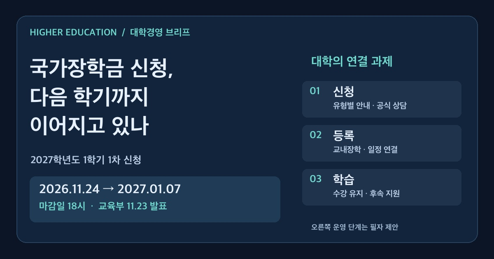

장학금 신청 공지를 올렸다고 학생지원이 끝나는 것은 아니다. 학생이 신청 화면을 열었는지, 필요한 절차를 마쳤는지, 지원을 받은 뒤 다음 학기 수업을 계속 들을 수 있는지는 서로 다른 문제다. 대학에서는 이 과정이 장학 부서, 학과, 학사 부서 사이에 나뉘기 쉽다.

교육부가 11월 23일 발표한 2027학년도 1학기 국가장학금 신청 안내는 이 연결을 점검할 계기다. 신청 일정은 학생에게 당장 필요한 정보지만, 대학컨설팅 관점에서는 **재정지원이 실제 학업지속으로 이어지는 운영 구조**를 함께 봐야 한다.

<figure class="note-cover-figure">
  
  <figcaption>교육부 11월 23일 보도자료를 참고해 자체 제작. 신청 일정은 공식 발표 내용이며, 신청·등록·학습을 연결하는 운영 단계는 필자의 제안이다.</figcaption>
</figure>

## 오늘의 핵심

교육부와 한국장학재단 발표에 따르면, 2027학년도 1학기 국가장학금 1차 신청은 **2026년 11월 24일 9시부터 2027년 1월 7일 18시까지**다. 한국장학재단 누리집과 앱에서 신청할 수 있으며, 신청 기간 중에는 24시간 가능하되 마감일은 18시에 끝난다. 기존 재학생은 1차 신청이 원칙이다.

신입생도 최종 합격 여부나 입학 대학 결정과 관계없이 이번 기간에 신청할 수 있다. 편입생·재입학생·복학생 등도 신청 대상에 포함된다. 신청할 수 있다는 사실과 장학금 수혜가 확정됐다는 사실은 구분해야 한다.

또 하나의 변화는 학자금 지원구간이다. 보도자료는 2027년부터 기존 10구간을 5구간으로 개편한다고 안내한다. 기존 1~3구간은 가, 4~6구간은 나, 7~8구간은 다, 9구간은 라, 10구간은 마로 대응하며 국가장학금은 라 구간까지 지원한다고 밝혔다. 자료에 제시된 Ⅰ유형 연간 지원 **예정** 단가는 가 600만 원, 나 440만 원, 다 360만 원, 라 100만 원이고, 기초·차상위는 전액이다. 이는 연간 예정 단가이지 이번 학기에 개인별로 확정 지급되는 금액이 아니다.

자료에는 2027학년도부터 도입 예정인 지방 국립대 전액 장학금도 국가장학금 신청을 통해서만 지원받을 수 있다는 안내가 있다. 다만 이번 발표만으로 모든 지방 국립대 학생의 전액 지원을 단정하거나 세부 자격을 추정해서는 안 된다. 도입 예정 안내와 실제 적용 요건은 나눠 확인해야 한다.

## 왜 대학전략 관점에서 중요한가

[[장학금]]은 등록금 부담을 낮추는 수단이지만, 학생의 학업을 가로막는 비용이 등록금뿐인 것은 아니다. 통학·주거비, 생활비를 마련하기 위한 근로시간, 수업 시간표와 일자리의 충돌도 함께 봐야 한다. 이번 발표가 이러한 문제가 해결됐다는 근거는 아니다. 대학이 지원 효과를 점검할 때 살펴야 할 조건이라는 뜻이다.

[[학생성공]] 관점에서 보면 신청 건수와 수혜액은 지원의 시작을 보여주는 지표다. 그다음에는 등록이 이어졌는지, 수강이 유지됐는지, 필요한 상담을 받았는지가 남는다. 대학경영이 장학 실적을 확보하고도 학업중단의 원인을 놓칠 수 있는 이유가 여기에 있다.

지원구간 개편은 안내 체계를 바꿔야 하는 일이기도 하다. 홈페이지는 새 체계를 쓰는데 학과 안내문은 옛 구간을 그대로 쓰면 학생은 자신이 어디에 해당하는지부터 혼란스러워진다. 교내 장학 규정이 기존 구간을 인용한다면 담당 부서가 적용 기준을 검토하고 설명해야 한다. 국가 제도의 구간명이 바뀌었다고 교내 규정까지 자동으로 바뀌었다고 볼 수는 없다.

## 정책·교육과정·지역연계 포인트

### 신청 안내를 학생의 다음 행동으로 바꾸기

긴 공지를 한 번 배포하는 것보다 학생 유형별로 다음 행동을 짧게 안내하는 편이 유용하다. 재학생에게는 1차 신청 원칙을, 입학예정자에게는 대학이 정해지기 전에도 신청할 수 있다는 점을, 복학생에게는 복학 일정과 장학 절차를 각각 확인하도록 안내한다.

이때 대학이 한국장학재단의 심사를 대신하거나 학생의 수혜 여부를 미리 확약해서는 안 된다. 대학의 역할은 공식 신청 경로와 상담 창구를 연결하고, 학생이 중간에서 멈췄을 때 도움을 받을 곳을 분명히 하는 것이다.

### 장학·학사·상담의 인계 지점을 정하기

[[학생경로 관리]]는 모든 부서의 자료를 한곳에 모으는 작업과 다르다. 어느 상황에서 누가 다음 상담을 연결할지 정하는 것이 먼저다. 예를 들어 학생이 경제적 사유로 휴학을 고민한다고 밝히면 장학 상담뿐 아니라 수강 계획과 학습지원 상담을 함께 제안할 수 있다.

아래는 정부의 의무 지침이 아니라 대학 내부 운영을 위한 제안이다.

| 단계 | 대학이 확인할 질문 | 담당 조직 간 연결 |
| --- | --- | --- |
| 신청 | 학생이 공식 절차와 문의처를 알고 있는가 | 장학 부서·학과의 안내 문구 통일 |
| 등록 | 지원 결과와 등록 일정 사이에 설명이 필요한가 | 장학·재무·학사 부서의 상담 인계 |
| 수강 | 생활 여건 때문에 필수 수업 이수가 어려운가 | 학과·지도교수·학습지원 조직 연결 |
| 학기 중 | 지원 이후에도 학생이 도움을 요청할 통로가 있는가 | 학생 동의에 기반한 후속 상담 |

[[학업지속 지원]]을 명목으로 소득정보나 상담 내용을 지도교수에게 일괄 공유하는 방식은 피해야 한다. 목적에 필요한 최소 정보, 적법한 처리 근거, 접근권한과 보관기간을 먼저 정해야 한다. 지원을 위한 연락이 학생에게 낙인이나 감시로 느껴지지 않도록 선택권도 보장해야 한다.

### 지역 연계는 근로 자리보다 학습 조건부터

보도자료는 이번 기간에 국가근로장학금도 신청할 수 있다고 안내한다. 국가장학금과 국가근로장학금의 신청·선발·운영 조건을 같은 것으로 설명하지 않도록 주의해야 한다.

대학이 [[지역산업 연계]]와 학생 근로 경험을 함께 설계하려면 전공 관련 업무인지뿐 아니라 수업 참여를 해치지 않는지도 봐야 한다. 실습 시간이 긴 학과나 통학 시간이 긴 학생에게는 근로 기회가 늘어도 이용하기 어려울 수 있다. 지역기관과의 협력은 자리 수를 늘리는 일과 함께 시간표, 이동, 지도 여건을 조정하는 과제다. 이는 이번 발표에 포함된 확정 사업 내용이 아니라 대학 운영에 대한 제안이다.

## 학생·학부모가 확인할 것

- **신청 마감:** 2027년 1월 7일 18시다. 마지막 날도 자정까지라고 생각하지 않는다.
- **입학예정자:** 대학 최종 합격이나 진학 대학 결정 전에도 이번 1차 신청이 가능하다.
- **지원구간:** 지난해 숫자 구간과 올해 가~마 구간을 혼동하지 말고 공식 안내를 확인한다.
- **지원액:** 연간 예정 단가를 개인의 한 학기 확정 수혜액으로 받아들이지 않는다.
- **지방 국립대 지원:** 도입 예정 장학금의 신청 연계 안내와 세부 자격 확정은 구분해서 확인한다.
- **문의 경로:** 개인별 자격과 절차는 한국장학재단 누리집·앱과 상담전화 1599-2000에서 확인한다. 대학별 등록 일정과 교내 장학 기준은 해당 대학에 묻는다.

## 대학컨설팅 관점에서 보는 전략

대학이 이번 신청 기간에 먼저 할 일은 새로운 대형 플랫폼을 만드는 것이 아니다. 안내문과 교내 규정의 구간 표현을 점검하고, 학생 유형별 문의를 어느 부서가 받을지 정하고, 상담이 다른 부서로 넘어갈 때 학생이 처음부터 설명을 반복하지 않게 만드는 일이다.

운영 지표도 구분할 필요가 있다. 공지 열람 수, 신청 관련 문의 처리, 등록 상담 연결, 학기 중 후속 지원은 서로 다른 [[실행지표]]다. 대학이 적법하게 확인할 수 있는 범위에서 집계하고, 수혜 학생의 학업 결과가 좋아졌더라도 장학금만의 효과라고 단정하지 않아야 한다. 학생 구성과 학사 여건이 함께 영향을 줄 수 있기 때문이다.

[[성과환류]]는 다음 학기에 안내문을 한 번 더 보내는 데서 끝나지 않는다. 학생이 자주 멈추는 절차가 무엇이었는지, 부서 간 인계가 끊긴 곳은 어디였는지, 교내 지원으로 메우지 못한 학습 조건은 무엇이었는지를 고치는 일이다.

**신청은 학생이 하지만, 신청 이후의 연결은 대학이 설계해야 한다.** 장학금을 학생 한 명의 다음 학기로 이어지게 만드는 것이 대학전략의 과제다.

## 확인한 출처

- [교육부, 「신청은 미리! 등록금 걱정은 멀리! 2027학년도 1학기 국가장학금 신청하세요」, 2026.11.23.](https://www.moe.go.kr/boardCnts/viewRenew.do?boardID=294&boardSeq=107785&lev=0&searchType=null&statusYN=W&page=1&s=moe&m=020402&opType=N) — 공개 본문과 첨부 HWPX의 본문·지원구간 표를 확인했다. 신청 일정, 구간 개편, 연간 지원 예정 단가, 지방 국립대 장학금 신청 연계 및 국가근로장학금 안내의 근거다.

위의 부서 간 인계표, 학업지속 지원 방식과 운영 지표는 공식 발표 내용과 구분한 필자의 대학컨설팅 제안이다.
