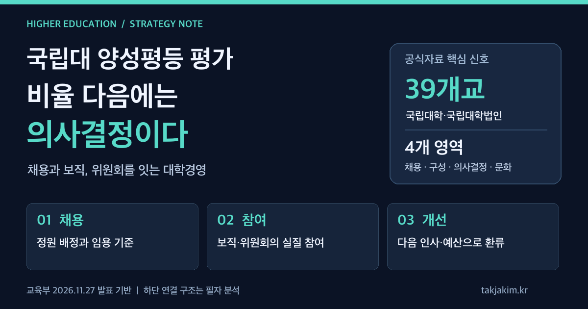

여성 교원의 비율이 높아졌다는 소식과 대학의 의사결정 방식이 달라졌다는 소식은 같지 않다. 채용의 문이 넓어져도 보직과 위원회에서 발언할 기회가 제한되면 변화는 중간에서 멈춘다. 반대로 위원회 구성만 바꾸고 교원 충원과 경력 형성의 조건을 그대로 두어도 지속되기 어렵다.

교육부가 11월 27일 공개한 국립대학 양성평등 추진실적 평가는 이 연결을 살펴볼 계기다. 대학컨설팅 관점에서 중요한 질문은 어느 대학이 상을 받았느냐보다 **채용과 보직, 위원회와 지원 조직이 같은 방향으로 움직이느냐**다.

<figure class="note-cover-figure">
  
  <figcaption>교육부의 2026년 11월 27일 보도자료를 바탕으로 자체 제작한 전략 카드. 39개교와 네 평가영역은 공식자료, 하단의 운영 연결은 이 글의 분석이다.</figcaption>
</figure>

## 오늘의 핵심

- 교육부는 국립대학 및 국립대학법인 **39개교**의 양성평등 조치계획 추진실적 평가 결과를 발표했다. 전임교원 규모 등에 따라 일반대학Ⅰ·Ⅱ와 교육대·교원대의 세 그룹으로 나눠 평가했다.
- 점검 대상은 신임교원 성별 다양성 제고 노력, 전임교원 성별 다양성, 의사결정 기구 성별 다양성, 대학 내 양성평등문화 구현 노력의 네 영역이다. 단일 채용 지표만 보는 구조가 아니다.
- 교육부는 제주대·국립경국대·공주교대를 우수대학 시상 대상으로 제시하고, C등급 대학에는 현장 자문을 실시해 개선을 지원한다고 밝혔다. 이 글은 발표자료와 첨부 HWPX를 확인한 분석이며, 행사 사후 결과를 별도로 확인한 현장 보도는 아니다.

이번 발표는 국립대학의 **전년도 추진실적 평가**다. 발표 시점과 실적의 기준기간을 혼동해 모든 수치를 2026년 신규 성과로 읽어서는 안 된다. 또한 평가 대상이 국립대학과 국립대학법인이므로 사립대학까지 포함한 전국 대학 순위로 확장해서도 안 된다. [교육부 공식자료](#sources)

## 왜 대학전략 관점에서 중요한가

[[대학 거버넌스]]는 회의체 이름을 나열하는 일이 아니다. 누가 의제를 올리고, 어떤 자료로 판단하며, 결정 이후 누가 책임지는지를 정하는 문제다. 교원 채용과 보직 구성은 그 구조에 직접 영향을 준다.

첨단학과 신설이나 지역산업 연계처럼 눈에 띄는 전략사업도 결국 정원 배정, 인사, 예산, 교육과정 심의를 통과해야 한다. 이 과정에서 구성원의 경험이 충분히 반영되지 않으면 대학이 파악하는 문제의 범위도 좁아질 수 있다. 다만 여성 비율 상승 자체가 교육의 질이나 연구성과 상승을 입증하는 것은 아니다. 대표성의 변화와 교육·연구 결과는 각각 확인해야 한다.

이번 평가의 의미는 인사 담당 부서의 실적을 대학 전체의 운영 문제로 읽을 수 있다는 데 있다. 양성평등을 별도 캠페인으로만 관리하면 교무·기획 조직의 의사결정과 연결하기 어렵다. 평가에서 확인한 차이를 정원 배정과 보직 운영의 검토 의제로 가져와야 [[성과환류]]가 시작된다.

## 공식자료의 세 사례에서 읽을 운영 장치

아래 내용은 특정 대학의 종합 리뷰가 아니라 교육부가 제시한 사례를 비교해 읽은 정책 분석이다. 수치는 공식자료의 지표명과 함께 봐야 하며, 서로 다른 분모를 직접 비교해 대학 간 우열을 매겨서는 안 된다.

| 공식자료의 사례 | 확인한 장치와 수치 | 대학경영에서 더 물어볼 질문 |
| --- | --- | --- |
| 제주대 | 여성 교수가 없거나 비율이 낮은 학과에 정원을 우선 배정하는 지침. 전임교원 여성 비율 28.4%, 신임교원 여성 비율 46.9% | 채용 단계의 변화가 학과별 교원 구성과 경력 유지로 이어지는가 |
| 국립경국대 | 교원임용양성평등추진위원회 중심의 보직공모제 및 여성 가산점 운영. 처장·국장 여성 비율 40.0%, 대학평의원회 여성 비율 42.9% | 보직 진입 이후 실질적인 의제 제안과 결정 참여가 가능한가 |
| 공주교대 | 전임교원 여성 비율 43.7%, 교무·대학인사위원회 여성 비율 57.1%. 독립기구로 개편한 인권·상담센터의 성인지교육 콘텐츠 개발 및 폭력예방교육 이수의 인사 연계 | 교육 이수와 지원 조직의 운영이 구성원의 경험 개선으로 연결되는가 |

공통점은 선언만으로 접근하지 않았다는 것이다. 정원 배정 지침, 보직 선임 방식, 지원 조직과 인사 연계처럼 반복적으로 작동하는 규칙을 건드렸다. 그렇다고 개별 장치를 다른 대학에 그대로 이식하면 같은 결과가 난다는 뜻은 아니다. 학문 분야와 채용 여건, 조직 규모에 맞게 검토해야 한다.

## 정책·교육과정·지역연계 포인트

### 정책: 지표마다 분모와 담당자를 붙인다

여성 비율이라는 말 하나로 신임교원, 전체 전임교원, 주요보직, 위원회 구성을 묶으면 병목을 찾기 어렵다. 채용에서 개선이 있었지만 보직 진입에서 정체되는 대학과, 후보자 확보부터 어려운 대학은 대응이 달라야 한다.

대학은 각 [[실행지표]]에 기준일, 분모, 담당 부서와 다음 검토 시점을 함께 남길 필요가 있다. 소규모 학과는 한 명의 변동으로 비율이 크게 움직일 수 있으므로 인원수와 여러 해의 추이를 함께 확인하는 편이 낫다. 이는 이 글의 관리 제안이지 교육부가 새로 의무화한 보고 양식은 아니다.

### 교육과정: 대표성을 학생 경험의 질문으로 연결한다

교원 구성의 변화가 곧바로 수업 개선을 의미하지는 않는다. 다만 대학은 이를 [[교육과정 개발]]과 학습환경 점검의 질문으로 연결할 수 있다. 교과목 사례와 실습 역할 배분에서 특정 성별에 대한 고정관념이 반복되는지, 연구실과 현장실습에서 문제를 제기할 창구가 작동하는지 확인하는 식이다.

여성 교원에게 관련 교육과 상담을 모두 맡기는 방식은 피해야 한다. 다양성을 확대하면서 같은 사람에게 위원회·멘토링 업무가 쏠리면 연구와 경력 개발의 시간을 줄일 수 있다. 참여 확대와 업무 부담 분산을 함께 설계해야 한다.

### 지역연계: 같은 질문을 대학 밖에도 적용한다

지역기업과의 [[산학협력]]에서도 학생이 다양한 직무를 경험할 기회를 갖는지 점검할 수 있다. 현장실습 배치와 기업 멘토 매칭에서 성별에 따른 관행적 구분이 있는지 살피고, 학생이 불편을 말했을 때 대학과 기업 중 누가 대응하는지 정해야 한다.

이는 이번 보도자료가 지역기업 연계 성과를 확인했다는 뜻이 아니다. 대학 내부의 채용·의사결정 점검을 외부 협력의 운영 기준으로 확장해 보자는 제안이다. 지역 인재양성 전략도 실제 학생 경험에서 검증되어야 한다.

## 학생·학부모가 확인할 것

평가등급이나 수상 여부만으로 대학생활의 안전성과 교육의 질을 판단하기는 어렵다. 학생이 확인할 자료는 더 구체적이다.

1. **인권·상담 창구의 접근성:** 담당 조직과 연락 방법, 상담·신고 절차가 명확한가. 비밀보장과 불이익 방지 안내가 있는가.
2. **학과의 학습 기회:** 연구실 참여, 프로젝트 역할, 현장실습과 멘토링의 선발 기준이 공개되어 있는가.
3. **학생 의견을 처리하는 방식:** 설문을 받는 데서 끝나지 않고 개선 내용과 처리 결과를 알리는가.
4. **수치의 범위:** 특정 위원회의 비율인지, 전체 교원 비율인지, 어느 시점의 자료인지 구분할 수 있는가.

이 항목은 대학을 고르는 단순 점수표가 아니다. 학생이 학습 기회를 이용하고 문제 발생 시 지원받을 수 있는 운영 조건을 확인하기 위한 질문이다.

## 대학컨설팅 관점에서 보는 전략

대학이 바로 시작할 수 있는 일은 거창한 새 사업보다 기존 인사·위원회 자료를 연결해 보는 것이다. 다음은 공식 평가항목을 참고해 제안하는 실행 순서다.

**첫째, 채용부터 보직까지의 경로를 나눠 본다.** 지원자 확보, 신규 임용, 경력 유지, 보직 진입을 구분하고 어느 단계에 제약이 있는지 확인한다. 개인 식별이 가능한 소수 집단의 자료는 공개 범위와 접근 권한을 신중히 정해야 한다.

**둘째, 위원회 참여의 조건을 점검한다.** 구성 비율뿐 아니라 회의 시간, 자료 제공 시점, 의제 제안 절차, 업무량을 살핀다. 구성원이 명단에는 있으나 충분히 준비하거나 발언하기 어려운 구조라면 대표성이 형식에 머무를 수 있다.

**셋째, 개선 과제를 다음 인사·예산 일정에 연결한다.** 담당자와 기한이 없는 권고는 다음 평가 때 다시 등장하기 쉽다. [[조직 운영]]의 실제 일정에 맞춰 정원 배정 지침 검토, 보직 공모 절차 점검, 상담체계 개선 중 무엇을 언제 바꿀지 정해야 한다.

여기서 [[성과관리]]의 대상은 단순한 비율 상승만이 아니다. 구성원의 참여 기회, 업무 부담, 지원 이용 경험을 함께 확인해야 숫자와 현실 사이의 간극을 줄일 수 있다. 다만 이런 지표를 수집할 때에도 필요한 정보만 모으고 개인의 상담·신고 내용이 인사상 불이익으로 연결되지 않도록 분리해야 한다.

이번 평가를 대학경영의 자료로 읽는다면 결론은 분명하다. **비율을 보고하는 일에서 멈추지 말고, 그 비율을 만드는 규칙과 참여의 조건을 바꿔야 한다.** 대학의 전략은 문서의 목표보다 정원 한 자리, 보직 한 자리, 회의 한 번을 운영하는 방식에서 드러난다.

## 확인한 출처

- [교육부, 국립대학 양성평등 추진 성과공유회 개최](https://www.moe.go.kr/boardCnts/viewRenew.do?boardID=294&boardSeq=107868&lev=0&m=020402&s=moe), 2026.11.27. 게시. 첨부 HWPX 본문과 붙임의 평가 결과·우수사례를 확인했다. 평가 대상 39개교, 네 평가영역, 사례별 수치와 제도, 현장 자문 계획의 근거다. 보도자료는 11월 26일 배포, 11월 27일 보도시점으로 표기돼 있다.

자료에 명시된 제도·수치와 이 글의 실행 제안을 구분했다. 별도의 취업성과, 교육효과, 구성원 만족도나 행사 사후 실적은 확인하지 않았으므로 성과로 단정하지 않는다.
